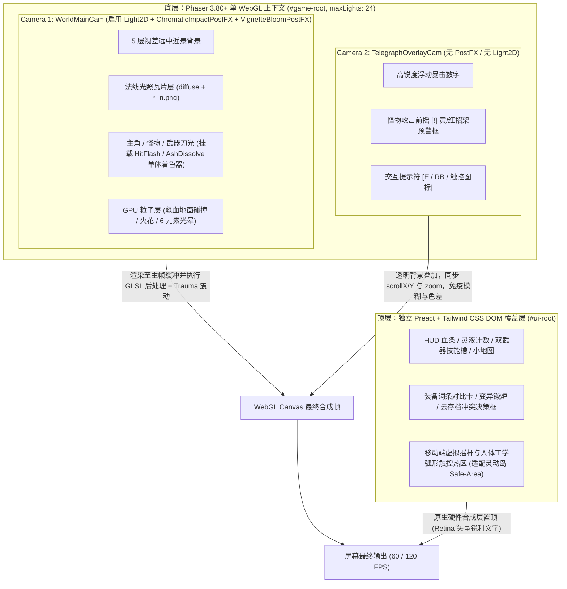
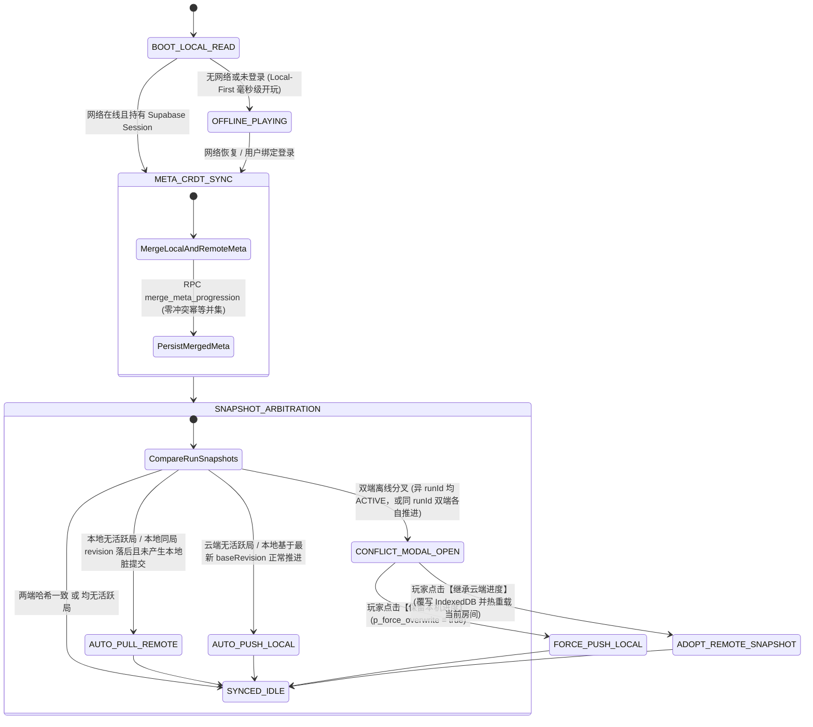

# 《水银坩埚（QUICKSILVER CRUCIBLE）》工程总纲、渲染管线与跨端云存档协议

> **文档编号**：`docs/01_ARCHITECTURE_AND_SYNC.md`  
> **版本**：`v1.0.0-commercial`  
> **目标平台**：Windows / macOS / Linux 桌面浏览器 & iOS / iPadOS (Safari Standalone PWA)，60/120 FPS 自适应  
> **技术底座**：`Phaser 3.80+ (WebGL Only + Light2D + PostFX)` + `TypeScript 5.x (strict)` + `Vite 6` + `Preact + Tailwind CSS` + `Dexie.js` + `Supabase`

---

## 1. 项目工程全景目录树

本项目严格遵循 **Antigravity 原生上下文治理规范** 与 **单 `.ts` 文件 ≤ 250 行反耦合铁律**。严禁创建已废弃的 `.agents/workflows/` 目录；所有可复用自动化管线统一封装在 `.agents/skills/` 下，模块化编码护栏统一存放在 `.agents/rules/` 下。

```text
QUICKSILVER CRUCIBLE/
├── AGENTS.md                                      # 项目最高工程宪法（无 Frontmatter，体积严格 < 24KB）
├── .agents/
│   ├── rules/                                     # 模块化上下文规则（全部含合法 YAML Frontmatter）
│   │   ├── combat-and-architecture.md             # 帧率无关物理、节点化 FSM、事件总线与对象池铁律
│   │   ├── zero-placeholder-assets.md             # 零占位符红线、法线光照、GLSL 后处理与双轨音频验收标准
│   │   └── level-topology-and-determinism.md      # 手工 RoomChunk 切片可达性与确定性 PRNG 铁律
│   └── skills/                                    # 按需渐进式加载的自动化流水线技能（替代旧版 workflows）
│       ├── asset-factory/
│       │   ├── SKILL.md                           # AI 原画 → 抠图 → 色板量化 → Sobel 法线图 → MultiAtlas 技能手册
│       │   └── scripts/
│       │       ├── generate_sprite.py             # 多模态序列帧/瓦片生图调用脚本
│       │       ├── quantize_palette.py            # 最近邻网格对齐与全局锁定 HEX 色板抖动量化
│       │       ├── normal_map_sobel.py            # 基于高度估计与 Sobel 梯度生成 *_n.png 法线贴图
│       │       └── pack_multiatlas.mjs            # 枢轴点裁剪与 Phaser MultiAtlas + NormalMap 关联打包
│       ├── audio-pipeline/
│       │   ├── SKILL.md                           # BGM 双轨对齐、-14 LUFS 响度标准化与双编码导出技能手册
│       │   └── scripts/
│       │       ├── normalize_lufs.py              # ffmpeg loudnorm -14 LUFS 批处理脚本
│       │       ├── zero_cross_loop.py             # 零交叉点检测与无缝循环采样裁切
│       │       └── export_dual_codec.sh           # .webm (Opus) + .m4a (AAC) 双格式导出脚本
│       └── visual-qa-inspector/
│           ├── SKILL.md                           # 内置浏览器启动本地 Vite 页面、截图巡检与零占位符审计技能
│           └── scripts/
│               └── audit_zero_placeholder.mjs     # 扫描源码与资产目录阻断 fillRect/createOscillator/缺失法线图
├── docs/                                          # 全量商业级工程开发文档（四卷本）
│   ├── 01_ARCHITECTURE_AND_SYNC.md                # [第一卷] 架构总纲、自适应视口、iOS PWA 与云存档 SQL 协议
│   ├── 02_COMBAT_AND_ROGUELITE_SPEC.md            # [第二卷] 帧级打击感数值、DAG 拓扑关卡、12 武器与 20 词条矩阵
│   ├── 03_WORLD_LORE_AND_ENEMIES.md               # [第三卷] 暗黑炼金世界观、台词库、4 群落与 12 怪 + 2 Boss AI
│   ├── 04_ART_VFX_AUDIO_PIPELINE.md               # [第四卷] 全局色板、GLSL 着色器源码、Prompt 词典与交互音乐规范
│   └── 05_ANTIGRAVITY_EXECUTION_PLAN.md           # [第四卷] Milestone 1~10 原子任务拆解与视觉巡检门禁
├── supabase/
│   ├── config.toml                                # Supabase 本地 CLI 配置
│   └── migrations/
│       └── 0001_initial_cloud_save.sql            # 玩家档案、CRDT 局外存档、局内快照表、RPC 函数与 RLS 策略
├── public/
│   ├── manifest.webmanifest                       # PWA 独立全屏与 landscape 横屏锁定清单
│   ├── icons/                                     # PWA Apple Touch Icon (180x180) 与多尺寸应用图标
│   └── assets/
│       ├── atlases/                               # 打包产出的角色/怪物/武器/机关 MultiAtlas (含 diffuse 与 *_n.png)
│       ├── tilemaps/                              # 4 大生态群落瓦片集图集与手工 RoomChunk JSON 切片库
│       ├── audio/
│       │   ├── stems/                             # 4 群落双轨 BGM (explore/combat) 与 2 Boss 分阶段音轨 (.webm/.m4a)
│       │   └── sfx/                               # 带多变体池的近战/受击/招架/环境/UI 音效 (.webm/.m4a)
│       └── fonts/                                 # 像素标题字体与高可读性无衬线数值字体 (.woff2)
├── src/
│   ├── main.ts                                    # 应用引导入口：挂载 Preact UI 层、解锁 iOS 音频、启动 Phaser
│   ├── core/
│   │   ├── GameApp.ts                             # Phaser.Game WebGL 实例工厂与生命周期总控
│   │   ├── Constants.ts                           # 逻辑分辨率、物理步长 (1/120s)、图层深度 Z-Index 常量表
│   │   ├── ClockController.ts                     # 60/120Hz 自适应固定步长累加器、顿帧 (Hit-Stop) 与慢动作缩放
│   │   ├── DeterministicRng.ts                    # Mulberry32 确定性伪随机数生成器（支持步数快照序列化）
│   │   ├── EventBus.ts                            # 强类型全局事件总线（解耦词条联动、战斗判定、音效与 HUD）
│   │   └── ObjectPool.ts                          # 泛型零 GC 预分配对象池（投射物、伤害飘字、残影、受击粒子）
│   ├── input/
│   │   ├── ActionMap.ts                           # 统一输入动作抽象层与设备热切换仲裁器
│   │   ├── KeyboardMouseProvider.ts               # 桌面键鼠采样、按键重绑定与鼠标瞄准向量计算
│   │   ├── GamepadProvider.ts                     # HTML5 Gamepad 标准映射（Xbox/DualSense/拉伸手柄）与死区滤波
│   │   ├── TouchVirtualPadProvider.ts             # 移动端左侧动态盲操浮动摇杆 + 右侧人体工学弧形动作热区计算
│   │   └── HapticsManager.ts                      # Gamepad 双马达震动执行器与移动端优雅降级封装
│   ├── render/
│   │   ├── ViewportScaler.ts                      # 四端自适应分辨率矩阵：整数倍像素缩放与 EXPAND 视口外扩计算
│   │   ├── CameraRig.ts                           # 双摄像机同步控制器、前瞻偏移 (Lookahead) 与创伤震动衰减
│   │   ├── LightingDirector.ts                    # Phaser Light2D 动态点光源池（最大 24 光源预算与距离剔除）
│   │   ├── GhostTrailRenderer.ts                  # 翻滚与突进动作的 RenderTexture 渐变着色残影池
│   │   ├── pipelines/
│   │   │   ├── ChromaticImpactPostFX.ts           # 暴击/重击/招架瞬间屏幕边缘色差撕裂与局部径向模糊管线
│   │   │   ├── VignetteBloomPostFX.ts             # 暗黑炼金氛围暗角与高光阈值辉光后处理管线
│   │   │   ├── HitFlashPipeline.ts                # 实体级受击纯白/元素色闪白 SinglePipeline
│   │   │   ├── AshDissolvePipeline.ts             # 怪物死亡 Perlin 噪点边缘余烬溶解着色器管线
│   │   │   └── ShieldRefractPipeline.ts           # 炼金护盾与招架力场法线折射波纹管线
│   │   ├── shaders/
│   │   │   ├── chromatic_impact.frag              # 色差撕裂与径向冲击 GLSL 片元着色器
│   │   │   ├── vignette_bloom.frag                # 暗角与辉光提取合成 GLSL 片元着色器
│   │   │   ├── hit_flash.frag                     # 受击高亮覆盖 GLSL 片元着色器
│   │   │   ├── ash_dissolve.frag                  # 灰烬燃烧边缘溶解 GLSL 片元着色器
│   │   │   └── shield_refract.frag                # 屏幕空间力场扭曲 GLSL 片元着色器
│   │   └── vfx/
│   │       ├── ParticleDirector.ts                # GPU 粒子发射器总调度与视口裁剪管理
│   │       ├── BloodSparkEmitter.ts               # 带瓦片地面反弹碰撞的受击水银血珠与黄铜火花发射器
│   │       └── ElementalAuraEmitter.ts            # 油污/燃烧/流血/冰冻/感电/毒雾 6 元素附着粒子配置
│   ├── combat/
│   │   ├── DamageCalculator.ts                    # 三系指数成长、破盾倍率、暴击条件校验与最终伤害结算纯函数
│   │   ├── HitStopController.ts                   # 基于攻击重量的分级冻结帧（Hit-Stop）与攻击者微抖动控制
│   │   ├── HitboxManager.ts                       # 帧精确攻击盒（AABB/扇形）激活、多段受击去重与招架判定
│   │   ├── StatusEffectMachine.ts                 # 6 大元素状态层数衰减、状态转换与 DoT 跳字状态机
│   │   ├── AffixSynergyEngine.ts                  # 订阅 EventBus 实现 20 条词条化学反应联动的规则执行引擎
│   │   └── ProjectilePool.ts                      # 弩箭、炼金烧瓶、穿透电弧与穿透弹道物理池
│   ├── entities/
│   │   ├── player/
│   │   │   ├── PlayerEntity.ts                    # 主角容器实体：组合状态机、物理组件、装备栏与法线精灵
│   │   │   ├── PlayerPhysics.ts                   # 帧率无关加减速、土狼时间、跳跃缓冲、单向平台下穿与爬墙检测
│   │   │   ├── PlayerStats.ts                     # 赤化/黄化/白化三围等级、生命上限、灵液瓶充能与变异槽管理
│   │   │   ├── PlayerInventory.ts                 # 双主手武器栏、双主动技能槽、护符与局内拾取替换逻辑
│   │   │   └── states/                            # 严格独立的节点化有限状态机（每状态独立文件 ≤ 250 行）
│   │   │       ├── IPlayerState.ts                # 状态生命周期契约接口与状态枚举定义
│   │   │       ├── PlayerStateMachine.ts          # 状态切换仲裁器、转换合法性守卫与状态历史栈
│   │   │       ├── IdleState.ts                   # 站立待机与呼吸灯效状态
│   │   │       ├── RunState.ts                    # 地面疾跑、急停转向尘雾与脚步声触发状态
│   │   │       ├── JumpState.ts                   # 一段起跳、可变跳高截断（松键早落）与滞空微操状态
│   │   │       ├── DoubleJumpState.ts             # 二段炼金气浪喷射跳跃状态
│   │   │       ├── WallSlideState.ts              # 磁铁攀爪符文贴墙匀速滑落与蹬墙反跳状态
│   │   │       ├── DodgeRollState.ts              # 地面/空中翻滚、无敌帧 (i-Frames) 窗口、穿怪与残影触发状态
│   │   │       ├── ParryState.ts                  # 举盾瞬时招架窗口判定、弹反投射物与成功重置冷却状态
│   │   │       ├── AttackComboState.ts            # 多段武器连招帧驱动、翻滚取消后摇窗口与前冲位移状态
│   │   │       ├── HurtState.ts                   # 受击硬直、击退保护、橙血可回复机制 (Rally) 冻结状态
│   │   │       └── DeadState.ts                   # 躯壳碎裂溶解、水银核回收动画与结算触发状态
│   │   └── enemies/
│   │       ├── BaseEnemy.ts                       # 怪物抽象基类：仇恨感知、韧性条、受击闪白与元素挂点
│   │       ├── PerceptionSensor.ts                # 视线遮挡射线检测 (LOS)、听觉警戒半径与跨平台追击寻路
│   │       ├── TelegraphRenderer.ts               # 攻击前摇黄框 `[!]` 可招架 / 红框不可招架闪烁预警渲染器
│   │       ├── EnemyDirector.ts                   # 房间遭遇战刷怪节奏、精英怪词缀赋予与仇恨数量统计（驱动音乐）
│   │       ├── roster/                            # 12 种普通与精英怪物独立行为树实现（每文件 1~2 种 ≤ 250 行）
│   │       │   ├── SlagHuskEnemy.ts               # 矿渣行尸 & 狂暴矿工
│   │       │   ├── AlembicThrowerEnemy.ts         # 烧瓶投掷者 & 酸液喷吐虫
│   │       │   ├── BrassSentinelEnemy.ts          # 黄铜持盾卫兵 & 链锤处刑官
│   │       │   ├── VoltaicWeaverEnemy.ts          # 电弧织网者 & 发条自爆蛛
│   │       │   ├── OssuaryPrelateEnemy.ts         # 骸骨堂司铎（护盾图腾）& 钟摆刺客
│   │       │   └── MercuryStalkerEnemy.ts         # 水银拟态猎手 & 星界审判官
│   │       └── bosses/
│   │           ├── FurnaceWardenBoss.ts           # Boss 1：黄铜香炉典狱长·萨尔弗双阶段状态机与场地熔炉机关
│   │           └── GrandAlchemistBoss.ts          # Boss 2：钙化至高炼金师·帕拉塞尔苏斯三阶段时间轴与星盘激光
│   ├── world/
│   │   ├── RoomChunkSchema.ts                     # RoomChunk JSON 强类型结构与 DoorSocket 门锚点契约定义
│   │   ├── DagBiomeGenerator.ts                   # 基于种子的有向无环图 (DAG) 关卡拓扑生成与分支分配算法
│   │   ├── DoorSocketStitcher.ts                  # 切片世界坐标对齐、走廊过渡桥接与无缝碰撞体烘焙器
│   │   ├── ParallaxComposer.ts                    # 每群落 5 层景深视差卷轴与远景动态雾气合成器
│   │   ├── TrapController.ts                      # 尖刺池、酸液间歇泉、钟摆斩刃与高压电弧机关同步控制器
│   │   ├── TeleporterNetwork.ts                   # 房间内传送石碑激活与小地图秒传逻辑
│   │   └── LoreRoomSpawner.ts                     # 随机环境叙事房抽样、交互调查点与碎片化文本派发
│   ├── data/                                      # 零逻辑纯数据配表层（全部 readonly 强类型）
│   │   ├── palette.data.ts                        # 全局锁定 HEX 色板与 6 元素发光色常量定义
│   │   ├── weapons.data.ts                        # 12 把完整武器帧数据、倍率、破盾值与暴击触发器定义
│   │   ├── skills.data.ts                         # 6 种主动炼金技能/部署陷阱配表
│   │   ├── mutations.data.ts                      # 12 种局内变异机制配表
│   │   ├── affixes.data.ts                        # 20 条词条权重、槽位互斥规则与联动系数表
│   │   ├── biomes.data.ts                         # 4 大生态群落拓扑参数、怪物池、视差层与光照环境色配置
│   │   ├── runes.data.ts                          # 4 大永久探索符文与永恒锻炉铁匠铺升级树配表
│   │   └── dialogue.data.ts                       # 序章、3 核心 NPC 多轮对话树与 10 个剧情房调查文本库
│   ├── audio/
│   │   ├── AudioDirector.ts                       # 音频总管：衔接 EventBus、场景生命周期与静音偏好持久化
│   │   ├── AdaptiveStemMixer.ts                   # Howler + WebAudio 同 BPM 双轨（探索轨/战斗轨）交叉淡入淡出器
│   │   ├── SfxPoolPlayer.ts                       # 并发限流、±8% 随机音高抖动 (Pitch Jitter) 与立体声声像池
│   │   ├── WebAudioFilterRack.ts                  # 濒死心跳与暂停菜单实时双二阶低通滤波器 (BiquadLowPass)
│   │   └── IosAudioUnlocker.ts                    # iOS Safari/PWA suspended & interrupted 状态自动恢复机
│   ├── storage/
│   │   ├── SaveSchema.ts                          # 双轨存档 TypeScript 接口与 WebCrypto SHA-256 规范化签名校验
│   │   ├── LocalVault.ts                          # Dexie.js (IndexedDB) 本地毫秒级原子事务读写与防篡改校验
│   │   ├── SupabaseClient.ts                      # Supabase 单例客户端、Magic Link/OAuth 与匿名账号无损转正封装
│   │   ├── CrdtMetaMerger.ts                      # 局外永久进度客户端幂等集合并集 (CRDT Set-Union) 合并纯函数
│   │   ├── SnapshotConflictMachine.ts             # 局内快照多端分叉检测、乐观锁版本比对与冲突解决状态机
│   │   └── CloudSyncCoordinator.ts                # 监听跨房间/切后台 (visibilitychange/pagehide) 自动同步调度器
│   ├── scenes/
│   │   ├── BootScene.ts                           # WebGL 扩展能力自检、本地存档预热与 iOS 解锁握手场景
│   │   ├── PreloadScene.ts                        # 图集法线对加载、GLSL Pipeline 注册与着色器预编译防卡顿场景
│   │   ├── SanctumHubScene.ts                     # 出生基地「永恒锻炉圣所」：武器图鉴悬吊瓶、铁匠铺与出发管口
│   │   ├── BiomeRunScene.ts                       # 核心肉鸽探索战斗主场景：挂载双相机、DAG 世界与自适应混音
│   │   └── BossArenaScene.ts                      # 独立封闭 Boss 决战场景：专属运镜演出与阶段音轨切换
│   └── ui/                                        # Preact + Tailwind CSS 独立 DOM 覆盖层（零着色器污染）
│       ├── UiOverlayRoot.tsx                      # 订阅 EventBus 的顶层 UI 路由与 env(safe-area-inset-*) 容器
│       ├── HudBar.tsx                             # 左上角血条/橙血槽、右下角双武器双技能冷却图标、右上角灵液与小地图
│       ├── BossHealthBar.tsx                      # Boss 阶段分割大血条与名牌入场动效组件
│       ├── TouchControlsOverlay.tsx               # 移动端自适应半透明虚拟摇杆与弧形按键视觉反馈层
│       ├── WeaponCompareModal.tsx                 # 拾取装备时新旧武器 DPS、词条高亮与联动箭头对比弹窗
│       ├── ScrollPickModal.tsx                    # 三选一炼金卷轴（赤化/黄化/白化）属性成长弹窗
│       ├── MutationForgeModal.tsx                 # 关卡过渡区变异选择与灵液投入铁匠铺面板
│       ├── DialogueBanner.tsx                     # 底部不遮挡视野的暗黑炼金风格 NPC 台词与环境叙事卷轴框
│       ├── SaveConflictModal.tsx                  # 双端离线分叉可视化存档对比选择框（展示时间戳/时长/关卡/装备）
│       └── AuthSyncDrawer.tsx                     # 账号绑定（匿名转正式邮箱/GitHub/Google）与云同步状态指示抽屉
├── tests/
│   ├── unit/
│   │   ├── DeterministicRng.test.ts               # 验证跨端序列化后 10,000 步随机数序列 100% 比特级一致
│   │   ├── CrdtMetaMerger.test.ts                 # 验证交换律、结合律、幂等律（A∪B === B∪A）不丢任何解锁项
│   │   ├── SnapshotConflictMachine.test.ts        # 验证快进合并、异设备同种子分叉与异种子冲突状态流转
│   │   └── DamageAndSynergy.test.ts               # 验证三系指数成长公式与 20 词条元素状态转换倍率
│   └── topology/
│       └── DagReachability.test.ts                # 遍历全部 RoomChunk 门锚点高低差校验跳跃/攀爬 100% 可达
├── index.html                                     # iOS PWA 视口安全区配置、禁止缩放与根挂载点 (#game-root, #ui-root)
├── vite.config.ts                                 # Vite 6 + Preact + Tailwind + vite-plugin-pwa 离线缓存配置
├── tsconfig.json                                  # TypeScript 5.x strict: true, noUncheckedIndexedAccess: true
└── package.json                                   # 锁定依赖版本与构建/测试/资产流水线/零占位符审计脚本
```

---

## 2. 游戏主循环、分层渲染架构与跨端专项工程方案

### 2.1 60/120 FPS 自适应帧率无关主循环（Fixed-Step Accumulator）

为确保在 iPad Pro / iPhone Pro / MacBook Pro 的 **120Hz ProMotion** 屏幕与普通 **60Hz** 显示器上呈现**完全一致的跳跃抛物线、土狼时间、招架判定帧窗口与确定性物理结果**，严禁在 `Scene.update(time, delta)` 中直接将可变 `delta` 乘入非线性加速度公式。

`src/core/ClockController.ts` 采用**固定 `120Hz` 逻辑步长累加器 + 渲染插值因子 `alpha`** 架构：

```typescript
// src/core/ClockController.ts 核心步进模型
export const FIXED_STEP_SEC = 1 / 120;         // 8.3333ms 固定物理与状态机步长
export const MAX_ACCUMULATOR_SEC = 0.05;       // 切后台恢复时单帧最大补偿上限 50ms，严防穿墙隧穿

export class ClockController {
  private accumulatorSec = 0;
  private hitStopRemainingSec = 0;
  private timeScale = 1.0;

  public triggerHitStop(durationMs: number): void {
    // 同帧多次命中取最长顿帧时长，不无限叠加卡死
    this.hitStopRemainingSec = Math.max(this.hitStopRemainingSec, durationMs / 1000);
  }

  public tick(
    rawDeltaMs: number,
    fixedSimStep: (dt: number) => void,
    renderInterpolate: (alpha: number, hitStopActive: boolean) => void
  ): void {
    const clampedSec = Math.min(Math.max(rawDeltaMs / 1000, 0), MAX_ACCUMULATOR_SEC);

    // 顿帧冻结期间：世界逻辑与物理步进暂停，但摄像机创伤震动、粒子闪烁与输入缓冲照常采样！
    if (this.hitStopRemainingSec > 0) {
      this.hitStopRemainingSec = Math.max(0, this.hitStopRemainingSec - clampedSec);
      renderInterpolate(1.0, true);
      return;
    }

    this.accumulatorSec += clampedSec * this.timeScale;
    while (this.accumulatorSec >= FIXED_STEP_SEC) {
      fixedSimStep(FIXED_STEP_SEC);
      this.accumulatorSec -= FIXED_STEP_SEC;
    }

    const alpha = this.accumulatorSec / FIXED_STEP_SEC;
    renderInterpolate(alpha, false);
  }
}
```

- **在 120Hz 屏幕上**：每次 `requestAnimationFrame` 间隔约 `8.33ms`，每帧恰好执行 `1` 次 `fixedSimStep`，实现原生丝滑 120 FPS。
- **在 60Hz 屏幕上**：每次 `requestAnimationFrame` 间隔约 `16.67ms`，每帧精确执行 `2` 次 `fixedSimStep`，招架窗口（例如 `100ms = 12 个逻辑帧`）在任何刷新率设备上分毫不差。

---

### 2.2 双摄像机 + 独立 Preact DOM 三层零污染渲染管线

为彻底解决传统单画布方案中“开启全屏色差撕裂、辉光与屏幕剧烈震动时，伤害数字、招架感叹号与 UI 文字一起发虚重影”的通病，本项目强制采用**三层隔离渲染架构**：



#### 双摄像机对象过滤铁律（`src/render/CameraRig.ts`）
1. 场景初始化时创建两个显式图层组：`worldLitGroup`（所有受 `Light2D` 与全屏 `PostFX` 影响的瓦片、精灵、粒子）与 `crispIndicatorGroup`（浮动伤害字、头顶韧性条、`[!]` 招架提示、地面掉落物铭牌）。
2. `WorldMainCam (this.cameras.main)` 调用 `mainCam.ignore(crispIndicatorGroup)`，并挂载 `[VignetteBloomPostFX, ChromaticImpactPostFX]`。
3. `TelegraphOverlayCam` 通过 `this.cameras.add(0, 0, width, height, false, 'telegraph')` 创建，设置透明背景，调用 `telegraphCam.ignore(worldLitGroup)`，每帧在 `Phaser.Scenes.Events.POST_UPDATE` 中同步 `mainCam.scrollX`、`mainCam.scrollY` 与 `mainCam.zoom`（**故意不同步** `mainCam` 的创伤旋转角 `rotation` 与色差着色器），保证混战中招架时机信号 100% 清晰可读。

---

### 2.3 四端自适应分辨率缩放矩阵（像素完美整数缩放 vs 视口外扩 `EXPAND` 策略）

本项目的美术基准网格采用 **逻辑基准高度 `360px`（16:9 标准视口为 `640 × 360`，瓦片尺寸 `16 × 16 px`，主角碰撞身高 `30 px` / 视觉精灵画布 `64 × 64 px`）**。

针对桌面标准屏、高分屏、全面屏手机（19.5:9 / 20:9 超宽比例）与 iPad（4:3 比例），严禁使用 `Phaser.Scale.FIT` 留出丑陋黑边，也严禁使用非等比拉伸导致像素变形。`src/render/ViewportScaler.ts` 执行以下四端自适应矩阵：

| 终端档位 | 典型设备与物理参数 | 屏幕宽高比 | 逻辑视口策略 (Logical Canvas) | 整数/纹素缩放倍率 | 安全区与摄像机边界补偿规则 |
| :--- | :--- | :--- | :--- | :--- | :--- |
| **Tier 1：桌面标准高清** | Windows / Linux 1080p (`1920×1080`, DPR `1.0`) | `16:9` (`1.778`) | 锁定精确 `640 × 360` | **严格 `3×` 整数倍** (`1920/640 = 3`) | 零黑边、100% 像素网格严丝合缝对齐；Preact HUD 四周内边距 `24px`。 |
| **Tier 2：桌面 2K / 4K / Retina** | 2K (`2560×1440`) / 4K (`3840×2160`) / MacBook Retina | `16:9` ~ `16:10` | 高度锁定 `360`（16:10 下扩展至 `640 × 400`） | **严格 `4×` (2K) / `6×` (4K) 整数倍** | WebGL Framebuffer 按物理像素 `canvas.width = logicalW * scale` 渲染，开启 `TEXTURE_MAG_FILTER: NEAREST`。 |
| **Tier 3：超宽全面屏手机** | iPhone 15/16 Pro 横屏 (`852×393` CSS px, DPR `3.0` → `2556×1179` 物理) | `19.5:9` ~ `21.6:9` | **水平视口外扩 (Horizontal EXPAND)**：高度锁定 `360`，宽度动态扩展至 `min(780, round(360 * aspect))`（iPhone Pro 为 `780 × 360`） | 物理倍率 `3.275×`（启用双线性边缘抗锯齿纹素采样防摩尔纹） | 游戏画面铺满整个灵动岛屏幕零黑边；Preact HUD 与虚拟摇杆严格内缩 `env(safe-area-inset-left)` / `right`（约 `59px`），避开灵动岛与底部横条。 |
| **Tier 4：平板大屏生产力设备** | iPad Pro 11" / 13" 横屏 (`1194×834` / `1366×1024`, DPR `2.0`, 120Hz) | `4:3` ~ `1.43:1` | **垂直视口适度外扩 (Vertical EXPAND)**：宽度锁定 `640`，高度动态扩展至 `min(450, round(640 / aspect))` | `3×` ~ `4×` 高清像素倍率 | 房间 `RoomChunk` 最小高度强制 ≥ `480px`（30 格瓦片），`CameraRig.setBounds` 钳制上下边界不穿帮。 |

```typescript
// src/render/ViewportScaler.ts 核心视口计算纯函数
export interface ViewportMetrics {
  readonly logicalWidth: number;
  readonly logicalHeight: number;
  readonly zoomFactor: number;
  readonly dpr: number;
}

export function computeViewportMetrics(cssWidth: number, cssHeight: number, rawDpr: number): ViewportMetrics {
  const dpr = Math.min(Math.max(rawDpr || 1, 1), 3); // 封顶 3x DPR 保障移动端着色器填充率在 120FPS 预算内
  const safeWidth = Math.max(cssWidth, 320);
  const safeHeight = Math.max(cssHeight, 240);
  const aspect = safeWidth / safeHeight;

  const BASE_HEIGHT = 360;
  const BASE_WIDTH = 640;
  const STANDARD_ASPECT = BASE_WIDTH / BASE_HEIGHT; // 1.7778

  let logicalWidth = BASE_WIDTH;
  let logicalHeight = BASE_HEIGHT;

  if (aspect >= STANDARD_ASPECT) {
    // 超宽手机或带鱼屏：锁定垂直视野 360px，水平外扩（最高限制在 800px 防止远程武器超视距白嫖怪物）
    logicalHeight = BASE_HEIGHT;
    logicalWidth = Math.min(800, Math.round((BASE_HEIGHT * aspect) / 2) * 2);
  } else {
    // 4:3 iPad 或 16:10 笔记本：锁定水平视野 640px，垂直外扩（最高限制在 460px 匹配最小房间切片高度）
    logicalWidth = BASE_WIDTH;
    logicalHeight = Math.min(460, Math.round((BASE_WIDTH / aspect) / 2) * 2);
  }

  const physicalHeight = safeHeight * dpr;
  const rawZoom = physicalHeight / logicalHeight;
  // 若物理像素比接近整数倍（误差 < 0.08），强制吸附至整数倍获得绝对锐利像素边缘
  const nearestInt = Math.round(rawZoom);
  const zoomFactor = Math.abs(rawZoom - nearestInt) < 0.08 ? Math.max(1, nearestInt) : rawZoom;

  return { logicalWidth, logicalHeight, zoomFactor, dpr };
}
```

---

### 2.4 iOS Safari / PWA 全屏独立运行、触控防误触与 WebAudio 解锁工程方案

#### 1. `index.html` 与 `public/manifest.webmanifest` 全屏横屏锁定配置
在 `index.html` 头部注入完整的 iOS WebKit Standalone 与安全区视口声明：

```html
<!doctype html>
<html lang="zh-CN" class="dark select-none overflow-hidden bg-[#0b0c10]">
  <head>
    <meta charset="UTF-8" />
    <meta
      name="viewport"
      content="width=device-width, initial-scale=1.0, maximum-scale=1.0, minimum-scale=1.0, user-scalable=no, viewport-fit=cover"
    />
    <meta name="apple-mobile-web-app-capable" content="yes" />
    <meta name="mobile-web-app-capable" content="yes" />
    <meta name="apple-mobile-web-app-status-bar-style" content="black-translucent" />
    <meta name="apple-mobile-web-app-title" content="水银坩埚" />
    <meta name="theme-color" content="#0b0c10" />
    <link rel="manifest" href="/manifest.webmanifest" />
    <link rel="apple-touch-icon" sizes="180x180" href="/icons/apple-touch-icon-180.png" />
    <title>QUICKSILVER CRUCIBLE | 水银坩埚</title>
  </head>
  <body class="m-0 p-0 w-screen h-screen overflow-hidden touch-none select-none bg-[#0b0c10]">
    <!-- WebGL 渲染容器 -->
    <div id="game-root" class="fixed inset-0 z-0"></div>
    <!-- Preact 零着色器污染 UI 与触控热区层 -->
    <div
      id="ui-root"
      class="fixed inset-0 z-10 pointer-events-none"
      style="
        padding-top: env(safe-area-inset-top, 0px);
        padding-right: env(safe-area-inset-right, 0px);
        padding-bottom: env(safe-area-inset-bottom, 0px);
        padding-left: env(safe-area-inset-left, 0px);
      "
    ></div>
    <script type="module" src="/src/main.ts"></script>
  </body>
</html>
```

`public/manifest.webmanifest` 标准内容：

```json
{
  "name": "QUICKSILVER CRUCIBLE 水银坩埚",
  "short_name": "水银坩埚",
  "description": "暗黑炼金与腐化机械奇幻 2D 横版动作肉鸽",
  "start_url": "/?source=pwa",
  "scope": "/",
  "display": "standalone",
  "orientation": "landscape",
  "background_color": "#0b0c10",
  "theme_color": "#0b0c10",
  "icons": [
    { "src": "/icons/icon-192.png", "sizes": "192x192", "type": "image/png", "purpose": "any" },
    { "src": "/icons/icon-512.png", "sizes": "512x512", "type": "image/png", "purpose": "any maskable" }
  ]
}
```

> **iOS 竖屏握持提醒兜底**：由于 iOS Safari 在非主屏幕浏览器标签页内不强制执行 `manifest.orientation: "landscape"`，当 `window.innerHeight > window.innerWidth` 且检测到触控设备时，`UiOverlayRoot.tsx` 自动暂停 `ClockController` 并覆盖高质感暗黑炼金星盘旋转提示层（“请横向握持设备以唤醒炼金躯壳”），横屏后 `0ms` 自动恢复。

#### 2. 多点触控手势劫持防护与人体工学虚拟手柄规范
- **全局 CSS 防系统手势干扰**：在全局样式表中对 `html, body, #game-root, #ui-root` 强制声明：
  ```css
  html, body {
    touch-action: none;
    overscroll-behavior: none;
    -webkit-touch-callout: none;
    -webkit-user-select: none;
    user-select: none;
    -webkit-tap-highlight-color: transparent;
  }
  ```
- **iOS 底部 Home Indicator 防误滑死区**：右侧弧形动作键组（主手攻击 `A`、副手/招架 `B`、翻滚 `Dodge`、跳跃 `Jump`、双主动技能 `S1/S2`、饮用灵液瓶 `Heal`）最低锚点距离屏幕物理底边至少保留 `max(env(safe-area-inset-bottom), 22px)` 净空，防止激烈搓招时误触发 iOS 系统切换应用手势。
- **多指独立 `pointerId` 追踪**：`TouchVirtualPadProvider.ts` 基于 `PointerEvent.pointerId` 维护独立槽位——左半屏首个落指坐标动态生成浮动摇杆圆心（支持盲操跟手漂移上限 `48px`），右半屏支持同时按住攻击键并滑向翻滚键实现零抬指顺滑取消（Slide-to-Cancel）。

#### 3. iOS WebAudio `suspended` / `interrupted` 状态自动解锁机（`src/audio/IosAudioUnlocker.ts`）
iOS WebKit 存在两项极易导致无声 Bug 的底层限制：
1. 首次用户交互前 `AudioContext.state` 为 `'suspended'`；
2. 游玩途中接听电话、唤出 Siri、下拉控制中心或锁屏再亮屏后，`AudioContext.state` 会变为非标准 WebKit 专有状态 `'interrupted'`，常规 `Howler` 不会自动重连。

`IosAudioUnlocker.ts` 实现全生命周期自愈：

```typescript
// src/audio/IosAudioUnlocker.ts
import { Howler } from 'howler';

type WebKitAudioState = AudioContextState | 'interrupted';

export class IosAudioUnlocker {
  private unlocked = false;

  public install(): void {
    // 开启 Howler iOS WebAudio 静音开关穿透（iOS 17+ navigator.audioSession API 兼容）
    const nav = navigator as Navigator & { audioSession?: { type: string } };
    if (nav.audioSession) {
      nav.audioSession.type = 'playback'; // 即使 iPhone 侧边静音拨片开启，游戏内主动开启声音仍可正常发声
    }

    const unlockGestureEvents = ['pointerdown', 'touchstart', 'keydown'] as const;
    const handleGesture = (): void => {
      void this.resumeContext();
    };

    for (const evt of unlockGestureEvents) {
      window.addEventListener(evt, handleGesture, { passive: true, capture: true });
    }

    document.addEventListener('visibilitychange', () => {
      if (document.visibilityState === 'visible') {
        void this.resumeContext();
      }
    });
  }

  public async resumeContext(): Promise<void> {
    const ctx = Howler.ctx as (AudioContext & { state: WebKitAudioState }) | null;
    if (!ctx) return;

    if (ctx.state === 'suspended' || ctx.state === 'interrupted') {
      try {
        await ctx.resume();
      } catch {
        // 等待下一次手势回调重试
        return;
      }
    }

    if (!this.unlocked && ctx.state === 'running') {
      // 播放 1 采样点全零静音 Buffer 彻底唤醒 iOS 硬件解码通道
      const silentBuffer = ctx.createBuffer(1, 1, 22050);
      const source = ctx.createBufferSource();
      source.buffer = silentBuffer;
      source.connect(ctx.destination);
      source.start(0);
      this.unlocked = true;
    }
  }
}
```

#### 4. 移动端切后台零丢档生命周期钩子
严禁依赖 `window.onbeforeunload`（iOS Safari 与 PWA 上划关闭或切后台时**完全不触发** `beforeunload`）！
`CloudSyncCoordinator.ts` 统一绑定双保险事件：
- `document.addEventListener('visibilitychange', () => { if (document.visibilityState === 'hidden') vault.flushImmediate(); })`
- `window.addEventListener('pagehide', () => { vault.flushImmediate(); })`
此外，每次穿过房间门锚点、拾取武器/卷轴、激活传送碑、饮用灵液瓶或击败精英怪时，均在当前帧末触发增量 `Dexie.js` 本地事务落盘（耗时 `< 1.5ms`）。

---

## 3. 多端同步云存档完整工程协议（Local-First + Cloud Sync）

### 3.1 Supabase PostgreSQL 建表 SQL、原子合并 RPC 与 RLS 安全策略

以下 SQL 脚本存放于 `supabase/migrations/0001_initial_cloud_save.sql`，**100% 可直接在 Supabase SQL Editor 或 `supabase db push` 中零修改执行**：

```sql
-- ============================================================================
-- Migration: 0001_initial_cloud_save.sql
-- Project  : QUICKSILVER CRUCIBLE (水银坩埚)
-- Engine   : Supabase PostgreSQL 15+ with Row-Level Security (RLS)
-- ============================================================================

CREATE EXTENSION IF NOT EXISTS "pgcrypto";

-- ----------------------------------------------------------------------------
-- 1. 通用 updated_at 自动维护触发器函数
-- ----------------------------------------------------------------------------
CREATE OR REPLACE FUNCTION public.tg_set_updated_at()
RETURNS TRIGGER
LANGUAGE plpgsql
AS $$
BEGIN
  NEW.updated_at = timezone('utc', now());
  RETURN NEW;
END;
$$;

-- ----------------------------------------------------------------------------
-- 2. 玩家档案表 (支持 Supabase Anonymous Auth 匿名游玩与无损转正)
-- ----------------------------------------------------------------------------
CREATE TABLE IF NOT EXISTS public.player_profiles (
  user_id             UUID PRIMARY KEY REFERENCES auth.users(id) ON DELETE CASCADE,
  display_moniker     TEXT NOT NULL DEFAULT 'Vessel-09',
  is_promoted_account BOOLEAN NOT NULL DEFAULT FALSE,
  last_device_id      TEXT,
  last_device_label   TEXT,
  created_at          TIMESTAMPTZ NOT NULL DEFAULT timezone('utc', now()),
  updated_at          TIMESTAMPTZ NOT NULL DEFAULT timezone('utc', now())
);

CREATE TRIGGER set_player_profiles_updated_at
  BEFORE UPDATE ON public.player_profiles
  FOR EACH ROW EXECUTE FUNCTION public.tg_set_updated_at();

-- 当 auth.users 创建新用户（含 signInAnonymously 匿名用户）时自动初始化档案与空局外存档
CREATE OR REPLACE FUNCTION public.handle_new_auth_user()
RETURNS TRIGGER
LANGUAGE plpgsql
SECURITY DEFINER
SET search_path = public
AS $$
BEGIN
  INSERT INTO public.player_profiles (user_id, is_promoted_account)
  VALUES (NEW.id, NOT COALESCE(NEW.is_anonymous, TRUE))
  ON CONFLICT (user_id) DO NOTHING;

  INSERT INTO public.meta_progressions (user_id)
  VALUES (NEW.id)
  ON CONFLICT (user_id) DO NOTHING;

  RETURN NEW;
END;
$$;

DROP TRIGGER IF EXISTS on_auth_user_created ON auth.users;
CREATE TRIGGER on_auth_user_created
  AFTER INSERT ON auth.users
  FOR EACH ROW EXECUTE FUNCTION public.handle_new_auth_user();

-- 当匿名用户通过 Magic Link / GitHub / Google 绑定转正时自动更新标记（auth.uid 保持不变，存档零丢失！）
CREATE OR REPLACE FUNCTION public.handle_auth_user_promoted()
RETURNS TRIGGER
LANGUAGE plpgsql
SECURITY DEFINER
SET search_path = public
AS $$
BEGIN
  IF OLD.is_anonymous IS TRUE AND NEW.is_anonymous IS FALSE THEN
    UPDATE public.player_profiles
       SET is_promoted_account = TRUE
     WHERE user_id = NEW.id;
  END IF;
  RETURN NEW;
END;
$$;

DROP TRIGGER IF EXISTS on_auth_user_promoted ON auth.users;
CREATE TRIGGER on_auth_user_promoted
  AFTER UPDATE OF is_anonymous ON auth.users
  FOR EACH ROW EXECUTE FUNCTION public.handle_auth_user_promoted();

-- ----------------------------------------------------------------------------
-- 3. 轨道一：meta_progressions（局外永久成长表 — CRDT Set-Union 幂等并集模型）
-- ----------------------------------------------------------------------------
CREATE TABLE IF NOT EXISTS public.meta_progressions (
  user_id               UUID PRIMARY KEY REFERENCES auth.users(id) ON DELETE CASCADE,
  schema_version        INTEGER NOT NULL DEFAULT 1,
  -- 幂等增长集合（只增不减 Set-Union）
  unlocked_runes        TEXT[] NOT NULL DEFAULT ARRAY[]::TEXT[],
  unlocked_weapons      TEXT[] NOT NULL DEFAULT ARRAY['wpn_rust_scalpel', 'wpn_alembic_bow', 'wpn_slag_buckler']::TEXT[],
  unlocked_skills       TEXT[] NOT NULL DEFAULT ARRAY['skl_vitriol_flask']::TEXT[],
  unlocked_mutations    TEXT[] NOT NULL DEFAULT ARRAY['mut_crimson_frenzy', 'mut_mercury_ward', 'mut_tactical_reload']::TEXT[],
  discovered_lore_ids   TEXT[] NOT NULL DEFAULT ARRAY[]::TEXT[],
  seen_npc_dialogue_ids TEXT[] NOT NULL DEFAULT ARRAY[]::TEXT[],
  true_ending_flags     TEXT[] NOT NULL DEFAULT ARRAY[]::TEXT[],
  -- 键值单调最大值映射（Per-Key LWW/Max Register：铁匠铺蓝图细胞投入量、怪物击杀图鉴计数）
  blueprint_ichor_map   JSONB NOT NULL DEFAULT '{}'::JSONB,
  forge_tier_progress   JSONB NOT NULL DEFAULT '{"plus_tier_ichor": 0, "s_tier_ichor": 0, "flask_charges": 1, "gold_reserve_lvl": 0}'::JSONB,
  bestiary_kill_counts  JSONB NOT NULL DEFAULT '{}'::JSONB,
  -- 单调递增统计峰值
  banked_ichor          INTEGER NOT NULL DEFAULT 0 CHECK (banked_ichor >= 0),
  max_crucible_heat     SMALLINT NOT NULL DEFAULT 0 CHECK (max_crucible_heat BETWEEN 0 AND 5),
  total_runs_started    INTEGER NOT NULL DEFAULT 0 CHECK (total_runs_started >= 0),
  total_runs_cleared    INTEGER NOT NULL DEFAULT 0 CHECK (total_runs_cleared >= 0),
  -- 完整性校验与并发代数
  crdt_revision         BIGINT NOT NULL DEFAULT 1,
  payload_sha256        TEXT NOT NULL DEFAULT '',
  updated_at            TIMESTAMPTZ NOT NULL DEFAULT timezone('utc', now())
);

CREATE TRIGGER set_meta_progressions_updated_at
  BEFORE UPDATE ON public.meta_progressions
  FOR EACH ROW EXECUTE FUNCTION public.tg_set_updated_at();

-- 辅助纯函数：合并两个单调递增数值型 JSONB 字典，每个键取 GREATEST(a[k], b[k])
CREATE OR REPLACE FUNCTION public.jsonb_max_numeric_merge(a JSONB, b JSONB)
RETURNS JSONB
LANGUAGE sql
IMMUTABLE
AS $$
  SELECT COALESCE(
    jsonb_object_agg(
      k,
      to_jsonb(
        GREATEST(
          COALESCE((a ->> k)::NUMERIC, 0),
          COALESCE((b ->> k)::NUMERIC, 0)
        )
      )
    ),
    '{}'::JSONB
  )
  FROM (
    SELECT jsonb_object_keys(COALESCE(a, '{}'::JSONB)) AS k
    UNION
    SELECT jsonb_object_keys(COALESCE(b, '{}'::JSONB)) AS k
  ) keys;
$$;

-- 辅助纯函数：字符串数组幂等去重排序并集
CREATE OR REPLACE FUNCTION public.text_array_set_union(a TEXT[], b TEXT[])
RETURNS TEXT[]
LANGUAGE sql
IMMUTABLE
AS $$
  SELECT COALESCE(
    ARRAY(
      SELECT DISTINCT elem
      FROM unnest(COALESCE(a, ARRAY[]::TEXT[]) || COALESCE(b, ARRAY[]::TEXT[])) AS elem
      WHERE elem IS NOT NULL AND length(elem) > 0
      ORDER BY elem
    ),
    ARRAY[]::TEXT[]
  );
$$;

-- 服务端原子 CRDT 合并 RPC：无论多端离线多久，调用此函数绝不覆盖或丢失任何一端已解锁内容
CREATE OR REPLACE FUNCTION public.merge_meta_progression(
  p_schema_version        INTEGER,
  p_unlocked_runes        TEXT[],
  p_unlocked_weapons      TEXT[],
  p_unlocked_skills       TEXT[],
  p_unlocked_mutations    TEXT[],
  p_discovered_lore_ids   TEXT[],
  p_seen_npc_dialogue_ids TEXT[],
  p_true_ending_flags     TEXT[],
  p_blueprint_ichor_map   JSONB,
  p_forge_tier_progress   JSONB,
  p_bestiary_kill_counts  JSONB,
  p_banked_ichor          INTEGER,
  p_max_crucible_heat     SMALLINT,
  p_total_runs_started    INTEGER,
  p_total_runs_cleared    INTEGER,
  p_payload_sha256        TEXT
)
RETURNS public.meta_progressions
LANGUAGE plpgsql
SECURITY INVOKER
SET search_path = public
AS $$
DECLARE
  v_uid    UUID := (SELECT auth.uid());
  v_result public.meta_progressions;
BEGIN
  IF v_uid IS NULL THEN
    RAISE EXCEPTION 'UNAUTHENTICATED: auth.uid() is null';
  END IF;

  INSERT INTO public.meta_progressions (
    user_id, schema_version,
    unlocked_runes, unlocked_weapons, unlocked_skills, unlocked_mutations,
    discovered_lore_ids, seen_npc_dialogue_ids, true_ending_flags,
    blueprint_ichor_map, forge_tier_progress, bestiary_kill_counts,
    banked_ichor, max_crucible_heat, total_runs_started, total_runs_cleared,
    crdt_revision, payload_sha256
  ) VALUES (
    v_uid, p_schema_version,
    public.text_array_set_union(ARRAY[]::TEXT[], p_unlocked_runes),
    public.text_array_set_union(ARRAY['wpn_rust_scalpel', 'wpn_alembic_bow', 'wpn_slag_buckler']::TEXT[], p_unlocked_weapons),
    public.text_array_set_union(ARRAY['skl_vitriol_flask']::TEXT[], p_unlocked_skills),
    public.text_array_set_union(ARRAY['mut_crimson_frenzy', 'mut_mercury_ward', 'mut_tactical_reload']::TEXT[], p_unlocked_mutations),
    public.text_array_set_union(ARRAY[]::TEXT[], p_discovered_lore_ids),
    public.text_array_set_union(ARRAY[]::TEXT[], p_seen_npc_dialogue_ids),
    public.text_array_set_union(ARRAY[]::TEXT[], p_true_ending_flags),
    COALESCE(p_blueprint_ichor_map, '{}'::JSONB),
    COALESCE(p_forge_tier_progress, '{}'::JSONB),
    COALESCE(p_bestiary_kill_counts, '{}'::JSONB),
    GREATEST(0, p_banked_ichor),
    GREATEST(0::SMALLINT, LEAST(5::SMALLINT, p_max_crucible_heat)),
    GREATEST(0, p_total_runs_started),
    GREATEST(0, p_total_runs_cleared),
    1,
    p_payload_sha256
  )
  ON CONFLICT (user_id) DO UPDATE SET
    schema_version        = GREATEST(meta_progressions.schema_version, EXCLUDED.schema_version),
    unlocked_runes        = public.text_array_set_union(meta_progressions.unlocked_runes, EXCLUDED.unlocked_runes),
    unlocked_weapons      = public.text_array_set_union(meta_progressions.unlocked_weapons, EXCLUDED.unlocked_weapons),
    unlocked_skills       = public.text_array_set_union(meta_progressions.unlocked_skills, EXCLUDED.unlocked_skills),
    unlocked_mutations    = public.text_array_set_union(meta_progressions.unlocked_mutations, EXCLUDED.unlocked_mutations),
    discovered_lore_ids   = public.text_array_set_union(meta_progressions.discovered_lore_ids, EXCLUDED.discovered_lore_ids),
    seen_npc_dialogue_ids = public.text_array_set_union(meta_progressions.seen_npc_dialogue_ids, EXCLUDED.seen_npc_dialogue_ids),
    true_ending_flags     = public.text_array_set_union(meta_progressions.true_ending_flags, EXCLUDED.true_ending_flags),
    blueprint_ichor_map   = public.jsonb_max_numeric_merge(meta_progressions.blueprint_ichor_map, EXCLUDED.blueprint_ichor_map),
    forge_tier_progress   = public.jsonb_max_numeric_merge(meta_progressions.forge_tier_progress, EXCLUDED.forge_tier_progress),
    bestiary_kill_counts  = public.jsonb_max_numeric_merge(meta_progressions.bestiary_kill_counts, EXCLUDED.bestiary_kill_counts),
    banked_ichor          = EXCLUDED.banked_ichor,
    max_crucible_heat     = GREATEST(meta_progressions.max_crucible_heat, EXCLUDED.max_crucible_heat),
    total_runs_started    = GREATEST(meta_progressions.total_runs_started, EXCLUDED.total_runs_started),
    total_runs_cleared    = GREATEST(meta_progressions.total_runs_cleared, EXCLUDED.total_runs_cleared),
    crdt_revision         = meta_progressions.crdt_revision + 1,
    payload_sha256        = EXCLUDED.payload_sha256
  RETURNING * INTO v_result;

  RETURN v_result;
END;
$$;

-- ----------------------------------------------------------------------------
-- 4. 轨道二：active_run_snapshots（当前局内进度快照 — 支持跨设备接力与分叉检测）
-- ----------------------------------------------------------------------------
CREATE TABLE IF NOT EXISTS public.active_run_snapshots (
  user_id             UUID PRIMARY KEY REFERENCES auth.users(id) ON DELETE CASCADE,
  run_id              UUID NOT NULL,
  schema_version      INTEGER NOT NULL DEFAULT 1,
  lifecycle_state     TEXT NOT NULL DEFAULT 'ACTIVE' CHECK (lifecycle_state IN ('ACTIVE', 'VICTORY', 'DEAD', 'ABANDONED')),
  -- 来源设备元数据（用于冲突对比弹窗可视化展示）
  device_id           TEXT NOT NULL,
  device_label        TEXT NOT NULL DEFAULT 'Unknown Device',
  -- 确定性世界种子与 Mulberry32 步进状态
  run_seed            BIGINT NOT NULL CHECK (run_seed >= 0 AND run_seed <= 4294967295),
  rng_internal_state  BIGINT NOT NULL CHECK (rng_internal_state >= 0 AND rng_internal_state <= 4294967295),
  rng_step_count      BIGINT NOT NULL DEFAULT 0 CHECK (rng_step_count >= 0),
  -- 当前关卡与房间锚点坐标
  biome_id            TEXT NOT NULL,
  biome_depth         SMALLINT NOT NULL DEFAULT 1 CHECK (biome_depth BETWEEN 1 AND 4),
  current_room_id     TEXT NOT NULL,
  spawn_checkpoint_id TEXT NOT NULL,
  playtime_ms         BIGINT NOT NULL DEFAULT 0 CHECK (playtime_ms >= 0),
  -- 角色完整局内快照（血量、三系卷轴、装备词条、激活变异、已清理房间与开启宝箱集合）
  player_snapshot     JSONB NOT NULL,
  loadout_summary     JSONB NOT NULL, -- 轻量冗余摘要：供冲突弹窗直接渲染武器/技能图标无需解析完整快照
  world_delta         JSONB NOT NULL DEFAULT '{}'::JSONB,
  -- 乐观并发控制代数与防篡改校验
  revision            INTEGER NOT NULL DEFAULT 1 CHECK (revision >= 1),
  payload_sha256      TEXT NOT NULL CHECK (length(payload_sha256) = 64),
  client_saved_at     TIMESTAMPTZ NOT NULL,
  updated_at          TIMESTAMPTZ NOT NULL DEFAULT timezone('utc', now())
);

CREATE TRIGGER set_active_run_snapshots_updated_at
  BEFORE UPDATE ON public.active_run_snapshots
  FOR EACH ROW EXECUTE FUNCTION public.tg_set_updated_at();

-- 乐观锁推送局内快照 RPC：自动识别线性接力 (Fast-Forward) 与双端离线分叉 (Conflict)
CREATE OR REPLACE FUNCTION public.push_active_run_snapshot(
  p_run_id              UUID,
  p_schema_version      INTEGER,
  p_lifecycle_state     TEXT,
  p_device_id           TEXT,
  p_device_label        TEXT,
  p_run_seed            BIGINT,
  p_rng_internal_state  BIGINT,
  p_rng_step_count      BIGINT,
  p_biome_id            TEXT,
  p_biome_depth         SMALLINT,
  p_current_room_id     TEXT,
  p_spawn_checkpoint_id TEXT,
  p_playtime_ms         BIGINT,
  p_player_snapshot     JSONB,
  p_loadout_summary     JSONB,
  p_world_delta         JSONB,
  p_base_revision       INTEGER,
  p_payload_sha256      TEXT,
  p_client_saved_at     TIMESTAMPTZ,
  p_force_overwrite     BOOLEAN DEFAULT FALSE
)
RETURNS JSONB
LANGUAGE plpgsql
SECURITY INVOKER
SET search_path = public
AS $$
DECLARE
  v_uid      UUID := (SELECT auth.uid());
  v_existing public.active_run_snapshots;
  v_saved    public.active_run_snapshots;
BEGIN
  IF v_uid IS NULL THEN
    RAISE EXCEPTION 'UNAUTHENTICATED: auth.uid() is null';
  END IF;

  SELECT * INTO v_existing
    FROM public.active_run_snapshots
   WHERE user_id = v_uid
   FOR UPDATE;

  -- 场景 A：云端尚无快照，或云端旧局已结束(DEAD/VICTORY/ABANDONED)且本地开启了新局，或用户已在冲突框明确选择保留本地(p_force_overwrite)
  IF NOT FOUND
     OR p_force_overwrite IS TRUE
     OR (v_existing.lifecycle_state <> 'ACTIVE' AND v_existing.run_id <> p_run_id)
  THEN
    INSERT INTO public.active_run_snapshots (
      user_id, run_id, schema_version, lifecycle_state,
      device_id, device_label, run_seed, rng_internal_state, rng_step_count,
      biome_id, biome_depth, current_room_id, spawn_checkpoint_id, playtime_ms,
      player_snapshot, loadout_summary, world_delta,
      revision, payload_sha256, client_saved_at
    ) VALUES (
      v_uid, p_run_id, p_schema_version, p_lifecycle_state,
      p_device_id, p_device_label, p_run_seed, p_rng_internal_state, p_rng_step_count,
      p_biome_id, p_biome_depth, p_current_room_id, p_spawn_checkpoint_id, p_playtime_ms,
      p_player_snapshot, p_loadout_summary, p_world_delta,
      COALESCE(v_existing.revision, 0) + 1, p_payload_sha256, p_client_saved_at
    )
    ON CONFLICT (user_id) DO UPDATE SET
      run_id              = EXCLUDED.run_id,
      schema_version      = EXCLUDED.schema_version,
      lifecycle_state     = EXCLUDED.lifecycle_state,
      device_id           = EXCLUDED.device_id,
      device_label        = EXCLUDED.device_label,
      run_seed            = EXCLUDED.run_seed,
      rng_internal_state  = EXCLUDED.rng_internal_state,
      rng_step_count      = EXCLUDED.rng_step_count,
      biome_id            = EXCLUDED.biome_id,
      biome_depth         = EXCLUDED.biome_depth,
      current_room_id     = EXCLUDED.current_room_id,
      spawn_checkpoint_id = EXCLUDED.spawn_checkpoint_id,
      playtime_ms         = EXCLUDED.playtime_ms,
      player_snapshot     = EXCLUDED.player_snapshot,
      loadout_summary     = EXCLUDED.loadout_summary,
      world_delta         = EXCLUDED.world_delta,
      revision            = active_run_snapshots.revision + 1,
      payload_sha256      = EXCLUDED.payload_sha256,
      client_saved_at     = EXCLUDED.client_saved_at
    RETURNING * INTO v_saved;

    RETURN jsonb_build_object('status', 'COMMITTED', 'snapshot', to_jsonb(v_saved));
  END IF;

  -- 场景 B：幂等重传（哈希完全一致）
  IF v_existing.payload_sha256 = p_payload_sha256 THEN
    RETURN jsonb_build_object('status', 'NO_OP', 'snapshot', to_jsonb(v_existing));
  END IF;

  -- 场景 C：同一局游戏 (run_id 相同) 且乐观锁基线版本严格匹配 -> 正常跨房间/跨端线性推进
  IF v_existing.run_id = p_run_id AND v_existing.revision = p_base_revision THEN
    UPDATE public.active_run_snapshots SET
      schema_version      = p_schema_version,
      lifecycle_state     = p_lifecycle_state,
      device_id           = p_device_id,
      device_label        = p_device_label,
      rng_internal_state  = p_rng_internal_state,
      rng_step_count      = p_rng_step_count,
      biome_id            = p_biome_id,
      biome_depth         = p_biome_depth,
      current_room_id     = p_current_room_id,
      spawn_checkpoint_id = p_spawn_checkpoint_id,
      playtime_ms         = p_playtime_ms,
      player_snapshot     = p_player_snapshot,
      loadout_summary     = p_loadout_summary,
      world_delta         = p_world_delta,
      revision            = v_existing.revision + 1,
      payload_sha256      = p_payload_sha256,
      client_saved_at     = p_client_saved_at
    WHERE user_id = v_uid
    RETURNING * INTO v_saved;

    RETURN jsonb_build_object('status', 'COMMITTED', 'snapshot', to_jsonb(v_saved));
  END IF;

  -- 场景 D：检测到双端离线分叉！（异 run_id 同时处于 ACTIVE，或同 run_id 在两台设备上各自向不同方向推进了版本）
  -- 绝不静默覆盖，立即返回云端快照供前端弹出可视化对比选择框！
  RETURN jsonb_build_object(
    'status', 'CONFLICT',
    'remote_snapshot', to_jsonb(v_existing)
  );
END;
$$;

-- ----------------------------------------------------------------------------
-- 5. 历史战绩归档表（供圣所荣耀石碑回溯历次通关/阵亡配置）
-- ----------------------------------------------------------------------------
CREATE TABLE IF NOT EXISTS public.run_history_logs (
  id              UUID PRIMARY KEY DEFAULT gen_random_uuid(),
  user_id         UUID NOT NULL REFERENCES auth.users(id) ON DELETE CASCADE,
  run_id          UUID NOT NULL UNIQUE,
  outcome         TEXT NOT NULL CHECK (outcome IN ('VICTORY', 'DEAD', 'ABANDONED')),
  run_seed        BIGINT NOT NULL,
  reached_biome   TEXT NOT NULL,
  killed_by_id    TEXT,
  playtime_ms     BIGINT NOT NULL,
  final_loadout   JSONB NOT NULL,
  finished_at     TIMESTAMPTZ NOT NULL DEFAULT timezone('utc', now())
);

CREATE INDEX IF NOT EXISTS idx_run_history_user_finished
  ON public.run_history_logs (user_id, finished_at DESC);

-- ----------------------------------------------------------------------------
-- 6. 严格行级安全策略 (RLS — 使用 (SELECT auth.uid()) 启用 Postgres InitPlan 缓存优化)
-- ----------------------------------------------------------------------------
ALTER TABLE public.player_profiles      ENABLE ROW LEVEL SECURITY;
ALTER TABLE public.meta_progressions    ENABLE ROW LEVEL SECURITY;
ALTER TABLE public.active_run_snapshots ENABLE ROW LEVEL SECURITY;
ALTER TABLE public.run_history_logs     ENABLE ROW LEVEL SECURITY;

-- player_profiles RLS
CREATE POLICY "Users can read own profile"
  ON public.player_profiles FOR SELECT
  TO authenticated
  USING ((SELECT auth.uid()) = user_id);

CREATE POLICY "Users can insert own profile"
  ON public.player_profiles FOR INSERT
  TO authenticated
  WITH CHECK ((SELECT auth.uid()) = user_id);

CREATE POLICY "Users can update own profile"
  ON public.player_profiles FOR UPDATE
  TO authenticated
  USING ((SELECT auth.uid()) = user_id)
  WITH CHECK ((SELECT auth.uid()) = user_id);

-- meta_progressions RLS
CREATE POLICY "Users can read own meta progression"
  ON public.meta_progressions FOR SELECT
  TO authenticated
  USING ((SELECT auth.uid()) = user_id);

CREATE POLICY "Users can insert own meta progression"
  ON public.meta_progressions FOR INSERT
  TO authenticated
  WITH CHECK ((SELECT auth.uid()) = user_id);

CREATE POLICY "Users can update own meta progression"
  ON public.meta_progressions FOR UPDATE
  TO authenticated
  USING ((SELECT auth.uid()) = user_id)
  WITH CHECK ((SELECT auth.uid()) = user_id);

-- active_run_snapshots RLS
CREATE POLICY "Users can read own active run snapshot"
  ON public.active_run_snapshots FOR SELECT
  TO authenticated
  USING ((SELECT auth.uid()) = user_id);

CREATE POLICY "Users can insert own active run snapshot"
  ON public.active_run_snapshots FOR INSERT
  TO authenticated
  WITH CHECK ((SELECT auth.uid()) = user_id);

CREATE POLICY "Users can update own active run snapshot"
  ON public.active_run_snapshots FOR UPDATE
  TO authenticated
  USING ((SELECT auth.uid()) = user_id)
  WITH CHECK ((SELECT auth.uid()) = user_id);

CREATE POLICY "Users can delete own active run snapshot"
  ON public.active_run_snapshots FOR DELETE
  TO authenticated
  USING ((SELECT auth.uid()) = user_id);

-- run_history_logs RLS
CREATE POLICY "Users can read own run history"
  ON public.run_history_logs FOR SELECT
  TO authenticated
  USING ((SELECT auth.uid()) = user_id);

CREATE POLICY "Users can insert own run history"
  ON public.run_history_logs FOR INSERT
  TO authenticated
  WITH CHECK ((SELECT auth.uid()) = user_id);
```

---

### 3.2 TypeScript 存档 Schema 与 SHA-256 防篡改完整性校验（`src/storage/SaveSchema.ts`）

```typescript
// src/storage/SaveSchema.ts
export type BiomeId =
  | 'biome_01_slag_retort'
  | 'biome_02_vitriol_sewers'
  | 'biome_03_clockwork_ossuary'
  | 'biome_04_crucible_apex';

export type StatColor = 'rubedo' | 'citrinitas' | 'albedo';
export type QualityTier = 'I' | 'II' | 'III' | 'IV' | 'V' | 'VI';
export type ForgeGrade = 'BASE' | 'PLUS' | 'DOUBLE_PLUS' | 'S';

export interface SerializedWeaponInstance {
  readonly instanceId: string;
  readonly weaponId: string;
  readonly level: QualityTier;
  readonly forgeGrade: ForgeGrade;
  readonly bonusStatColor: StatColor | null;
  readonly affixIds: readonly string[];
}

export interface SerializedSkillInstance {
  readonly instanceId: string;
  readonly skillId: string;
  readonly level: QualityTier;
  readonly forgeGrade: ForgeGrade;
  readonly affixIds: readonly string[];
  readonly cooldownRemainingMs: number;
}

export interface LoadoutVisualSummary {
  readonly primaryWeaponId: string | null;
  readonly secondaryWeaponId: string | null;
  readonly skillOneId: string | null;
  readonly skillTwoId: string | null;
  readonly statCounts: Readonly<Record<StatColor, number>>;
  readonly currentHp: number;
  readonly maxHp: number;
}

export interface PlayerRunStateSnapshot {
  readonly currentHp: number;
  readonly maxHp: number;
  readonly rallyOrangeHp: number;
  readonly flaskChargesLeft: number;
  readonly maxFlaskCharges: number;
  readonly carriedGold: number;
  readonly unbankedIchor: number;
  readonly stats: Readonly<Record<StatColor, number>>;
  readonly primaryWeapon: SerializedWeaponInstance | null;
  readonly secondaryWeapon: SerializedWeaponInstance | null;
  readonly skillSlotOne: SerializedSkillInstance | null;
  readonly skillSlotTwo: SerializedSkillInstance | null;
  readonly activeMutationIds: readonly string[];
  readonly killStreakCount: number;
}

export interface WorldDeltaSnapshot {
  readonly clearedRoomIds: readonly string[];
  readonly openedChestIds: readonly string[];
  readonly activatedTeleporterIds: readonly string[];
  readonly purchasedShopSlotIds: readonly string[];
  readonly droppedFloorLoot: readonly {
    readonly roomId: string;
    readonly x: number;
    readonly y: number;
    readonly item: SerializedWeaponInstance | SerializedSkillInstance;
  }[];
}

export interface ActiveRunSnapshot {
  readonly runId: string;
  readonly schemaVersion: 1;
  readonly lifecycleState: 'ACTIVE' | 'VICTORY' | 'DEAD' | 'ABANDONED';
  readonly deviceId: string;
  readonly deviceLabel: string;
  readonly runSeed: number;
  readonly rngInternalState: number;
  readonly rngStepCount: number;
  readonly biomeId: BiomeId;
  readonly biomeDepth: 1 | 2 | 3 | 4;
  readonly currentRoomId: string;
  readonly spawnCheckpointId: string;
  readonly playtimeMs: number;
  readonly playerSnapshot: PlayerRunStateSnapshot;
  readonly loadoutSummary: LoadoutVisualSummary;
  readonly worldDelta: WorldDeltaSnapshot;
  readonly revision: number;
  readonly baseRevision: number;
  readonly clientSavedAt: string;
  readonly payloadSha256: string;
}

export interface MetaProgressionRecord {
  readonly schemaVersion: 1;
  readonly unlockedRunes: readonly string[];
  readonly unlockedWeapons: readonly string[];
  readonly unlockedSkills: readonly string[];
  readonly unlockedMutations: readonly string[];
  readonly discoveredLoreIds: readonly string[];
  readonly seenNpcDialogueIds: readonly string[];
  readonly trueEndingFlags: readonly string[];
  readonly blueprintIchorMap: Readonly<Record<string, number>>;
  readonly forgeTierProgress: {
    readonly plus_tier_ichor: number;
    readonly s_tier_ichor: number;
    readonly flask_charges: number;
    readonly gold_reserve_lvl: number;
  };
  readonly bestiaryKillCounts: Readonly<Record<string, number>>;
  readonly bankedIchor: number;
  readonly maxCrucibleHeat: 0 | 1 | 2 | 3 | 4 | 5;
  readonly totalRunsStarted: number;
  readonly totalRunsCleared: number;
  readonly crdtRevision: number;
  readonly payloadSha256: string;
}

// 递归键排序规范化序列化，确保跨浏览器 V8 / JavaScriptCore 属性枚举顺序一致
function canonicalizeJson(value: unknown): string {
  if (value === null || typeof value !== 'object') {
    return JSON.stringify(value);
  }
  if (Array.isArray(value)) {
    return `[${value.map(canonicalizeJson).join(',')}]`;
  }
  const record = value as Record<string, unknown>;
  const sortedKeys = Object.keys(record)
    .filter((k) => k !== 'payloadSha256' && k !== 'revision' && k !== 'baseRevision' && k !== 'crdtRevision')
    .sort();
  const pairs = sortedKeys.map((k) => `${JSON.stringify(k)}:${canonicalizeJson(record[k])}`);
  return `{${pairs.join(',')}}`;
}

const INTEGRITY_DOMAIN_SALT = 'QUICKSILVER_CRUCIBLE_V1_INTEGRITY';

export async function computeSaveSha256(payload: unknown): Promise<string> {
  const canonical = `${INTEGRITY_DOMAIN_SALT}:${canonicalizeJson(payload)}`;
  const bytes = new TextEncoder().encode(canonical);
  const digest = await crypto.subtle.digest('SHA-256', bytes);
  return Array.from(new Uint8Array(digest))
    .map((b) => b.toString(16).padStart(2, '0'))
    .join('');
}
```

---

### 3.3 确定性伪随机数生成器（`Mulberry32` 步数状态同步，`src/core/DeterministicRng.ts`）

所有关卡 DAG 拓扑生成、房间变体抽样、宝箱装备掉落、铁匠重铸词条抽签**严禁调用 `Math.random()`**，必须统一调用 `DeterministicRng` 实例。当玩家在 Windows 电脑打完第二关第 4 个房间存档，出门在 iPhone 上读取 `ActiveRunSnapshot` 时，`DeterministicRng.fromSnapshot` 直接恢复 `rngInternalState`（`uint32`）与 `rngStepCount`，保证第 5 个房间的商店货物与词条在两台设备上 **100% 比特级一致**。

```typescript
// src/core/DeterministicRng.ts
export interface RngSnapshot {
  readonly seed: number;
  readonly internalState: number;
  readonly stepCount: number;
}

export class DeterministicRng {
  public readonly seed: number;
  private state: number;
  private steps: number;

  public constructor(seed: number, internalState?: number, stepCount = 0) {
    this.seed = seed >>> 0;
    this.state = (internalState !== undefined ? internalState : seed) >>> 0;
    this.steps = stepCount;
  }

  public static fromSnapshot(snap: RngSnapshot): DeterministicRng {
    return new DeterministicRng(snap.seed, snap.internalState, snap.stepCount);
  }

  public serialize(): RngSnapshot {
    return {
      seed: this.seed,
      internalState: this.state >>> 0,
      stepCount: this.steps,
    };
  }

  /** 生成 [0, 1) 半开区间均匀分布 32 位确定性浮点数 (Mulberry32 核心算法) */
  public nextFloat(): number {
    this.steps += 1;
    this.state = (this.state + 0x6d2b79f5) >>> 0;
    let t = this.state;
    t = Math.imul(t ^ (t >>> 15), t | 1);
    t ^= t + Math.imul(t ^ (t >>> 7), t | 61);
    return ((t ^ (t >>> 14)) >>> 0) / 4294967296;
  }

  /** 生成 [min, max] 闭区间确定性整数 */
  public nextInt(min: number, max: number): number {
    const lo = Math.ceil(min);
    const hi = Math.floor(max);
    return Math.floor(this.nextFloat() * (hi - lo + 1)) + lo;
  }

  /** 派生子模块独立确定性流（如单独为某一关卡生成拓扑，不污染战斗掉落步数） */
  public fork(channelHash: number): DeterministicRng {
    const mixed = (this.state ^ Math.imul(channelHash >>> 0, 0x9e3779b1)) >>> 0;
    return new DeterministicRng(mixed);
  }

  public pick<T>(items: readonly T[]): T {
    if (items.length === 0) {
      throw new Error('DeterministicRng.pick called on empty array');
    }
    return items[this.nextInt(0, items.length - 1)]!;
  }
}
```

---

### 3.4 双端离线冲突合并状态机与匿名转正流程



#### 冲突仲裁与匿名账号无损转正三大核心保障
1. **双轨严格解耦**：即便在 `CONFLICT_MODAL_OPEN` 阶段玩家选择放弃本机局内进度（`ADOPT_REMOTE_SNAPSHOT`），本机在离线期间打出的所有**新武器蓝图、新符文、图鉴击杀数与剧情残页**早已在前置步骤 `META_CRDT_SYNC` 中通过集合并集永久合入账号，**绝不因局内回档而损失任何局外成长**。
2. **可视化存档对比选择框（`src/ui/SaveConflictModal.tsx`）**：严禁弹出冰冷的 JSON 报错。弹窗左右并排展示【本机存档卡片】与【云端存档卡片】，每张卡片清晰渲染：
   - 设备标识与保存相对时间（例如：`Windows 11 Desktop · 22 分钟前` vs `iPhone 16 Pro PWA · 刚刚`）；
   - 当前生态群落缩略横幅与累计游玩时长（`00:28:14 · 第二层：矾酸暗渠`）；
   - 当前血量百分比与赤/黄/白三系卷轴徽章计数（如 `赤 9 / 黄 2 / 白 4`）；
   - `loadoutSummary` 对应的双主手武器与双主动技能像素图标。
3. **匿名账号零丢档转正**：首次打开游戏时静默调用 `supabase.auth.signInAnonymously()` 获取持久化 `user_id`；当玩家在 `AuthSyncDrawer` 中输入邮箱接收 Magic Link 或点击绑定 GitHub / Google 时，调用 `supabase.auth.updateUser({ email })` 或 `supabase.auth.linkIdentity({ provider })`——Supabase 保持原 `auth.uid()` 不变，`on_auth_user_promoted` 触发器自动将档案标记为正式账号，所有历史云存档与本地 IndexedDB 零迁移无缝继承。
