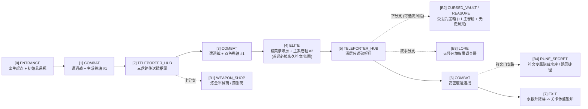

# 《水银坩埚（QUICKSILVER CRUCIBLE）》核心战斗帧数据、关卡切片拓扑算法与肉鸽数值全表

> **文档编号**：`docs/02_COMBAT_AND_ROGUELITE_SPEC.md`  
> **版本**：`v1.0.0-commercial`  
> **物理基准**：固定仿真频率 `120 Hz`（`1 tick = 8.3333 ms`），逻辑基准视口 `640 × 360 px`，标准瓦片网格 `16 × 16 px`  
> **主角碰撞盒**：站立/滞空 `14 × 30 px`（视觉画布 `64 × 64 px`），翻滚/下蹲压缩碰撞盒 `14 × 16 px`

---

## 1. 极限打击感（Game Feel）精确运动学与帧数据总表

### 1.1 主角移动、跳跃、爬墙与翻滚精确运动学参数表（`src/entities/player/PlayerPhysics.ts`）

所有物理量严格基于 `FIXED_STEP_SEC = 1 / 120` 秒步进，确保 60Hz 与 120Hz 屏幕跳跃高度误差 `0.00 px`。

| 动作模块 | 参数标识符 | 精确物理数值 | 逻辑帧换算 (`@120Hz`) | 手感调校工程说明 |
| :--- | :--- | :--- | :--- | :--- |
| **地面移动** | `MAX_RUN_SPEED` | `216 px/s` (`13.5 格/秒`) | `1.80 px/tick` | 兼顾高速跑图爽快感与狭小机关房落点精准度 |
| **地面起步** | `GROUND_ACCEL` | `2,880 px/s²` | `9 ticks` (`75.0 ms`) 达极速 | 零粘滞感瞬间响应，前 `3 ticks` 播放蹬地尘雾粒子 |
| **地面急停** | `GROUND_DECEL` | `3,600 px/s²` | `7 ticks` (`58.3 ms`) 完全刹停 | 松开方向键立即干脆停步，严禁冰面滑行感 |
| **反向急转** | `TURN_SNAP_ACCEL` | `5,400 px/s²` | `5 ticks` (`41.7 ms`) 完成反向 | 奔跑中反向推摇杆赋予 `1.875×` 制动倍率，支持极限拉扯 |
| **空中微操** | `AIR_ACCEL` / `AIR_DECEL` | `1,920 px/s²` / `960 px/s²` | `13 ticks` 空中满速转向 | 保留充足空中横移修正能力，避开地面毒池或尖刺 |
| **一段起跳** | `JUMP_INITIAL_VY` | `-372 px/s` | 瞬时垂直冲量 | 满按一段跳理论净高 `60.2 px`（安全跨越 `3.5 格 = 56 px` 平台） |
| **可变跳高截断** | `JUMP_CUT_MULTIPLIER` | `vy *= 0.45` | 上升期松键第 `1 tick` 生效 | 轻点跳跃键仅跳起 `22 px`（`1.4 格`），方便快速小跳打低位头目 |
| **三段式非对称重力** | `GRAVITY_RISE` | `1,180 px/s²` | 上升期 (`vy < -45 px/s`) | 轻盈起跳上升段 |
| **顶点滞空窗** | `GRAVITY_APEX` | `590 px/s²` (`0.5×`) | 顶点区间 (`|vy| ≤ 45 px/s`) | 在抛物线最高点提供约 `66 ms (8 ticks)` 黄金悬停瞄准窗口 |
| **下落重力与极速** | `GRAVITY_FALL` / `MAX_FALL_VY` | `1,740 px/s²` / `540 px/s` | 下落重力为上升期的 `1.47×` | 干脆利落下坠，杜绝“月球漂浮感” |
| **二段炼金喷射跳** | `DOUBLE_JUMP_VY` | `-336 px/s` | 瞬时重置 `vy` 并允许 100% 反向修正 `vx` | 一段+二段跳总安全跨越高度 `96 px (6 格)`，脚底爆发水银气浪 |
| **土狼时间** | `COYOTE_TIME_MS` | `100.0 ms` | **`12 ticks`** | 走出平台边缘后 `12 ticks` 内按跳跃仍判定为合法地面一段跳 |
| **跳跃输入缓冲** | `JUMP_BUFFER_MS` | `116.7 ms` | **`14 ticks`** | 落地前 `14 ticks` 内提前按下跳跃键，触地第 `1 tick` 自动起跳 |
| **攻击/翻滚预输入** | `ACTION_BUFFER_MS` | `133.3 ms` | **`16 ticks`** | 硬直或翻滚末尾提前按键不吞指令，出招无缝衔接 |
| **磁铁攀爪贴墙** | `WALL_SLIDE_MAX_VY` | `92 px/s` | 贴墙匀速下滑（解锁攀爪符文后生效） | 蹬墙反跳赋予 `(vx = ±250 px/s, vy = -355 px/s)` 并锁定同侧回贴 `100 ms` |
| **煅烧震地下砸** | `SLAM_DIVE_VY` | `+680 px/s` | 启动前空中悬停蓄力 `83.3 ms (10 ticks)` | 落地产生 `80 px` 半径震波（眩晕普通怪 `1.0s`；持有震地符文时击穿易碎矿渣地板） |

---

### 1.2 翻滚无敌帧（Dodge Roll）、黄金招架窗口（Parry）与橙血挽回（Rally）帧时间轴

```text
【翻滚 DodgeRollState 时间轴：总长 350.0ms = 42 ticks @ 120Hz，冷却 CD = 450.0ms = 54 ticks】
Tick:  01 ........................................ 32 | 33 .. 34 ............ 42
       |================ 完全无敌帧 (i-Frames) =======| |===== 收招恢复窗口 ===|
       |  0.0ms ~ 266.7ms (32 ticks)                  | | 266.7ms ~ 350.0ms    |
       |  · 免疫一切近战/远程/陷阱碰撞伤害             | | · Tick 34 (283.3ms)  |
       |  · 穿过一切敌方实体碰撞盒（零卡位）           | |   起开放 Jump /      |
       |  · 初速 380 px/s -> 余弦衰减，总位移 96 px    | |   Attack 提前取消！   |
       |  · 每 4 ticks 生成 1 个水银青色渐变残影精灵   | |                      |

【盾牌招架 ParryState 时间轴：总长 450.0ms = 54 ticks @ 120Hz】
Tick:  01 .. 02 | 03 ............................. 20 | 21 .................. 54
       |= 前摇 =| |======= 黄金招架判定窗口 ==========| |==== 空挥惩罚后摇 ====|
       | 16.7ms | | 16.7ms ~ 166.7ms (持续 150.0ms)   | | 166.7ms ~ 450.0ms    |
       | 2 ticks| | 18 ticks 瞬时力场展开             | | 34 ticks 破绽期      |
                  └── 若在此 18 ticks 内接触敌方【可招架攻击】或【投射物】：
                      1. 玩家免受 100% 伤害与击退；
                      2. 立即清零盾牌冷却 CD（0ms 可连续连环招架多段攻击！）；
                      3. 触发 90ms 全场冻结顿帧 + ChromaticImpact 色差撕裂脉冲；
                      4. 近战攻击者韧性条直接归零，进入 1,800ms 跪地眩晕；
                      5. 远程投射物偏转所有权，以 1.8x 移速与 250% 伤害原路弹回！
```

#### 橙血进攻挽回机制（Rally Mechanic — 鼓励高压侵略性战斗）
- 玩家受击扣除生命值 $\Delta H$ 时，其中 **$75\% \times \Delta H$** 不会立即彻底消失，而是转化为 HUD 血条上的**高亮琥珀色暂存槽（`rallyOrangeHp`）**。
- **冻结期**：受击后 `900 ms (108 ticks)` 内橙血槽保持静止不衰减；若此期间玩家以近战或远程武器命中敌人，每次命中按武器基础系数立刻将 `8% ~ 18%` 最大橙血转回真实红血（暴击回复量 `×1.5`；成功盾反立即回复当前剩余橙血的 `60%`）。
- **衰减期**：超过 `900 ms` 未命中敌人（或在此期间再次受击），橙血槽以每秒最大生命值 `32%/s` 的速率匀速流失。

---

### 1.3 分级顿帧（Hit-Stop）、受击闪白（Hit-Flash）与创伤屏幕震动（Trauma Shake）数学模型

#### 1. 顿帧时长分级计算公式（`src/combat/HitStopController.ts`）
$$\text{HitStop}_{\text{ms}} = \operatorname{clamp}\Big(\text{BaseStop}_{\text{weight}} + 14 \cdot \mathbb{I}_{\text{crit}} + 22 \cdot \mathbb{I}_{\text{breachStun}} + 8 \cdot \ln(1 + N_{\text{extraTargets}}),\; 16,\; 140\Big)$$

| 打击量级档位 | 触发条件 | 基础冻结时长 $\text{BaseStop}$ | 叠加暴击/破盾峰值 | 渲染层附加微表现 |
| :--- | :--- | :--- | :--- | :--- |
| **Light（轻快切割）** | 快刀第 1~3 段、速射弓箭、持续电弧 | `25 ms` (`3 ticks`) | `39 ms` | 仅目标精灵在水平方向产生 `±2 px` 高频受击抖动 |
| **Medium（标准斩击）** | 快刀终结技、长柄甜区、投掷瓶直击 | `45 ms` (`5~6 ticks`) | `67 ms` | 目标抖动 `±3 px` + 刀光高光帧延长保持 |
| **Heavy（重兵开山）** | 巨斧蓄力劈、重锤第三段砸地、震地下砸 | `75 ms` (`9 ticks`) | `111 ms` | 主角与受击怪同步震颤 + 地面碎石粒子瞬时喷发 |
| **Parry / Execution（极意）** | 黄金招架成功、破盾处决、击杀精英/Boss 最后一击 | `90 ms` (`11 ticks`) | **`140 ms` (`17 ticks`)** | 叠加 `ChromaticImpactPostFX` 径向色差冲击与清脆金属泛音 |

#### 2. 受击闪白曲线（`src/render/pipelines/HitFlashPipeline.ts`）
受击第 `0 ~ 60 ms (7 ticks)` 内，片元着色器 `uFlashAmount` 锁定 `1.0`（漫反射纹理与纯白 `#FFFFFF` 按 `100%` 混合，保留 Alpha 硬边缘剪影）；第 `60 ~ 100 ms (5 ticks)` 线性衰减至 `0.0`，并在过渡段混入当前伤害对应的元素高亮色（如火焰 `#FF5E2B`、感电 `#38BDF8`）。

#### 3. 创伤屏幕震动非线性衰减方程（`src/render/CameraRig.ts`）
严禁使用随机白噪声每帧瞬移镜头。`CameraRig` 维护归一化创伤值 $T \in [0, 1]$：
- **创伤注入**：轻击暴击 $+0.12$，重锤砸地 $+0.35$，成功盾反 $+0.42$，玩家受重击 $+0.55$，Boss 破阶段咆哮 $+0.75$（钳制 $T \le 1.0$）。
- **复合衰减微分步进**：
  $$T_{t + \Delta t} = \max\big(0,\; T_t - (1.85 \cdot T_t + 0.65) \cdot \Delta t\big)$$
- **二次/三次幂平滑采样（仅作用于 `WorldMainCam`，绝不污染 `TelegraphOverlayCam` 与 Preact HUD）**：
  $$\Delta X = 14\text{ px} \cdot T^2 \cdot \mathcal{N}_1(28 t), \quad \Delta Y = 10\text{ px} \cdot T^2 \cdot \mathcal{N}_2(28 t + 100), \quad \Delta \theta = 1.6^\circ \cdot T^3 \cdot \mathcal{N}_3(22 t + 200)$$
  其中 $\mathcal{N}_k$ 为一维连续梯度噪声（Simplex 1D），确保高刷新率下镜头晃动充满物理弹性且不伤眼。

---

## 2. 房间切片（Room Chunks）JSON 规范与 DAG 拓扑拼接算法

### 2.1 `RoomChunk` 标准 JSON 数据结构契约（`src/world/RoomChunkSchema.ts`）

所有地形均由经过跳跃运动学包络验证的手工模板切片组成。每个网格单元固定为 `16 × 16 px`。

```typescript
// src/world/RoomChunkSchema.ts
export type RoomRole =
  | 'ENTRANCE'
  | 'COMBAT'
  | 'ELITE'
  | 'TELEPORTER_HUB'
  | 'SHOP'
  | 'TREASURE'
  | 'CURSED_VAULT'
  | 'LORE'
  | 'RUNE_SECRET'
  | 'CORRIDOR_BRIDGE'
  | 'EXIT';

export type DoorDirection = 'WEST' | 'EAST' | 'NORTH' | 'SOUTH';

export type RuneId =
  | 'rune_vitriol_tendril'
  | 'rune_mercury_conduit'
  | 'rune_calcined_ram'
  | 'rune_magnetic_claws';

export interface DoorSocketSpec {
  readonly socketId: string;
  readonly direction: DoorDirection;
  /** 门锚点左下角（WEST/EAST 为通道地面脚底格；NORTH/SOUTH 为井道左边缘格）局部瓦片坐标 */
  readonly tileX: number;
  readonly tileY: number;
  /** 通道开口宽度/净高：水平门固定净高 4 格 (64px)，垂直竖井固定净宽 4 格 (64px) */
  readonly apertureTiles: 4;
  /** 若非 null，则仅当玩家已解锁对应符文时可通行（拓扑生成器绝不将其用于主干必经路径） */
  readonly requiredRune: RuneId | null;
}

export interface RectSpan {
  readonly tileX: number;
  readonly tileY: number;
  readonly widthTiles: number;
  readonly heightTiles: number;
}

export interface EnemySpawnSlot {
  readonly slotId: string;
  readonly tileX: number;
  readonly tileY: number;
  readonly allowedArchetypes: readonly ('MELEE_FODDER' | 'RANGED_HARASS' | 'SHIELD_TANK' | 'SUPPORT_CASTER' | 'FLANKER' | 'ELITE_GUARD')[];
  readonly minCrucibleHeat: 0 | 1 | 2 | 3 | 4 | 5;
  readonly patrolSpanTiles: readonly [number, number];
}

export interface TrapSlotSpec {
  readonly slotId: string;
  readonly trapType: 'SPIKE_BED' | 'ACID_GEYSER' | 'PENDULUM_BLADE' | 'VOLTAIC_ARC_GATE' | 'FLAME_NOZZLE';
  readonly tileX: number;
  readonly tileY: number;
  readonly widthTiles: number;
  readonly phaseOffsetMs: number;
  readonly cyclePeriodMs: number;
}

export interface LightAnchorSpec {
  readonly tileX: number;
  readonly tileY: number;
  readonly preset: 'TORCH_AMBER' | 'VITRIOL_VAT_GREEN' | 'VOLTAIC_CYAN' | 'FURNACE_CRIMSON' | 'MERCURY_SILVER';
  readonly radiusPx: number;
  readonly flickerAmplitude: number;
}

export interface RoomChunkTemplate {
  readonly chunkId: string;
  readonly biomePool: readonly string[];
  readonly role: RoomRole;
  readonly widthTiles: number;   // 最小 40 格 (640px)
  readonly heightTiles: number;  // 最小 30 格 (480px，适配 iPad 4:3 垂直外扩不穿帮)
  /** RLE 或多矩形实心碰撞区（自动按邻居掩码 47-Tile Autotile 映射至群落法线瓦片集） */
  readonly solidRects: readonly RectSpan[];
  /** 单向穿透木桥/黄铜格栅（允许从下方跳穿、站在上方按 下+跳 穿透下落） */
  readonly oneWayPlatforms: readonly { readonly tileX: number; readonly tileY: number; readonly widthTiles: number }[];
  /** 磁铁攀爪可吸附垂直墙面段 */
  readonly climbableWalls: readonly { readonly tileX: number; readonly topTileY: number; readonly heightTiles: number; readonly normalSide: 'LEFT' | 'RIGHT' }[];
  /** 煅烧震地符文可击碎的裂纹矿渣地板 */
  readonly breakableSlagFloors: readonly { readonly tileX: number; readonly tileY: number; readonly widthTiles: number }[];
  readonly doorSockets: readonly DoorSocketSpec[];
  readonly enemySpawns: readonly EnemySpawnSlot[];
  readonly trapSlots: readonly TrapSlotSpec[];
  readonly teleporterTilePos: { readonly tileX: number; readonly tileY: number } | null;
  readonly rewardPedestalTilePos: { readonly tileX: number; readonly tileY: number } | null;
  readonly loreAnchor: { readonly tileX: number; readonly tileY: number; readonly lorePoolTag: string } | null;
  readonly lightAnchors: readonly LightAnchorSpec[];
}
```

#### 标准战斗房 `RoomChunk` 完整可解析 JSON 实例（`public/assets/tilemaps/chunks/slag_combat_vat_01.json`）

```json
{
  "chunkId": "slag_combat_vat_01",
  "biomePool": ["biome_01_slag_retort"],
  "role": "COMBAT",
  "widthTiles": 48,
  "heightTiles": 30,
  "solidRects": [
    { "tileX": 0, "tileY": 0, "widthTiles": 48, "heightTiles": 3 },
    { "tileX": 0, "tileY": 3, "widthTiles": 3, "heightTiles": 19 },
    { "tileX": 0, "tileY": 26, "widthTiles": 18, "heightTiles": 4 },
    { "tileX": 18, "tileY": 28, "widthTiles": 12, "heightTiles": 2 },
    { "tileX": 30, "tileY": 26, "widthTiles": 18, "heightTiles": 4 },
    { "tileX": 45, "tileY": 3, "widthTiles": 3, "heightTiles": 19 },
    { "tileX": 14, "tileY": 16, "widthTiles": 20, "heightTiles": 2 }
  ],
  "oneWayPlatforms": [
    { "tileX": 7, "tileY": 21, "widthTiles": 8 },
    { "tileX": 33, "tileY": 21, "widthTiles": 8 },
    { "tileX": 18, "tileY": 26, "widthTiles": 12 },
    { "tileX": 20, "tileY": 11, "widthTiles": 8 }
  ],
  "climbableWalls": [
    { "tileX": 3, "topTileY": 8, "heightTiles": 12, "normalSide": "RIGHT" }
  ],
  "breakableSlagFloors": [],
  "doorSockets": [
    { "socketId": "w_main", "direction": "WEST", "tileX": 0, "tileY": 25, "apertureTiles": 4, "requiredRune": null },
    { "socketId": "e_main", "direction": "EAST", "tileX": 47, "tileY": 25, "apertureTiles": 4, "requiredRune": null },
    { "socketId": "n_secret", "direction": "NORTH", "tileX": 22, "tileY": 0, "apertureTiles": 4, "requiredRune": "rune_vitriol_tendril" }
  ],
  "enemySpawns": [
    { "slotId": "sp_01", "tileX": 12, "tileY": 25, "allowedArchetypes": ["MELEE_FODDER", "SHIELD_TANK"], "minCrucibleHeat": 0, "patrolSpanTiles": [5, 16] },
    { "slotId": "sp_02", "tileX": 36, "tileY": 25, "allowedArchetypes": ["MELEE_FODDER", "FLANKER"], "minCrucibleHeat": 0, "patrolSpanTiles": [31, 42] },
    { "slotId": "sp_03", "tileX": 24, "tileY": 15, "allowedArchetypes": ["RANGED_HARASS", "SUPPORT_CASTER"], "minCrucibleHeat": 0, "patrolSpanTiles": [15, 32] },
    { "slotId": "sp_04_heat", "tileX": 23, "tileY": 10, "allowedArchetypes": ["RANGED_HARASS"], "minCrucibleHeat": 2, "patrolSpanTiles": [20, 27] }
  ],
  "trapSlots": [
    { "slotId": "tr_acid_pit", "trapType": "ACID_GEYSER", "tileX": 19, "tileY": 27, "widthTiles": 10, "phaseOffsetMs": 0, "cyclePeriodMs": 3200 }
  ],
  "teleporterTilePos": { "tileX": 6, "tileY": 25 },
  "rewardPedestalTilePos": null,
  "loreAnchor": null,
  "lightAnchors": [
    { "tileX": 8, "tileY": 23, "preset": "TORCH_AMBER", "radiusPx": 160, "flickerAmplitude": 0.12 },
    { "tileX": 24, "tileY": 27, "preset": "VITRIOL_VAT_GREEN", "radiusPx": 190, "flickerAmplitude": 0.08 },
    { "tileX": 40, "tileY": 23, "preset": "TORCH_AMBER", "radiusPx": 160, "flickerAmplitude": 0.12 },
    { "tileX": 24, "tileY": 14, "preset": "FURNACE_CRIMSON", "radiusPx": 140, "flickerAmplitude": 0.15 }
  ]
}
```
*运动学核验说明*：地面高度 `tileY = 26` → 左右单向跳台 `tileY = 21`（高差 `5 格 = 80 px`，二段跳上限 `96 px`，一段跳 `60 px` 可直接抓边或二段轻松登顶）→ 中央二层实心梁 `tileY = 16`（距跳台高差 `5 格 = 80 px`）→ 顶层狙击台 `tileY = 11`（高差 `5 格 = 80 px`），全路径 **100% 满足无符文可达性包络**；而 `tileY = 0` 的北向隐藏顶门距顶层平台 `11 格 (176 px)`，显式标记 `requiredRune: "rune_vitriol_tendril"` 由藤蔓升起抵达。

---

### 2.2 有向无环图（DAG）拓扑生成与 `DoorSocket` 无重叠拼接算法



#### `DoorSocketStitcher.ts` 核心世界坐标对齐与防重叠回溯算法
1. **门方向互补配对**：父房间选择未占用的输出门 $S_A$（例如 `EAST`，局部瓦片坐标 $(x_A, y_A)$），子房间必须从候选模板库中筛选具备相反方向输入门 $S_B$（`WEST`，且 `S_B.requiredRune === null` 或与分支约束一致）的切片。
2. **像素级零台阶对齐公式**：
   当父房间左上角世界瓦片坐标为 $(X_A, Y_A)$ 时，插入一段长度可变（`6 ~ 14 格`）的封印过渡走廊桥接块 `CorridorBridgeChunk`（防止相邻房间镜头边界互相穿帮，并提供跨房间本地存档检查点），子房间世界瓦片坐标 $(X_B, Y_B)$ 精确解算为：
   $$X_B = X_A + W_A + L_{\text{bridge}}, \qquad Y_B = Y_A + y_A - y_B$$
   此时两扇门的通道脚底格 `tileY` 在世界空间严格相等（误差 `0 px`），彻底杜绝角色冲刺过门时卡在 `1px` 缝隙上。
3. **空间包围盒（AABB）无重叠回溯求解**：
   每次放置候选子房间前，检测其外扩 `2 格` 安全边距后的世界矩形 `[X_B - 2, Y_B - 2, W_B + 4, H_B + 4]` 是否与已放置的任意房间矩形相交：
   - 若不相交：锁定坐标并递归生成后续节点；
   - 若相交：先尝试拉长 `L_bridge`（`6 -> 10 -> 14 格`），若仍碰撞则从当前 `biomeTopologyRng` 洗牌序列中尝试下一个候选 `RoomChunk`，最多支持 `3 层深度` 确定性回溯，确保在 `< 4 ms` 内 `100%` 生成无死锁连通地图。

```typescript
// src/world/DoorSocketStitcher.ts 核心对齐与包围盒无重叠求解器
import { DeterministicRng } from '../core/DeterministicRng';
import { DoorDirection, DoorSocketSpec, RoomChunkTemplate } from './RoomChunkSchema';

export interface PlacedRoomNode {
  readonly nodeId: string;
  readonly chunk: RoomChunkTemplate;
  readonly worldTileX: number;
  readonly worldTileY: number;
  readonly parentNodeId: string | null;
}

const OPPOSITE_DIR: Readonly<Record<DoorDirection, DoorDirection>> = {
  WEST: 'EAST',
  EAST: 'WEST',
  NORTH: 'SOUTH',
  SOUTH: 'NORTH',
};

export function solveSocketAlignment(
  parent: PlacedRoomNode,
  parentSocket: DoorSocketSpec,
  childChunk: RoomChunkTemplate,
  childSocket: DoorSocketSpec,
  bridgeTiles: number
): { worldTileX: number; worldTileY: number } {
  switch (parentSocket.direction) {
    case 'EAST':
      return {
        worldTileX: parent.worldTileX + parent.chunk.widthTiles + bridgeTiles,
        worldTileY: parent.worldTileY + parentSocket.tileY - childSocket.tileY,
      };
    case 'WEST':
      return {
        worldTileX: parent.worldTileX - bridgeTiles - childChunk.widthTiles,
        worldTileY: parent.worldTileY + parentSocket.tileY - childSocket.tileY,
      };
    case 'SOUTH':
      return {
        worldTileX: parent.worldTileX + parentSocket.tileX - childSocket.tileX,
        worldTileY: parent.worldTileY + parent.chunk.heightTiles + bridgeTiles,
      };
    case 'NORTH':
      return {
        worldTileX: parent.worldTileX + parentSocket.tileX - childSocket.tileX,
        worldTileY: parent.worldTileY - bridgeTiles - childChunk.heightTiles,
      };
  }
}

export function hasAabbCollision(
  candX: number,
  candY: number,
  candW: number,
  candH: number,
  placed: readonly PlacedRoomNode[],
  paddingTiles = 2
): boolean {
  for (const room of placed) {
    const separated =
      candX + candW + paddingTiles <= room.worldTileX ||
      room.worldTileX + room.chunk.widthTiles + paddingTiles <= candX ||
      candY + candH + paddingTiles <= room.worldTileY ||
      room.worldTileY + room.chunk.heightTiles + paddingTiles <= candY;
    if (!separated) return true;
  }
  return false;
}

export function tryAttachChildChunk(
  parent: PlacedRoomNode,
  outSocket: DoorSocketSpec,
  candidates: readonly RoomChunkTemplate[],
  placed: readonly PlacedRoomNode[],
  rng: DeterministicRng,
  nextNodeId: string
): PlacedRoomNode | null {
  const neededDir = OPPOSITE_DIR[outSocket.direction];
  const bridgeLengths = [6, 10, 14] as const;
  const startOffset = candidates.length > 0 ? rng.nextInt(0, candidates.length - 1) : 0;

  for (let i = 0; i < candidates.length; i++) {
    const chunk = candidates[(startOffset + i) % candidates.length]!;
    const matchingSockets = chunk.doorSockets.filter(
      (s) => s.direction === neededDir && s.requiredRune === outSocket.requiredRune
    );
    for (const inSocket of matchingSockets) {
      for (const bridge of bridgeLengths) {
        const pos = solveSocketAlignment(parent, outSocket, chunk, inSocket, bridge);
        if (!hasAabbCollision(pos.worldTileX, pos.worldTileY, chunk.widthTiles, chunk.heightTiles, placed)) {
          return {
            nodeId: nextNodeId,
            chunk,
            worldTileX: pos.worldTileX,
            worldTileY: pos.worldTileY,
            parentNodeId: parent.nodeId,
          };
        }
      }
    }
  }
  return null;
}
```

#### 四大生态群落 DAG 拓扑生成参数总表（`src/data/biomes.data.ts`）

| 生态群落 ID 与名称 | 主干房间数 | 支路房间数 | 保底三选一主卷轴 | 保底双色副卷轴 | 专属商店配置 | 符文解锁产出与隐藏路线 | 关底出口流向 |
| :--- | :---: | :---: | :---: | :---: | :--- | :--- | :--- |
| **`biome_01_slag_retort`**<br>矿渣蒸馏厂（第一层） | `6` | `3` | **`2` 个** | **`1` 个** | 武器或技能二选一商店 ×1 | 精英房首通必掉 **`rune_vitriol_tendril`（矾蚀藤蔓）** | 标准出口 → `biome_02_vitriol_sewers` |
| **`biome_02_vitriol_sewers`**<br>矾酸暗渠（第二层） | `7` | `4` | **`3` 个** | **`2` 个** | 武器商店 ×1 + 药剂食物摊 ×1 | 精英祭坛首通必掉 **`rune_mercury_conduit`（水银导管）**；设藤蔓隐藏宝库 ×1 | 决战升降梯 → **Boss 1：`boss_01_furnace_warden`（典狱长·萨尔弗）**（首次击败掉 **`rune_calcined_ram` 震地符文**） |
| **`biome_03_clockwork_ossuary`**<br>发条骸骨堂（第三层） | `8` | `4` | **`4` 个** | **`2` 个** | 高阶 `++/S` 武器与技能双商店 + 诅咒宝箱 ×1 | 钟楼精英守卫首通必掉 **`rune_magnetic_claws`（磁铁攀爪）**；设震地地板密室 ×1 | 标准出口 → `biome_04_crucible_apex` |
| **`biome_04_crucible_apex`**<br>星界熔炉之巅（第四层） | `8` | `4` | **`4` 个** | **`2` 个** | 星界全品类重铸大师商店 ×1 + 双钥匙炼金秘库 ×1 | 需同时具备 **攀爪 + 导管 + 震地** 方可收集齐三枚「原初质真名封印」（真结局前置） | 尖塔王座门 → **Boss 2：`boss_02_grand_alchemist`（帕拉塞尔苏斯）** |

---

## 3. 成品级肉鸽数值总表（100% 完整配表，零省略）

### 3.1 三系成长属性（赤化 / 黄化 / 白化）指数公式与等级收益表（`src/entities/player/PlayerStats.ts`）

玩家初始三围为 **`赤化 (Rubedo) = 1`、`黄化 (Citrinitas) = 1`、`白化 (Albedo) = 1`**，基础生命值上限 `BaseHP = 120`。

1. **主属性指数增伤公式**（双色武器与技能自动取两个关联颜色中的**最高值** $S_{\max}$ 计算）：
   $$\text{DamageMultiplier}(S) = 1.15^{(S - 1)}$$
2. **三系生命值边际递减增幅公式**（每次拾取卷轴使某系从 $k-1$ 升至 $k$ 时，累加对应的生命百分比加成，鼓励主点一系冲伤害、副吃双色卷轴撑高总血池）：
   - **白化（Albedo / 坚韧生存系）单级生命增幅**：$\Delta H_{\text{albedo}}(k) = \max\big(0.08,\; 0.70 \times 0.88^{(k - 2)}\big)$
   - **赤化（Rubedo / 近战狂战系）单级生命增幅**：$\Delta H_{\text{rubedo}}(k) = \max\big(0.05,\; 0.58 \times 0.85^{(k - 2)}\big)$
   - **黄化（Citrinitas / 远程战术系）单级生命增幅**：$\Delta H_{\text{citrinitas}}(k) = \max\big(0.04,\; 0.48 \times 0.83^{(k - 2)}\big)$

| 属性等级 $S$ | 伤害总倍率 $1.15^{(S-1)}$ | 赤化该级提供 HP 增幅 | 黄化该级提供 HP 增幅 | 白化该级提供 HP 增幅 | 实战节奏里程碑锚点 |
| :---: | :---: | :---: | :---: | :---: | :--- |
| **Lv. 1（初始）** | **`1.000×`** (`100%`) | — | — | — | 矿渣蒸馏厂出生基准（`120 HP`） |
| **Lv. 2** | **`1.150×`** (`115%`) | `+58.0%` | `+48.0%` | `+70.0%` | 第一关首枚卷轴显著提升容错 |
| **Lv. 3** | **`1.323×`** (`132%`) | `+49.3%` | `+39.8%` | `+61.6%` | 第一关末期基准 |
| **Lv. 5** | **`1.749×`** (`175%`) | `+35.6%` | `+27.5%` | `+47.4%` | 矾酸暗渠中段输出成型 |
| **Lv. 8** | **`2.660×`** (`266%`) | `+21.9%` | `+15.7%` | `+32.3%` | Boss 1 萨尔弗标准挑战门槛 |
| **Lv. 12** | **`4.652×`** (`465%`) | `+11.4%` | `+7.4%` | `+19.4%` | 发条骸骨堂中后期爆发 |
| **Lv. 16** | **`8.137×`** (`814%`) | `+6.0%` | `+4.0%` (保底) | `+11.7%` | 星界熔炉之巅标准主属性线 |
| **Lv. 20** | **`14.232×`** (`1,423%`) | `+5.0%` (保底) | `+4.0%` (保底) | `+8.0%` (保底) | 全清诅咒宝箱极限高配线 |
| **Lv. 24** | **`24.891×`** (`2,489%`) | `+5.0%` (保底) | `+4.0%` (保底) | `+8.0%` (保底) | 高热度（5 坩埚热阶）神装上限 |

---

### 3.2 12 把完整武器帧数据、破盾值与暴击机制配表（`src/data/weapons.data.ts`）

> **帧数据读表说明**：`前摇 / 判定 / 后摇 (可取消起点)` 均以 **毫秒 (`ms`)** 标注（除以 `8.333` 即为 `120Hz` 逻辑帧数）。例如 `67/33/150 (cancel@117)` 代表：前摇 `67ms (8帧)` → 攻击盒激活 `33ms (4帧)` → 收招后摇 `150ms (18帧)`，且在动作启动满 `117ms`（判定刚结束 `17ms`）时即可立刻通过**翻滚**或**盾反**无损取消剩余后摇！

| # | 武器 ID 与名称 | 色系归属 | 类别 | 连招段数与逐段帧数据 `前摇/判定/后摇 (可取消ms)` | 逐段基础伤害与动作倍率 | 破盾韧性削减 (`Breach`) | 专属暴击倍率与精确暴击触发条件 | 位移微操、蓝图解锁与核心机制 |
| :-: | :--- | :---: | :---: | :--- | :--- | :---: | :--- | :--- |
| **01** | `wpn_rust_scalpel`<br>**锈蚀解剖刃** | 赤化 | 近战快刀 | **4 段**：<br>S1: `58/33/117 (c@100)`<br>S2: `50/33/117 (c@92)`<br>S3: `67/42/133 (c@117)`<br>S4: `83/50/200 (c@150)` | `28 / 30 / 36 / 52`<br>(`1.00× / 1.07× / 1.29× / 1.86×`) | `0.2 / 0.2 / 0.4 / 0.8` | **`1.95×` 暴击**：**背刺暴击**——命中时玩家中心点位于目标当前面朝方向的后方 `180°` 半平面内。 | *[初始解锁]* 每段挥砍自带 `10 px` 微步吸附；配合翻滚穿背可刀刀红字暴击。 |
| **02** | `wpn_quicksilver_rapier`<br>**水银刺剑** | 赤化 | 近战突刺 | **3 段**：<br>S1: `67/42/142 (c@117)`<br>S2: `58/42/142 (c@108)`<br>S3: `92/58/217 (c@167)` | `34 / 38 / 64`<br>(`1.00× / 1.12× / 1.88×`) | `0.3 / 0.3 / 1.0` | **`2.25×` 暴击**：成功执行**翻滚（Dodge Roll）**或**黄金招架（Parry）**后的 **`1,800 ms` 窗口内**首次刺击必定暴击（剑尖亮起水银银芒提示）。 | *[水银拟态猎手掉蓝图 · 45 灵液]* 首段刺击瞬间向前瞬步突进 `44 px`（悬崖自动钳制防坠），狭长判定盒 `76×16 px`。 |
| **03** | `wpn_cinnabar_twinblades`<br>**辰砂双刃** | 赤化 / 黄化 | 近战连舞 | **5 段**：<br>S1: `50/25/92 (c@83)`<br>S2: `50/25/92 (c@83)`<br>S3: `67/42/117 (c@117)`<br>S4: `58/33/100 (c@100)`<br>S5: `100/67/233 (c@183)` | `20 / 20 / 35 / 24 / 68`<br>(`1.00× / 1.00× / 1.75× / 1.20× / 3.40×`) | `0.15 / 0.15 / 0.5 / 0.2 / 1.1` | **节奏段暴击**：**第 3 段交叉斩小暴击（`1.65×`）**，**第 5 段腾空风车斩大暴击（`2.40×`）**。 | *[钟摆刺客掉蓝图 · 60 灵液]* 命中携带【流血】的目标时，自身获得 `15%` 攻速提升，鼓励贪刀打完五连。 |
| **04** | `wpn_athanor_cleaver`<br>**锻炉断头重刃** | 赤化 / 白化 | 重型巨兵 | **2 段**：<br>S1: `233/67/283 (c@325)`<br>S2: `267/83/350 (c@375)` | `95 / 135`<br>(`1.00× / 1.42×`) | `1.8 / 2.8`<br>*(极易打断敌人前摇)* | **`2.60×` 律动暴击**：第 1 段命中任意敌人后，角色肩部迸发火星闪光（持续窗口 `220ms ~ 380ms`），**在此节拍窗口内精准按下第 2 段**（禁无脑狂按）触发熔铁顺劈必暴！ | *[Boss 1 萨尔弗掉蓝图 · 80 灵液]* 挥砍前摇期间享有 `40%` 伤害减免与防轻击打断浅霸体。 |
| **05** | `wpn_crucible_maul`<br>**坩埚震地重锤** | 白化 | 重型巨兵 | **3 段**：<br>S1: `250/67/267 (c@333)`<br>S2: `217/67/250 (c@300)`<br>S3: `317/100/383 (c@433)` | `88 / 96 / 160`<br>(`1.00× / 1.09× / 1.82×`) | `2.2 / 2.2 / 3.8`<br>*(全游戏最高破盾)* | **`2.50×` 碎壳暴击**：命中处于 **【冰冻 `Frozen`】、【眩晕 `Stunned`】或【定身 `Rooted`】** 控制状态下的敌人必定暴击。 | *[狂暴矿工掉蓝图 · 50 灵液]* 第 3 段砸地沿地面向前延伸一道 `96 px` 熔渣地裂冲击波，可隔着矮掩体震飞成群怪物。 |
| **06** | `wpn_pendulum_halberd`<br>**骸骨钟摆战戟** | 白化 / 赤化 | 长柄巨兵 | **3 段**：<br>S1: `150/50/183 (c@217)`<br>S2: `142/50/183 (c@208)`<br>S3: `200/67/267 (c@283)` | `58 / 62 / 94`<br>(`1.00× / 1.07× / 1.62×`) | `1.1 / 1.1 / 1.9` | **`2.15×` 刀尖甜区暴击**：战戟总长 `112 px`——内圈戟杆（`0 ~ 63 px`）仅造成普通伤害；**外圈月牙刃口（`64 ~ 112 px`）命中敌人必定暴击**！ | *[链锤处刑官掉蓝图 · 70 灵液]* 第 3 段为斜上方大圆弧挑斩，可精准击落空中飞扑虫与飞行电弧怪。 |
| **07** | `wpn_alembic_bow`<br>**曲颈瓶速射猎弓** | 黄化 | 远程弓箭 | **单段瞬射**：<br>`117/17/133 (c@142)`<br>*(箭矢初速 `860 px/s`，备弹 `6`)* | `48`<br>(`1.00×`) | `0.5` | **`2.05×` 暴击**：满足任一条件必暴——① 命中时与目标水平距离 **`≥ 160 px`（狙击距离）**；② 目标躯体上已插满 **`≥ 3` 支未拔出箭矢**。 | *[初始解锁]* 空中开弓提供 `180 ms` 滞空缓降；近战副手攻击或招架命中敌人瞬间自动拔回全部插矢。 |
| **08** | `wpn_clockwork_repeater`<br>**发条连发重弩** | 黄化 / 白化 | 远程重弩 | **单次按键三连点射**：<br>`150 / [3×58ms连射] / 217 (c@342)`<br>*(备弹 `18` 枚钢钉)* | `22 × 3` (`66`)<br>(`0.46× × 3`) | `0.35 × 3` | **`1.85×` 每矢暴击**：攻击处于 **【感电 `Electrified`】或【定身 `Rooted`】** 状态的敌人时，三发钢钉全部暴击！ | *[发条自爆蛛掉蓝图 · 65 灵液]* 若副手槽为空，自动赠送衍生副手技「齿轮钉网」（冷却 `6s`，定身路径首个敌人 `2.2s`）。 |
| **09** | `wpn_vitriol_thrower`<br>**矾酸蒸馏投掷瓶** | 赤化 / 黄化 | 投掷炼金 | **2 段交替抛投**：<br>S1: `125/17/158 (c@158)`<br>S2: `108/17/158 (c@142)`<br>*(无限瓶药，抛物线射程 `210 px`)* | `38` 直击 + 火池<br>(`1.00× + 0.35×/s`) | `0.4` | **`1.95×` 催化暴击**：瓶体直接砸中正处于 **【油污 `Oiled`】或【燃烧 `Ignited`】** 状态的敌人必定暴击。 | *[烧瓶投掷者掉蓝图 · 40 灵液]* 碎裂后在落点地面铺设宽 `64 px`、持续 `2.5s` 的微弱酸火区（每秒叠 1 层燃烧）。 |
| **10** | `wpn_voltaic_arc_staff`<br>**星盘电弧法杖** | 黄化 | 法术引导 | **脉冲链式释放**：<br>首拍 `100ms` 启动，按住每 `183ms (22 ticks)` 脉冲一次 `(c@任意帧秒断)` | `29` / 脉冲<br>(`1.00×`，弹射 `4` 目标) | `0.25` / 脉冲 | **`1.90×` 超导暴击**：满足任一必暴——① 玩家或目标正处于**水洼/酸液池/油污**地形中；② **电弧链式弹射至第 2、3、4 名次级目标时必定暴击**！ | *[电弧织网者掉蓝图 · 75 灵液]* 自动索敌锥角 `±35°`（射程 `185 px`），随时可无前摇接翻滚取消，清群怪神器。 |
| **11** | `wpn_slag_buckler`<br>**矿渣反冲圆盾** | 白化 | 盾牌 | **瞬按招架 / 长按举盾**：<br>`17ms` 起盾 / `150ms` 黄金招架窗 / `283ms` 空挥后摇 | 格挡减伤 `75%`；招架反击基础伤 `78` (`1.60×`) | 招架直接削空普通/精英怪全部韧性 | **`2.40×` 震荡暴击**：**黄金招架成功瞬间**向正前方 `96 px` 扇形迸发炼金冲击波，对范围内所有敌人造成必定暴击伤害并眩晕 `1.8s`！ | *[初始解锁]* 即使长按举盾未能触发黄金招架，被击中瞬间也会震退贴脸小怪 `32 px` 防止连续被围殴。 |
| **12** | `wpn_mirror_aegis`<br>**水银镜面圣盾** | 白化 / 黄化 | 盾牌 | **瞬按招架 / 长按举盾**：<br>`17ms` 起盾 / `150ms` 黄金招架窗 / `300ms` 空挥后摇 | 格挡减伤 `70%`；折射单束基础伤 `54` (`1.12× × 3`) | 招架直接击晕攻击者 | **`2.10× × 3` 棱镜暴击**：成功招架**敌方远程投射物**时，将其分裂为 **3 道自动追踪水银光束**全部暴击；成功招架**近战攻击**时，暴击反伤并对攻击者同时施加 `3 层感电 + 2.5s 冰冻`！ | *[星界审判官掉蓝图 · 100 灵液]* 挂载 `ShieldRefractPipeline` 屏幕空间水银波纹折射特效，视觉辨识度拉满。 |

---

### 3.3 6 种主动炼金技能与部署陷阱完整机制表（`src/data/skills.data.ts`）

玩家可同时装备 **2 个互不冲突的主动技能槽（`Skill Slot 1 / 2`）**，所有部署物与投掷技脱手前摇均控制在 `≤ 100 ms (12 ticks)` 内，绝不打断高速战斗流。

| # | 技能 ID 与名称 | 色系归属 | 基础冷却 | 类型 | 核心机制、判定半径与基础数值 | 元素与词条联动接口 |
| :-: | :--- | :---: | :---: | :---: | :--- | :--- |
| **01** | `skl_vitriol_flask`<br>**黑火油雾罐** | 赤化 / 黄化 | `10.0 s` | 投掷催化瓶 | 向前抛掷高压炼金罐，落地爆开半径 `112 px` 黑油雾，瞬间造成 `42` 点基础伤害，对范围内所有敌人施加 **`Oiled`（油污 `8.0s`）** 并在中心点引燃 `2 层 Ignited`（瞬间转化为高伤炼金紫火！）。 | 引爆毒雾时额外触发「矾毒爆燃」二次爆炸。 |
| **02** | `skl_clockwork_saw_trap`<br>**发条锯刃捕兽夹** | 黄化 / 白化 | `12.0 s` | 地面陷阱 | 向脚下或前方 `64 px` 抛设齿轮捕兽夹（场上最多存续 `2` 枚）。敌人踩中瞬间夹合，造成 `35` 点伤害并强制施加 **【定身 `Rooted` `3.2s`】（Boss 为 `1.6s` 无法位移）**，夹齿高速旋转每 `0.5s` 叠加 `1 层 Bleeding`。 | 完美触发「重锤 `wpn_crucible_maul`」与「连发重弩 `wpn_clockwork_repeater`」的定身必暴条件！ |
| **03** | `skl_tesla_coil_turret`<br>**黄铜特斯拉哨塔** | 黄化 | `14.0 s` | 自动炮台 | 部署一座耐久值 `320 HP`、持续 `18.0 s` 的发条电塔，每 `0.45s` 对 `200 px` 内最近敌人发射 `26` 点伤害电弧并叠 `1 层 Electrified`。**核心走位机制**：当玩家自身距离哨塔 `≤ 140 px` 时，玩家与哨塔之间拉出一条高压电弧绊线（触碰敌人每秒受 `65` 点电伤），且哨塔射速提升 `+60%`！ | 完美激活「哨塔共鸣」变异与全部感电暴击词条。 |
| **04** | `skl_cryo_mercury_nova`<br>**液氮水银霜环** | 白化 / 黄化 | `16.0 s` | 瞬发控场 | `67 ms` 极速瞬发，以自身为中心向四周扩散半径 `128 px` 的极寒水银环，造成 `45` 点寒霜伤害并将命中敌人全部 **【冰冻 `Frozen` `3.5s`】**，同时熄灭自身身上的负面燃烧效果。 | 破冰首击为目标附加 `+25%` 脆性易伤，重武器一锤清屏绝配。 |
| **05** | `skl_crimson_transfusion`<br>**赤化沸血狂潮** | 赤化 | `18.0 s` | 狂战增益 | 瞬间刺破自身水银核，将当前生命值的 `8%` 转化为**橙血槽（可通过接下来进攻 100% 吸回！）**，并在 **`6.0 s`** 内获得：**攻击速度 `+35%`、移动速度 `+25%`、每次攻击命中在目标处溅射 `24` 点范围血雾伤害**。 | 开启期间每次击杀敌人延长增益 `1.0 s`（单次开启最长延续至 `10.0 s`）。 |
| **06** | `skl_aegis_tonics`<br>**哲学家水银护瓮** | 白化 | `22.0 s` | 防御反制 | 立即回复当前已损失橙血的 `100%`（无橙血时直接治疗 `8%` 最大生命值），并展开持续 **`5.0 s`**、厚度相当于最大生命值 **`35%`** 的水银折射护盾；护盾存在期间免疫受击硬直，护盾被击碎或手动二段引爆时震飞周围 `110 px` 敌人造成 `90` 点白化伤害。 | 携带盾牌词条或白化高属性时护盾厚度随属性额外成长。 |

---

### 3.4 12 种局内变异（Mutations）完整机制与属性成长公式（`src/data/mutations.data.ts`）

玩家在每个关卡间的「休整锻炉区」可选择激活变异，最多同时装备 **`3` 个变异槽**（可花费金币随时洗点重选）。公式中 $R, C, A$ 分别代表玩家当前的 **赤化（Rubedo）、黄化（Citrinitas）、白化（Albedo）** 等级。

| # | 变异 ID 与名称 | 派系 | 精确触发机制与随属性动态成长公式 | 构筑协同定位 |
| :-: | :--- | :---: | :--- | :--- |
| **01** | `mut_crimson_frenzy`<br>**狂血饥渴** | 赤化 | 击杀任意敌人后获得 `5.0 s`【疾走】（移速 `+25%`，连续击杀刷新时长）；在【疾走】期间，每次近战攻击命中回复生命值：$\text{Heal} = \min\big(2.2\%,\; 0.55\% + 0.11\% \times R\big) \times \text{MaxHP}$。 | 高速跑图续航核心 |
| **02** | `mut_open_wounds`<br>**撕裂锯齿** | 赤化 | 你的每一次**近战武器命中**必定额外施加 `1 层 Bleeding（流血）`，每跳基础流血 DPS 为：$14 \times 1.15^{(R - 1)}$。 | 无条件稳定触发 `+60% 流血增伤` 词条与辰砂双刃加速 |
| **03** | `mut_predator_veil`<br>**水银光学拟态** | 赤化 | 使用近战武器击杀敌人后，角色进入 `2.8 s` **半透明光学隐身**（未仇恨或非 Boss 敌人丢失目标）；破隐一击造成的伤害额外提升：$\text{Bonus} = \min\big(110\%,\; 35\% + 5\% \times R\big)$。 | 锈蚀解剖刃背刺流质变核心 |
| **04** | `mut_scorch_execution`<br>**大煅烧处决** | 赤化 | 当普通/精英怪生命值低于 **`16%`**（Boss 低于 **`6%`**）且身上携带有任意【燃烧】或【流血】层数时，你的下次直接攻击立即将其**熔毁斩杀**，并在原地爆出半径 `80 px` 余烬波传递剩余层数！ | 高热度精英怪快速收割与链式清场 |
| **05** | `mut_point_blank`<br>**贴脸炼金铳术** | 黄化 | 使用**远程武器**命中距离你 `≤ 96 px (6 格)` 内的近身敌人时，最终伤害独立乘算提升：$\text{Mult} = 1 + \min\big(0.75,\; 0.28 + 0.03 \times C\big)$。 | 高风险近战化重弩 / 投掷瓶爆发 |
| **06** | `mut_tactical_reload`<br>**发条超频齿轮** | 黄化 | 每次触发**暴击（Critical Hit）**时，立即缩减两个主动技能剩余冷却时间：$\Delta \text{CD} = \min\big(1.6\text{ s},\; 0.45\text{ s} + 0.07\text{ s} \times C\big)$（内置最短触发间隔 `0.20 s`）。 | 连发重弩 / 电弧法杖高频刷技能流 |
| **07** | `mut_support_resonance`<br>**哨塔以太共鸣** | 黄化 | 当场上存在你部署的任意陷阱或哨塔且距离你 `≤ 180 px` 时，你造成的全部武器伤害提升：$\text{Bonus} = \min\big(65\%,\; 22\% + 2.8\% \times C\big)$。 | 阵地战 Boss 攻坚 |
| **08** | `mut_barbed_tips`<br>**水银倒钩箭簇** | 黄化 | 插在敌人躯体上的每一支箭矢/钢钉（最高计 `8` 支）每 `0.5 s` 在敌人体内震荡，每支造成 $9 \times 1.15^{(C - 1)}$ 点持续伤害；拔回箭矢瞬间引爆一次总额 `120%` 的撕裂伤。 | 速射猎弓与连发重弩长线刮骨 |
| **09** | `mut_mercury_ward`<br>**镜面虹吸反击** | 白化 | 每次成功触发**黄金招架（Parry）**，立即回复生命值：$\text{Heal} = \min\big(7.5\%,\; 2.2\% + 0.32\% \times A\big) \times \text{MaxHP}$（内置每名敌人 `3s` 回复冷却防刷血），且 `3.0 s` 内下次近战攻击附加 $65 \times 1.15^{(A - 1)}$ 点神圣水银伤害。 | 盾反流攻防一体核心 |
| **10** | `mut_gastronomy_distill`<br>**高纯度二次蒸馏** | 白化 | 所有场景食物与灵液瓶恢复量提升 **`+65%`**；若拾取食物时生命已满，将其回收提炼使本局全部武器伤害**永久累加 `+8%`**（上限叠加 `6` 次即 `+48%`）。 | 持久续航转后期输出 |
| **11** | `mut_frostbite_shatter`<br>**绝对零度霜蚀** | 白化 | 被施加减速或【冰冻】的敌人每秒承受 $22 \times 1.15^{(A - 1)}$ 点寒霜腐蚀伤害；若敌人在受控期间死亡，尸体爆裂将剩余控制时间传染给周围 `96 px` 敌人。 | 液氮霜环 + 坩埚重锤控杀体系 |
| **12** | `mut_emergency_carapace`<br>**水银应急凝壳** | 白化 | 当单次受到致命伤害且触发前你的生命值 **`> 25% MaxHP`** 时，强制锁血保留 **`1 HP`**，震退全场敌人并赋予 **`2.0 s` 绝对无敌帧**（每饮用一次灵液瓶或累计击杀 `35` 名敌人重置一次充能）。 | 防高热度秒杀保命底牌 |

---

### 3.5 6 大元素异常状态机与 20 条词条化学反应联动矩阵（`src/combat/AffixSynergyEngine.ts`）

#### 1. 六大元素异常状态与跨元素化学反应规则表（`src/combat/StatusEffectMachine.ts`）

| 状态 ID | 视觉发光锚点 | 持续时间 / 叠层上限 | 独立基础效果 | 跨元素碰撞化学反应（Chemical Reactions） |
| :--- | :--- | :---: | :--- | :--- |
| **`Oiled`**<br>炼金黑油 | 深紫黑油亮光 `#4C1D95` | `8.0 s` / `1 层` | 移动速度 `-15%` | **① 油 + 火 → `Violet Napalm（炼金紫火）`**：遇任意 `Ignited` 立即转化为紫火，燃烧每跳伤害翻倍（`2.0×`），持续时间刷新至 `6.0s`！<br>**② 油 + 冰**：使 `Frozen` 冻结时长延长 `+1.5 s`。 |
| **`Ignited`**<br>炽热燃烧 | 熔炉橙红火苗 `#FF5E2B` | `4.5 s` / `5 层` | 每 `0.33 s` 结算一次层数火焰 DoT | **火 + 冰 → `Thermal Shock（热震爆裂）`**：对 `Frozen` 目标施加火焰，解除冰冻但瞬间炸出相当于剩余寒冰与火焰总值 `180%` 的蒸汽震波伤害！ |
| **`Bleeding`**<br>锯齿流血 | 猩红血珠飞溅 `#E11D48` | `5.0 s` / `5 层` | 每 `0.40 s` 结算物理流血 DoT | **满层质变 → `Hemorrhage Burst（大动脉崩裂）`**：叠满第 `5 层` 瞬间清空全部流血层数，一次性引爆剩余总流血伤 **`135%`** 的真实爆发红字！ |
| **`Frozen`**<br>液氮冰冻 | 冰晶青蓝包裹 `#67E8F9` | `3.2 s`（精英 `1.8s`）/ `1 层` | 动作完全定格（Boss 转为 `-50%` 攻移速霜缓） | **重击破冰 → `Brittle Shatter（脆性碎裂）`**：承受直接近战/远程攻击时破冰，该次破冰一击获得额外 **`+40%` 碎冰乘区**，破冰后残留 `3.0 s` 寒霜减速。 |
| **`Electrified`**<br>发条感电 | 高压电弧青白 `#38BDF8` | `4.0 s` / `3 层` | 每 `0.50 s` 电击自身并向 `96 px` 内 `1` 名邻近怪传导 `45%` 电伤 | **电 + 潮湿/油/毒 → `Electrolytic Surge（电解超导）`**：目标处于酸水池或携带 `Oiled` / `Poisoned` 时，链式传导半径翻倍至 `192 px` 且电击跳伤**必定暴击**！ |
| **`Poisoned`**<br>矾酸毒蚀 | 荧光矾绿毒雾 `#3CE682` | `6.0 s` / `8 层` | 每 `0.50 s` 毒伤，且每层削弱目标护甲使所受全伤害 **`+3%`**（满层 `+24%` 易伤） | **毒 + 紫火 → `Vitriol Detonation（矾毒爆燃）`**：当携带 `≥ 3 层 Poisoned` 的敌人燃起紫火时，消耗毒层触发半径 `104 px` 的剧毒烈焰爆炸！ |

#### 2. 20 条完整武器/技能词条配表（`src/data/affixes.data.ts` — 严禁缩略，全量 20 条）

装备按锻炉品质可随机携带词条数量：基础级 `1 条`、`+` 级 `2 条`、`++` 级 `3 条`、`S` 级 `4 条（必含至少 1 条稀有星标 ★ 词条）`。

| 编号 | 词条 ID | 稀有度 | 适用槽位 | 互斥组 | 游戏内词条显示文本 | 精确数值与触发逻辑 |
| :-: | :--- | :---: | :---: | :---: | :--- | :--- |
| **01** | `afx_dmg_on_bleed` | 普通 | 全部武器/技能 | `grp_cond_bleed` | 对【流血】状态的目标造成 **`+60%`** 伤害 | 结算命中时检测 `target.hasStatus('Bleeding')`，加算入条件增伤池 |
| **02** | `afx_dmg_on_poison` | 普通 | 全部武器/技能 | `grp_cond_poison` | 对【矾毒】状态的目标造成 **`+80%`** 伤害 | 结算命中时检测 `target.hasStatus('Poisoned')`，增伤 `+80%` |
| **03** | `afx_dmg_on_burn` | 普通 | 全部武器/技能 | `grp_cond_burn` | 对【燃烧】状态的目标造成 **`+40%`** 伤害 | 检测 `Ignited` 或 `Violet Napalm` 激活时增伤 `+40%` |
| **04** | `afx_dmg_on_oil_burn` | 稀有 ★ | 全部武器/技能 | `grp_cond_burn` | 对处于【炼金紫火（燃烧油污）】的目标造成 **`+100%`** 伤害 | 检测 `target.isBurningOil === true` 时伤害直接翻倍！ |
| **05** | `afx_dmg_on_frozen` | 稀有 ★ | 重型巨兵/重弩 | `grp_cond_freeze` | 对【冰冻】状态的目标造成 **`+175%`** 伤害 | 配合重锤或单发高伤重击实现一击秒杀精英怪 |
| **06** | `afx_dmg_on_shock` | 普通 | 全部武器/技能 | `grp_cond_shock` | 对【感电】状态的目标造成 **`+50%`** 伤害 | 检测 `target.hasStatus('Electrified')` 时增伤 `+50%` |
| **07** | `afx_dmg_on_stun_root` | 普通 | 全部武器/技能 | `grp_cond_cc` | 对【眩晕】或【定身】的目标造成 **`+70%`** 伤害 | 完美联动盾反眩晕与捕兽夹定身 |
| **08** | `afx_coat_blade_oil` | 普通 | 近战武器/弓弩 | `grp_imbue` | 攻击命中时为目标涂抹【炼金黑油】（持续 `8.0s`） | 副手或首击挂油核心词条，为火系词条铺垫紫火 |
| **09** | `afx_ignite_on_crit` | 稀有 ★ | 全部武器 | `grp_imbue` | 每次触发**暴击**时使目标叠加 `2 层`【燃烧】 | 高暴击快刀/刺剑自循环点火器 |
| **10** | `afx_bleed_spread_kill` | 稀有 ★ | 近战/投掷武器 | `grp_on_kill` | 击败敌人时，将其身上的全部【流血】与【矾毒】层数传染给周围 `112 px` 敌人 | 清群怪链式血爆核心词条 |
| **11** | `afx_toxic_cloud_hit` | 稀有 ★ | 部署技能/投掷 | `grp_aoe_emit` | 技能命中或部署物激活时释放一片半径 `88 px` 的【矾酸毒雾】（每秒叠 `2 层 Poisoned`，持续 `4s`） | 为主手 `+80% 毒伤` 武器提供全自动挂毒场 |
| **12** | `afx_freeze_blast_kill` | 普通 | 近战武器/盾牌 | `grp_on_kill` | 击败敌人时迸发寒霜新星，将后方 `80 px` 内的敌人【冰冻 `2.0s`】 | 近战冲入怪堆防后排偷袭神技 |
| **13** | `afx_shock_on_dodge` | 普通 | 技能/护符/盾牌 | `grp_dodge_fx` | 翻滚穿过敌人时对其施加 `2 层`【感电】并落下一枚微型电弧球 | 零抬手走位挂感电，无缝衔接发条重弩必暴 |
| **14** | `afx_oil_fire_trail` | 稀有 ★ | 技能/靴子词条 | `grp_dodge_fx` | 翻滚路径上留下一道持续 `3.0s` 的【炼金紫火径】 | 边滚边铺紫火，拉扯追击怪自动烧血 |
| **15** | `afx_pierce_first` | 普通 | 远程弓弩 | `grp_proj_mod` | 发射的箭矢/钢钉穿透第 `1` 个命中的敌人（穿透后伤害不衰减） | 解决单发弓箭面对前排肉盾挡枪痛点 |
| **16** | `afx_shield_parry_poison` | 普通 | 盾牌专属 | `grp_parry_mod` | 成功招架时向周围喷射腐蚀毒雾，对全场近身敌人施加 `4 层`【矾毒】 | 招架瞬间挂满易伤 + 激活毒伤武器加成 |
| **17** | `afx_grenade_voltaic_net` | 普通 | 投掷技能/炮台 | `grp_aoe_emit` | 技能结束或炮台损毁时过载自爆，对 `100 px` 内敌人造成 `120%` 电击伤害并叠满 `3 层`【感电】 | 炮台残血变高伤定时炸弹 |
| **18** | `afx_leech_elite_hit` | 传奇 ★★ | 近战武器 | `grp_risk_reward` | 每次暴击恢复 **`1.0%` 最大生命值**，但自身承受的一切伤害增加 **`+100%`** | 极限高手向吸血狂战词条 |
| **19** | `afx_glass_crucible` | 传奇 ★★ | 全部武器 | `grp_risk_reward` | 武器造成的最终伤害提升 **`+100%`（造成双倍伤害！）**，同时角色受到的伤害增加 **`+100%`（承受双倍伤害！）** | 致敬《死亡细胞》经典双倍伤词条，Glass Cannon 竞速极品 |
| **20** | `afx_breach_shockwave` | 稀有 ★ | 重型巨兵 | `grp_heavy_mod` | 攻击击破敌人韧性条使其眩晕时，额外降下一道星界落雷造成 `85%` 武器基础伤并施加【感电】 | 重武器打断流视觉与AOE双重补强 |

#### 3. 强类型 `EventBus` 词条联动执行引擎骨架（`src/combat/AffixSynergyEngine.ts`）

```typescript
// src/combat/AffixSynergyEngine.ts — 零武器硬编码耦合，纯事件驱动词条化学反应引擎
import { EventBus } from '../core/EventBus';
import { StatusEffectMachine } from './StatusEffectMachine';

export class AffixSynergyEngine {
  private readonly unsubscribers: Array<() => void> = [];

  public constructor(
    private readonly bus: EventBus,
    private readonly statusMachine: StatusEffectMachine
  ) {}

  public mount(): void {
    // 1. 命中前条件词条倍率汇总钩子
    this.unsubscribers.push(
      this.bus.on('combat:query_affix_multiplier', (ctx) => {
        let additiveBonus = 0;
        let finalProduct = 1.0;
        const { targetId, affixIds } = ctx;

        if (affixIds.includes('afx_dmg_on_bleed') && this.statusMachine.has(targetId, 'Bleeding')) {
          additiveBonus += 0.60;
        }
        if (affixIds.includes('afx_dmg_on_poison') && this.statusMachine.has(targetId, 'Poisoned')) {
          additiveBonus += 0.80;
        }
        if (affixIds.includes('afx_dmg_on_oil_burn') && this.statusMachine.isVioletNapalm(targetId)) {
          additiveBonus += 1.00;
        } else if (affixIds.includes('afx_dmg_on_burn') && this.statusMachine.has(targetId, 'Ignited')) {
          additiveBonus += 0.40;
        }
        if (affixIds.includes('afx_dmg_on_frozen') && this.statusMachine.has(targetId, 'Frozen')) {
          additiveBonus += 1.75;
        }
        if (affixIds.includes('afx_dmg_on_shock') && this.statusMachine.has(targetId, 'Electrified')) {
          additiveBonus += 0.50;
        }
        if (affixIds.includes('afx_dmg_on_stun_root') && this.statusMachine.isImmobilized(targetId)) {
          additiveBonus += 0.70;
        }
        if (affixIds.includes('afx_glass_crucible')) {
          finalProduct *= 2.0; // 独立双倍乘区
        }
        ctx.outMultiplier = (1.0 + additiveBonus) * finalProduct;
      })
    );

    // 2. 命中后附魔与化学反应触发器
    this.unsubscribers.push(
      this.bus.on('combat:hit_landed', (ev) => {
        if (ev.affixIds.includes('afx_coat_blade_oil')) {
          this.statusMachine.apply(ev.targetId, 'Oiled', 1, ev.attackerStatScale);
        }
        if (ev.isCrit && ev.affixIds.includes('afx_ignite_on_crit')) {
          // 若目标刚被挂上 Oiled，StatusEffectMachine 内部自动触发 Oiled + Ignited -> Violet Napalm 紫火转化！
          this.statusMachine.apply(ev.targetId, 'Ignited', 2, ev.attackerStatScale);
        }
      })
    );

    // 3. 击杀状态传染与寒霜新星
    this.unsubscribers.push(
      this.bus.on('combat:enemy_killed', (ev) => {
        if (ev.killerAffixIds.includes('afx_bleed_spread_kill')) {
          this.statusMachine.transferStacksInRadius(ev.victimId, ev.worldX, ev.worldY, 112, ['Bleeding', 'Poisoned']);
        }
        if (ev.killerAffixIds.includes('afx_freeze_blast_kill')) {
          this.statusMachine.applyRadius(ev.worldX, ev.worldY, 80, 'Frozen', 1, 2000);
        }
      })
    );
  }

  public unmount(): void {
    while (this.unsubscribers.length > 0) {
      this.unsubscribers.pop()?.();
    }
  }
}
```

---

### 3.6 局外永久成长树：4 大探索符文与永恒锻炉铁匠铺升级表（`src/data/runes.data.ts`）

#### 1. 四大类银河恶魔城（Metroidvania）永久探索符文

| 符文 ID | 符文名称 | 固定首通掉落源 | 解锁能力与环境交互表现 | 跨周目探索路线收益 |
| :--- | :--- | :--- | :--- | :--- |
| **`rune_vitriol_tendril`** | **矾蚀藤蔓符文** | 第一层「矿渣蒸馏厂」精英祭坛守卫 | 站在地面绿色炼金排污格栅上按交互键，催生一条高 `160~240 px` 的钙化水银藤梯直通高台。 | 解锁第一、二层高空卷轴暗阁与额外诅咒宝箱房。 |
| **`rune_mercury_conduit`** | **水银导管符文** | 第二层「矾酸暗渠」深处精英司铎 | 触摸密封的黄铜毛细棺椁时，主角瞬间液化为一道银白高压流光，沿墙内暗管瞬移至密室另一端的配对棺椁。 | 解锁全部四层的封闭炼金宝库及第四层真结局第 1 枚封印。 |
| **`rune_calcined_ram`** | **煅烧震地符文** | 首次击败 **Boss 1：典狱长·萨尔弗** | 空中【下+跳】震地下砸威力升阶为赤红熔铁冲击（伤害 `+120%`），可彻底轰碎印有赤红炼金阵纹的易碎矿渣地面。 | 解锁第三层地下骸骨秘道与第四层真结局第 2 枚封印。 |
| **`rune_magnetic_claws`** | **磁铁攀爪符文** | 第三层「发条骸骨堂」钟楼精英处刑官 | 双手与脚踝激活电磁吸附力场，可在一切垂直墙面上匀速滑行并**无限次交替蹬墙反跳攀升**。 | 彻底改变全地图机动上限，解锁尖塔之巅最高处星盘圣坛（真结局第 3 枚封印）。 |

#### 2. 永恒锻炉圣所（Athanor Forge）灵液结晶（Ichor）永久升级总表

玩家在关卡内击杀怪物掉落**灵液结晶（Ichor Drops）**，在关卡休整区或出生圣所投入炼金收藏官与传奇大熔炉（支持跨局分期投入，由 `meta_progressions.forge_tier_progress` CRDT 最大值永久保存）：

| 升级模块 ID | 升级项目名称 | 阶段阶梯与累计灵液（Ichor）消耗 | 永久局外成长效果 |
| :--- | :--- | :--- | :--- |
| `upg_flask_tier` | **贤者灵液瓶充能** | `I 阶 (35)` → `II 阶 (120)` → `III 阶 (300)` → `IV 阶 (650)` | 局内可饮用回血药瓶上限由初始 `1 口` 依次永久提升至 **`2 / 3 / 4 口`**（每口回复 `60% MaxHP`）。 |
| `upg_starting_recycle` | **炼金回收熔解术** | `I 阶 (40)` → `II 阶 (150)` | 可将地上不需要的无用武器/技能长按直接熔解为 **`45% / 75%` 售卖等价金币**。 |
| `upg_gold_reserve` | **秘银金库袋** | `I 阶 (50)` → `II 阶 (140)` → `III 阶 (280)` → `IV 阶 (500)` | 角色阵亡重开新局时，最多保留上一局剩余金币的 **`800 / 2,000 / 4,000 / 7,500 G`**。 |
| `upg_starter_tubes` | **圣所多管悬吊槽** | 单次解锁 (`350 Ichor`，需通关 1 次 0 热阶) | 出生起点不再单发随机给装备，而是降下 **`4` 组透明玻璃蒸馏管**（每管含 1 近战 + 1 远程/盾 + 1 技能）供开局自由四选一！ |
| `upg_shop_restock` | **商会目录分类与刷新** | `分类定向 (180)` → `货架刷新 (320)` | 关卡内商店进门前可指定只刷【赤化 / 黄化 / 白化】专属装备，且每家商店支持最多 `3` 次付费刷新货架。 |
| `upg_legendary_forge_plus` | **大熔炉：`+` 级淬火池** | 满额 `800 Ichor`（每投入 `80` 提升 `10%`，Boss 后休整室开放） | 全局所有掉落与商店武器的初始品质有 **`0% → 100%`** 概率直接升阶为 **`+` 级**（等效武器等级 `+2` 且多 `1` 条词条）。 |
| `upg_legendary_forge_pp` | **大熔炉：`++` 级精炼池** | 满额 `1,800 Ichor`（需 `+` 级达 `100%` 且开启 `≥ 1` 坩埚热阶） | 全局装备有 **`0% → 100%`** 概率直接升阶为 **`++` 级**（等效等级 `+4`、附带 **`+1` 点自由卷轴属性**且多 `2` 条词条）。 |
| `upg_legendary_forge_s` | **大熔炉：`S` 级贤者之石** | 满额 `3,600 Ichor`（需 `++` 级达 `50%` 且开启 `≥ 3` 坩埚热阶） | 全局装备有 **`0% → 100%`** 概率直接升阶为最高 **`S` 级**（等效等级 `+6`、附带 **`+2` 点卷轴属性**且必带稀有星标 ★ 词条）。 |
