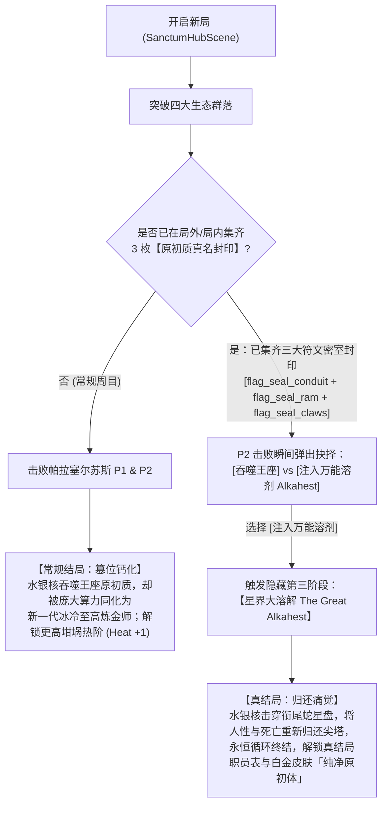

# 《水银坩埚（QUICKSILVER CRUCIBLE）》世界观剧情圣经、四大生态群落、怪物 AI 规格与全量叙事文本库

> **文档编号**：`docs/03_WORLD_LORE_AND_ENEMIES.md`  
> **版本**：`v1.0.0-commercial`  
> **题材美学锚点**：暗黑炼金与腐化机械奇幻（Dark Alchemy & Corrupted Clockwork Fantasy）  
> **配表对应源码**：`src/data/dialogue.data.ts`、`src/data/biomes.data.ts`、`src/entities/enemies/roster/*.ts`、`src/entities/enemies/bosses/*.ts`

---

## 1. 碎片化暗黑叙事架构与真结局触发链

### 1.1 世界灾变真相：「大煅烧（The Great Calcination）」

百年前，建立于大陆最深地脉裂隙之上的垂直工业城邦 **「衔尾蛇尖塔（Ouroboros Spire）」** 迎来了黄金时代。至高炼金师 **帕拉塞尔苏斯（Paracelsus）** 在地底三千尺处钻探到了传说中的 **「原初质母脉（Vein of Prima Materia）」**，从中提炼出兼具液态金属延展性与神经传导活性的 **「活态水银（Argentum Vivum）」**。

起初，活态水银驱动着不知疲倦的黄铜发条自动机，并被稀释成能治愈百病的灵药。然而，当尖塔贵族渴求彻底摆脱肉体衰老、强行启动覆盖全城的 **「大煅烧升华仪式」** 时，未经净化的原初质发生了不可逆的熵增异变——**「矾蚀疫病（The Vitriol Plague）」** 席卷全城：
- 底层矿工的肺叶结晶为滚烫的硫磺矿渣，四肢与手中的镐头融合成畸形的血肉金属聚合物；
- 暗渠中的排污炼金废液孕育出吞噬铜管的腐蚀囊肿；
- 上层骸骨堂的修士将自己的脊椎替换为精密黄铜擒纵轮，在永不停歇的钟摆声中陷入机械狂热。

---

### 1.2 主角不死循环的叙事内核：九号蒸馏体·阿兰比克（Vessel-09 "Alembic"）

玩家操控的主角并非传统亡灵，而是一枚没有固定五官、悬浮在镂空黄铜鸟笼头盔内的 **「贤者水银核（Philosopher's Mercury Core）」**，寄宿于一具由白瓷骨板与炼金皮革拼接而成的无头人造躯壳（Homunculus Chassis）之中。

- **死亡与重生的物理闭环**：每当躯壳在战斗中被击碎，白瓷与黄铜化为飞灰，但不可磨灭的液态水银核会渗入地面砖缝，顺着尖塔建造时铺设于每一堵墙体内的 **「毛细回流银管（Capillary Return Pipes）」** 倒流回地底起点的 **「永恒锻炉圣所（Athanor Sanctum）」**，重新注入一具刚刚出窑冷却的新躯壳。唯有高纯度的 **灵液结晶（Ichor）** 与刻入水银核本体的 **嬗变符文（Runes）** 能在回流中跨越死亡保留。
- **终极身世反转（碎片化揭晓）**：帕拉塞尔苏斯在仪式前夜发现，若要驾驭原初质成为“绝对理性的神明”，任何一丝怜悯、悔恨与肉体痛觉都会导致反应炉崩溃。于是他用解剖刃将自己灵魂中残存的 **「人性与良知」** 活生生剥离，封入第 9 号废液曲颈瓶丢弃进底层矿渣池——**玩家扮演的「九号蒸馏体」，正是最终 Boss 亲手抛弃的“人性半身”**。

---

### 1.3 多周目双结局与真结局触发状态链

- **三枚真结局封印获取条件**（写入 `meta_progressions.true_ending_flags`）：
  1. `flag_seal_conduit`：持有 `rune_mercury_conduit`（水银导管），进入第二层矾酸暗渠隐藏实验室调查「九号曲颈瓶原始实验日志」。
  2. `flag_seal_ram`：持有 `rune_calcined_ram`（煅烧震地），击穿第三层发条骸骨堂地下停尸间地板，拾取「被切除的痛觉神经标本」。
  3. `flag_seal_claws`：持有 `rune_magnetic_claws`（磁铁攀爪），攀上第四层星界熔炉之巅最高处折断的星盘尖顶，激活「万能溶剂（Alkahest）催化式」。

---

### 1.4 三大零打断战斗节奏的叙事载体工程规范

1. **环境叙事剧情房（`LoreRoomSpawner.ts`）**：
   - 每个生态群落固定从剧情切片池抽取 `1` 间无怪安全分支房；玩家踏入房间瞬间，`ClockController` 自动冻结【连杀加速计时器】与【橙血衰减】；调查耗时仅 `200 ms`，弹出底部半透明 `DialogueBanner.tsx`，按任意移动/翻滚键可立即关闭并继续跑图，首次阅读奖励 `+15 灵液结晶`。
2. **核心 NPC 递进式对话树（`src/data/dialogue.data.ts`）**：
   - 基于 `seen_npc_dialogue_ids` 幂等集合匹配最高优先级未读台词；严禁锁死玩家移动——若玩家在对话途中直接翻滚冲出画面，UI 自动平滑缩小为屏幕底部一行不挡视野的伴随语音字幕。
3. **12 把武器与 4 大符文暗黑风味铭文（拾取对比卡底部斜体展示）**：
   - `wpn_rust_scalpel`（锈蚀解剖刃）：*“尖塔医学院的第一课：先切开病人的声带，再切开病灶。”*
   - `wpn_quicksilver_rapier`（水银刺剑）：*“剑脊中空灌满活态汞，挥刺时重心永远比你的杀意快半寸。”*
   - `wpn_cinnabar_twinblades`（辰砂双刃）：*“朱砂本是剧毒之血，双刀交错之声恰似矿工临终的喘息。”*
   - `wpn_athanor_cleaver`（锻炉断头重刃）：*“它原本是用来斩断冷却失控的黄铜蒸汽管的，后来发现斩断叛乱者同样顺手。”*
   - `wpn_crucible_maul`（坩埚震地重锤）：*“锤头里封存着一炉尚未凝固的铁水，砸在冰雕上时听起来像极了庆典礼炮。”*
   - `wpn_pendulum_halberd`（骸骨钟摆战戟）：*“从大圣堂报丧钟上拆下的摆锤，每一击都在替亡者校准吉时。”*
   - `wpn_alembic_bow`（曲颈瓶速射猎弓）：*“弓弦由硬化羊肠与钨丝绞合，离目标越远，玻璃箭簇旋转积蓄的离心力越致命。”*
   - `wpn_clockwork_repeater`（发条连发重弩）：*“扣动一次扳机，发条盒便替你省去三次忏悔的工夫。”*
   - `wpn_vitriol_thrower`（矾酸蒸馏投掷瓶）：*“千万别摇晃——好吧，既然你是扔向别人，请使劲摇晃。”*
   - `wpn_voltaic_arc_staff`（星盘电弧法杖）：*“引天顶雷暴入凡铁，凡流淌液体之处，皆为刑场。”*
   - `wpn_slag_buckler`（矿渣反冲圆盾）：*“最卑贱的炉底废渣，却挡住了贵族老爷们最锋利的刺剑。”*
   - `wpn_mirror_aegis`（水银镜面圣盾）：*“凝视盾面之人，终将被自己的杀意原封不动地射穿眉心。”*

---

## 2. 完整成品台词库与环境叙事文本交付（`src/data/dialogue.data.ts`）

### 2.1 开场序章唤醒演出文本（`prologue_sequence`）

- **`pro_01` [黑场水银滴落声，微弱青银色点光源在管道中亮起]**：
  > “灰烬归于炉底，蒸汽归于苍穹，唯独不纯的记忆……顺着铅管流回了沟渠。”
- **`pro_02` [水银注入圣所中央碎裂的白瓷躯壳，镂空黄铜头盔亮起幽光]**：
  > “第九次煅烧残余物，编号 `Vessel-09`。无舌，无名，无痛觉许可证。”
- **`pro_03` [角色缓缓从锻炉石台撑起身，拾起地上的锈蚀解剖刃]**：
  > “尖塔之巅的大熔炉仍在轰鸣。去攀爬吧，空心的容器——去问问那位高坐云端的造物主，他究竟把谁的良心丢进了废液池。”

---

### 2.2 三位核心 NPC 全状态递进台词库（共 34 段完整成品台词，零删减）

#### NPC 1：蒸馏收藏官·科尔维斯（Archivist Corvus — 驻守圣所与关卡休整室，共 12 段）

| 台词 ID | 触发条件守卫 (`Trigger Condition`) | 成品演出台词正文 |
| :--- | :--- | :--- |
| `corvus_01` | 首次在圣所相遇 | “噢！别把水银甩在我刚擦干净的分馏瓶上，九号标本！看看你这副刚出窑的脆瓷骨架，走起路来像一袋快散架的怀表。把你在上面搜刮到的【灵液结晶】交给我——死人用不上知识，但我的坩埚需要燃料。” |
| `corvus_02` | 首次交付灵液解锁任意一项升级 | “嘶……多么醇厚的凝结记忆！尝起来有铁锈、恐慌，还有一点点底层监工劣质松子酒的酸味。拿着这把新家伙，下次死回来前争取多撑两条街。” |
| `corvus_03` | 玩家首次阵亡重生回到圣所 | “我听见排污管咕噜响，就知道你又被人敲碎了脑壳——虽然你本来也没有脑壳。别垂头丧气，只要水银核没蒸发，破碎不过是一次免费的酸洗除锈。” |
| `corvus_04` | 解锁 `rune_vitriol_tendril`（矾蚀藤蔓）后 | “你在手指里种下了矾蚀孢子？疯子行径，我喜欢。那些从排污格栅里疯长的钙化藤蔓原本是清洁工的噩梦，现在它们是你的私人云梯了。” |
| `corvus_05` | 解锁 `rune_mercury_conduit`（水银导管）后 | “液化穿梭毛细棺椁……你知道上一个尝试把自己压进两寸宽铜管的学徒怎么了吗？他在三个街区的水龙头里同时流了出来。好在你本来就是一团水银。” |
| `corvus_06` | 首次踏入第二层后休整室 | “闻到那股刺鼻的绿矾味了吗？前面就是黄铜香炉典狱长萨尔弗的领地。大煅烧前他是个虔诚的司炉长，现在他把活人塞进香炉当柴烧，只为了替尖塔维持恒温。” |
| `corvus_07` | 首次击败 Boss 1 萨尔弗后 | “萨尔弗倒下了？怪不得刚才整座地下管道的温度降了三度。他腹腔里那枚【煅烧震地符文】归你了——去把骸骨堂那些老古董的地板踩个稀巴烂吧。” |
| `corvus_08` | 解锁 `rune_magnetic_claws`（磁铁攀爪）后 | “电磁攀爪！这可是发条骸骨堂处刑官用来倒挂在钟楼顶上偷袭异端的违禁品。现在整座尖塔再也没有哪面高墙能拦住你了。” |
| `corvus_09` | 累计解锁 ≥ 8 把武器蓝图时 | “看看头顶这排悬吊玻璃瓶，简直像皇家军械库的解剖展柜。说真的，九号，你的战斗本能熟练得不像一团废液……倒像是某位剑术大师被强行抹掉署名后的肌肉记忆。” |
| `corvus_10` | 首次通关常规结局（开启 1 坩埚热阶） | “你坐上了王座，然后呢？原初质差点把你的水银核烧成一块没有思想的白金疙瘩，我费了九牛二虎之力才把你从回流管里滤出来！想真正毁掉这口坩埚，光靠蛮力劈开帕拉塞尔苏斯是不够的。” |
| `corvus_11` | 收集到至少 1 枚真名封印时 | “慢着……压低声音！你从密室里带回来的那页羊皮纸，上面有至高炼金师亲笔签下的灵魂剥离式。老天，你不是实验室事故的副产物……你是他亲手切下来的‘痛觉’！” |
| `corvus_12` | 集齐全部 3 枚真名封印后 | “万能溶剂【阿尔卡赫斯特（Alkahest）】的配方齐了。科尔维斯一生只记录历史，从不押注赌徒——但今天，我把所有的灵液炉火都借给你。上去吧，把属于人类的眼泪和死亡，重新砸进那暴君的胸膛里！” |

#### NPC 2：断臂钟表匠·伊索尔德（Isolde the Unwound — 驻守大熔炉铁匠铺，共 11 段）

| 台词 ID | 触发条件守卫 (`Trigger Condition`) | 成品演出台词正文 |
| :--- | :--- | :--- |
| `isolde_01` | 首次进入大熔炉休整区 | “别盯着我的左肩膀看，小水银滴。这组黄铜擒纵轮每分钟跳六十下，比我以前那颗总爱替学徒求情的肉体心脏准时多了。把武器搁砧板上——要淬火还是重铸词条？” |
| `isolde_02` | 首次将大熔炉 `+` 级进度推过 50% | “听见铁水咬进刀刃的嘶鸣了吗？帕拉塞尔苏斯以为只有血肉融合原初质才算升华，蠢货！真正的百炼精钢，从来不靠出卖灵魂来保持锋利。” |
| `isolde_03` | 大熔炉 `+` 级达成 100% 满额 | “成了！从今往后，只要是从尖塔箱子里翻出来的破铜烂铁，哪怕闭着眼摸，也带着我伊索尔德的炉温烙印。去给那些长满齿轮的杂碎放放血。” |
| `isolde_04` | 玩家手持重型武器（重刃/重锤/战戟）对话 | “哈，这才像话！那些花里胡哨的刺剑只配给贵族削苹果皮。记住我的话：面对举盾的黄铜卫兵，别跟他在那儿绣花，抡圆了直接连盾带骨头一块儿砸碎！” |
| `isolde_05` | 玩家手持发条连发重弩对话 | “这把连发重弩……是我小徒弟卢卡斯的出师作。大煅烧那天，执法队把他推进了骸骨堂的齿轮槽里。替我好好用它，每一根射出去的钢钉，都算他向尖塔讨回的工钱。” |
| `isolde_06` | 谈及 Boss 1 典狱长萨尔弗 | “萨尔弗胸口那座大香炉，就是我二十年前亲手铆合的。那时候里面装的是安神迷迭香，用来缓解矿工的矽肺病……谁能想到有一天，他会把自己肋骨掰开，往里面填满活人烧剩的硫磺？” |
| `isolde_07` | 首次抵达星界熔炉之巅前休整室 | “再往上就是星界熔炉了。风里全是沸腾水银的甜腥味。我这半边黄铜身子一靠近顶层就会被他的磁暴锁死，只能送你到这儿了，小家伙。” |
| `isolde_08` | 大熔炉 `++` 级达成 50% 以上 | “双倍精炼炉火已经吃透了秘银模具。你看我左手的齿轮是不是转得慢了些？每当你离塔顶近一步，套在我们这些半机械废人身上的发条诅咒就会松动一分。” |
| `isolde_09` | 玩家处于残血（HP < 30%）进入铁匠铺 | “白瓷胸甲裂得跟蜘蛛网似的还能活着爬进来，你可真是个倔种。先去旁边把灵液瓶灌满再上路，我可不想刚打磨好的好刀白白便宜了暗渠里的老鼠。” |
| `isolde_10` | 开启 ≥ 2 坩埚热阶时 | “尖塔察觉到你的威胁了，空气里的矾酸浓度翻了一倍，连行尸走肉都长出了晶化硬壳。把词条洗出【紫火】或者【破冰】再来见他们，别省那点金币！” |
| `isolde_11` | 真结局决战前最后一次锻造交互 | “我给你最后淬一次火，不收灵液。如果上面那个自称神明的老疯子真是你的另一半……替所有变成齿轮的工匠，狠狠敲响他的丧钟。” |

#### NPC 3：提灯告解修女·维斯帕（Sister Vesper — 四大群落随机走廊偶遇，共 11 段）

| 台词 ID | 触发条件守卫 (`Trigger Condition`) | 成品演出台词正文 |
| :--- | :--- | :--- |
| `vesper_01` | 第一层矿渣蒸馏厂铁栏后初遇 | “嘘……轻点踩那些碎玻璃，无头的小朝圣者。我的眼睛在大煅烧第一道白光亮起时就瞎了，可我依然能‘看’见你——在一整座发臭的锈铁塔里，只有你的胸口泛着干净的月光。” |
| `vesper_02` | 第一层第二次偶遇 | “他们管这儿叫‘蒸馏厂’。多体面的词儿呀，把贫民窟的骨髓熬成点亮上城区路灯的灯油。如果你在前面看到背着烧瓶的工人，给他们个痛快吧，他们的意识早就被高温煮熟了。” |
| `vesper_03` | 第二层矾酸暗渠偶遇 #1 | “滴答、滴答……听见头顶漏下来的绿矾酸雨了吗？贵族们在塔顶喝着长生酒，却把腐烂的罪孽全排进了下水道。小心那些鼓胀的绿囊虫，离它们死掉的地方远一点。” |
| `vesper_04` | 第二层矾酸暗渠偶遇 #2（已获水银导管） | “你能钻进毛细银管里了？真奇妙……就像眼泪倒流回眼眶一样。在这层最深处的密封铁棺后面，藏着至高炼金师年轻时的手稿，他那时候居然还会因为杀死一只白鼠而手抖呢。” |
| `vesper_05` | 第三层发条骸骨堂偶遇 #1 | “欢迎来到发条骸骨堂。听听这神圣的滴答声——主教们认为肉体会软弱、会背叛，只有把耻骨和肋骨换成黄铜齿轮，才能永不疲倦地赞美原初质。真是群连做梦都要卡着秒表的可怜虫。” |
| `vesper_06` | 第三层发条骸骨堂偶遇 #2 | “遇到披着红天鹅绒的骸骨司铎时，千万别对着套了水银光环的卫兵硬砍。先去摘掉诵经人的脑袋，乌龟壳自然就碎了。” |
| `vesper_07` | 玩家携带诅咒状态（受诅咒宝箱未解咒）偶遇 | “哎呀，你身上缠着多么贪婪的黑雾……碰一下就会粉身碎骨的诅咒。为了多拿一卷羊皮纸把命悬在刀尖上，看来你比我想象中更像个真正的赌徒。” |
| `vesper_08` | 第四层星界熔炉之巅偶遇 #1 | “好暖和的风……还是说，这是整座城市在发高烧？我的提灯快要亮不起来了，小水银滴。再往上走，连重力都会向那颗人造太阳低头。” |
| `vesper_09` | 第四层星界熔炉之巅偶遇 #2 | “你知道为什么只有你能一次次顺着银管流回圣所，而其他八个实验体全都变成了黑灰吗？因为水银只认自己的源头。你越靠近王座，你的心跳是不是就越吵闹？” |
| `vesper_10` | 常规结局通关后二周目偶遇 | “你昨天杀死了恶龙，然后坐在恶龙的金币堆上睡了一觉，对不对？别难过，没有解药的弑神，不过是换一副更结实的锁链罢了。去密室里找齐那三个被抹掉的名字吧。” |
| `vesper_11` | 集齐 3 枚真名封印后在第四层最终走廊偶遇 | “提灯里的火苗终于安静了。去吧，阿兰比克——他留下了神性与永恒，却唯独把‘慈悲’丢给了你。现在让他见识见识，慈悲握起刀来究竟有多疼。” |

---

### 2.3 10 个环境叙事剧情房（Lore Rooms）交互调查全表

| 编号 | 剧情房 ID 与所属群落 | 房间视觉美术陈设描述 | 调查交互点与完整文本正文 |
| :-: | :--- | :--- | :--- |
| **01** | `lore_01_quarantine_notice` 矿渣蒸馏厂 | 钉死铁板的矿工宿舍，墙面残留焦黑手印与一盏摇曳橙色油灯 | **【染血的司炉工排班板】**：“《第七十三号防疫令》：凡咳嗽咳出银色金属颗粒者，一律视作盗窃公家水银矿产论处，扣除当月口粮并调入三号高温曲颈瓶车间内侧清渣。无需发放防毒面罩。” |
| **02** | `lore_02_discarded_vessels` 矿渣蒸馏厂 | 堆满八具碎裂白瓷人偶残骸的废料井，编号 `01` 至 `08` 清晰可见 | **【八号实验体废弃记录】**：“`Vessel-01` 至 `08` 均在注入原初质三分钟内发生剧烈排异自燃。唯独昨夜从至高大人私人手术室送来的 `09 号银色废液`，在白瓷胸腔内呈现出诡异的平静——它甚至试图伸手替研究员擦去额头的汗水。建议立即销毁。” |
| **03** | `lore_03_sluice_petition` 矾酸暗渠 | 半淹没在绿色荧光酸水中的市政阀门站，桌上放着密封防水铜筒 | **【下水道巡检员的绝笔信】**：“致市政厅：上层贵族每天倾倒的‘返老还童药渣’正在溶解百年铜管！昨天老托马斯掉进了三号蓄水池，他没有淹死——他在爬上来的时候，和池壁上的黄铜水表长在了一起，现在还在冲我们眨眼！” |
| **04** | `lore_04_seal_conduit_lab` 矾酸暗渠 *(需水银导管)* | 只有通过毛细银管才能潜入的隐秘地下解剖室，中央立着碎裂的 9 号曲颈瓶 | **【第一真名封印：剥离手记】**：“*大煅烧前夜，帕拉塞尔苏斯亲笔*：每当想到明日启动熔炉将有十万底层市民化作矿渣，我的右手便颤抖得无法画完星阵。软弱是升华之癌。今夜我将以秘银柳叶刀剖开自我魂魄，将名为‘悲悯’的杂质封入九号瓶沉入暗渠。明日之后，世间唯余纯粹真理。” *(永久点亮 `flag_seal_conduit`)* |
| **05** | `lore_05_sulfur_chapel` 矾酸暗渠（Boss 前） | 摆满空香炉与儿童木鞋的小型祷告室，墙上挂着司炉长昔日勋章 | **【萨尔弗的熏香配方簿】**：“五月十二日：小玛尔塔的肺病又重了，迷迭香不够，我偷偷兑入了两滴稀释水银蒸汽，她终于睡了个好觉。六月四日：大家都长出了好漂亮的黄铜鳞片，只要把大家都放进我的大香炉里保暖，就再也没人会喊冷了。” |
| **06** | `lore_06_clockwork_vow` 发条骸骨堂 | 数十具跪姿骸骨整齐排列在巨大齿轮前，脊椎全部替换为发条弹簧 | **【机械苦修士入会誓词】**：“血肉腐败，唯齿轮永恒；心跳无序，唯擒纵精准。吾自愿献出脆弱之脏腑，换取发条圣堂一万两千转之虔诚。若吾发条松弛，愿同修以扳手拧断吾颈。” |
| **07** | `lore_07_seal_ram_crypt` 发条骸骨堂 *(需煅烧震地)* | 轰碎祭坛红色阵纹地板后坠入的冰冷停尸密室，冰柜内封存着银色神经束 | **【第二真名封印：痛觉标本】**：“封存于液氮水银中的一束剥离中枢神经。标签写道：*‘没有痛觉，躯体在被真理之火焚毁时便不会逃跑。谨将此束愚蠢的本能永镇地底，愿新人类不知疼痛为何物。’* 当你触碰玻璃罐时，水银核传来一阵久违的针刺感。” *(永久点亮 `flag_seal_ram`)* |
| **08** | `lore_08_lucas_workbench` 发条骸骨堂 | 散落着连发重弩图纸与半截断裂铁匠围裙的钟楼夹层工作台 | **【学徒卢卡斯的草稿背面】**：“告诉伊索尔德师父，我把重弩的止退簧改好了，后坐力再也不会震伤她的断臂。执法队的靴子声已经到楼梯口了——别替我报仇，师父，只要别让我的手艺变成他们的刑具。” |
| **09** | `lore_09_noble_banquet` 星界熔炉之巅 | 悬浮在云海之上的奢华露台餐厅，宾客全部凝固成姿态优雅的纯白石膏黄金雕像 | **【凝固的庆功宴祝酒词】**：“高脚杯里盛着沸腾的白色水银。主宾席上的公爵夫人依然保持着举杯微笑的姿势，只是她的嘴唇已与纯金酒杯彻底熔焊为一体。餐巾上绣着：*‘敬永恒不朽的第一夜。’*” |
| **10** | `lore_10_seal_claws_astrolabe` 星界熔炉之巅 *(需磁铁攀爪)* | 沿近乎垂直的折断星盘外壁一路蹬墙攀至云端极顶的秘密观星台 | **【第三真名封印：万能溶剂阿尔卡赫斯特】**：“被帕拉塞尔苏斯用铁链锁在最高处的禁忌逆向方程——*‘凡由水银凝结之不朽，唯以原主被弃之慈悲为引，方可逆向溶解一切钙化王权。’* 你的水银核与星盘凹槽严丝合缝地共鸣起来。” *(永久点亮 `flag_seal_claws`)* |

---

## 3. 四大生态群落（Biomes）视听、5 层视差与机关全案（`src/data/biomes.data.ts`）

### 3.1 群落一：`biome_01_slag_retort` — 矿渣蒸馏厂（The Slag Retorts）
- **美学与氛围锚点**：幽闭压抑的地下炼金矿渣监牢，到处是滴落暗红铁水的巨型曲颈蒸馏釜、锈迹斑斑的铆接铸铁管道与摇曳的琥珀色煤气壁灯。
- **色板与动态光照**：环境底色 `#14161F`，`Light2D Ambient` `#2A2D3D`，主点光源色 `#FF8A3D`（煤气炉火）与 `#3CE682`（废液罐微光）。
- **5 层景深视差配置（`ParallaxComposer.ts`）**：
  - `L0 (scroll: 0.05)`：深渊地下岩穹与远处若隐若现的巨型地下熔炉红光；
  - `L1 (scroll: 0.15)`：林立的百米高烟囱群与缓慢升降的矿石吊笼剪影；
  - `L2 (scroll: 0.35)`：多层铸铁拱廊、沸腾玻璃蒸馏塔与巨型压力表盘；
  - `L3 (scroll: 0.65)`：近景粗大铆钉蒸汽管道、铁链悬吊的废弃白瓷躯壳笼；
  - `L4 (scroll: 1.18)`：前景镜头边缘掠过的模糊铁栅栏与飘散黑灰暗角遮罩。
- **专属机关陷阱**：**高压蒸汽喷口（`FLAME_NOZZLE`）**——周期 `3.0s`，喷发前 `600ms` 管道发出尖锐泄压嘶鸣并亮起橙红微光，随后喷出长 `80 px` 烈焰柱（对玩家造成 `18% MaxHP` 伤害；对被击退撞入的怪物造成 `240` 点巨额火焰伤并叠满燃烧！）。
- **环境 GPU 粒子**：向上缓慢漂浮的橘红炉渣余烬（`24 particles/s`，`ADD` 加法混合）与斜向飘落的煤灰黑点。

---

### 3.2 群落二：`biome_02_vitriol_sewers` — 矾酸暗渠（The Vitriol Aqueducts）
- **美学与氛围锚点**：铜绿斑驳的哥特式地下拱顶排污渠，荧光绿矾酸瀑布在背景奔涌，腐烂血肉组织与黄铜阀门纠缠共生。
- **色板与动态光照**：环境底色 `#0D191B`，`Light2D Ambient` `#1E3533`，主点光源色 `#3CE682`（荧光矾酸）与 `#38D9A9`（发光菌落）。
- **5 层景深视差配置**：
  - `L0 (scroll: 0.05)`：幽暗潮湿的地下水库穹顶与惨绿色酸雾弥漫带；
  - `L1 (scroll: 0.18)`：远景多孔石砌泄洪大坝与垂落的绿矾钟乳石林；
  - `L2 (scroll: 0.38)`：生满铜绿的巨型转轮水车与交错排污涵洞；
  - `L3 (scroll: 0.68)`：近景破裂渗酸的黄铜弯管、发光毒蕈簇与铁索木栈桥；
  - `L4 (scroll: 1.15)`：前景顶部滴落酸液水珠的腐蚀拱门剪影。
- **专属机关陷阱**：**间歇矾酸泉与毒液池（`ACID_GEYSER`）**——踩入浅酸池每 `0.6s` 叠 `1 层 Poisoned`（翻滚无敌帧可无伤滚过）；间歇泉每 `3.2s` 沸腾冒泡 `700ms` 后冲起高 `112 px` 酸柱。
- **环境 GPU 粒子**：自顶向下坠落的细密荧光绿酸雨丝（触地溅起 `3` 帧微型水花粒子）与漂浮的碧绿毒孢子。

---

### 3.3 群落三：`biome_03_clockwork_ossuary` — 发条骸骨堂（The Clockwork Ossuary）
- **美学与氛围锚点**：高耸入云的哥特机械大圣堂，镶金颅骨堆砌的玫瑰花窗外雷电交加，房屋大小的黄铜巨型齿轮与镀金钟摆在背景咬合转动。
- **色板与动态光照**：环境底色 `#111324`，`Light2D Ambient` `#25294A`，主点光源色 `#38BDF8`（电弧冷光）与 `#F59E0B`（圣堂烛台暖金）。
- **5 层景深视差配置**：
  - `L0 (scroll: 0.04)`：午夜靛蓝暴风雷云与远处周期性划破天际的闪电剪影；
  - `L1 (scroll: 0.16)`：彩绘炼金玫瑰玻璃巨窗与哥特飞扶壁群；
  - `L2 (scroll: 0.36)`：实时缓慢啮合旋转（角速度 `6°/s`）的超巨型黄铜擒纵齿轮组；
  - `L3 (scroll: 0.66)`：镶嵌万千镀金颅骨的壁龛柱廊与垂挂重锤锁链；
  - `L4 (scroll: 1.20)`：前景高速扫过视野边缘的模糊钟摆铁索与飘落金箔灰。
- **专属机关陷阱**：**圣堂巨型斩首钟摆（`PENDULUM_BLADE`）**——沿圆弧以正弦规律摆动（周期 `2.8s`），刀刃带 `Light2D` 金属高光反光，不可盾反但支持**翻滚无敌帧穿刃**或把精英怪一脚踹上钟摆秒杀半管血！
- **环境 GPU 粒子**：金色圣堂香灰微粒与偶发的蓝白色静电电弧火花。

---

### 3.4 群落四：`biome_04_crucible_apex` — 星界熔炉之巅（The Astral Athanor）
- **美学与氛围锚点**：冲破云层的衔尾蛇尖塔极顶，破碎的黑曜石浮空回廊环绕着沸腾的银白水银瀑布与缓缓公转的黄金浑天星盘，神圣而诡谲。
- **色板与动态光照**：环境底色 `#180F24`，`Light2D Ambient` `#32204A`，主点光源色 `#E2E8F0`（纯白活态水银辉光）与 `#E11D48`（贤者之石赤红核心）。
- **5 层景深视差配置**：
  - `L0 (scroll: 0.02)`：紫黑色深邃星穹与占据半边天幕的巨型赤红日珥炼金阵；
  - `L1 (scroll: 0.12)`：翻涌的暗金云海与远处倒悬崩解的尖塔碎块；
  - `L2 (scroll: 0.32)`：多层同心反向旋转的黄金浑天仪星环与向上倒流的水银瀑布；
  - `L3 (scroll: 0.64)`：白瓷浮雕断柱、悬浮炼金碑文石板与红丝绒王座帷幔；
  - `L4 (scroll: 1.22)`：前景逆重力向上飘升的液态水银珠与星火流光。
- **专属机关陷阱**：**星界电弧闸门（`VOLTAIC_ARC_GATE`）**——两枚悬浮星盘节点每 `2.4s` 充能 `500ms` 后拉出横向或纵向激光束，触发感电与高额硬直。
- **环境 GPU 粒子**：逆重力向上漂浮的银白色水银液滴与赤金星尘光斑。

---

## 4. 12 种普通/精英怪物 + 2 大多阶段 Boss 完整 AI 规格书

> **招架与闪避预警铁律（`TelegraphRenderer.ts`）**：  
> - **黄色感叹号闪烁框 `[!] (Yellow Flash + 清脆金属蓄力音)`**：代表该招式 **100% 可被盾牌黄金招架（Parry）弹反**，也可翻滚躲避。  
> - **红色十字闪烁框 `[!] (Crimson Cross + 低沉破空嗡鸣音)`**：代表该招式为**不可招架破防技（Unparriable）**（如地面毒爆、抓投、巨型地裂波），必须通过**翻滚无敌帧、跳跃滞空或拉开距离**规避！

### 4.1 12 种普通与精英怪物完整 AI 行为与帧数据总表（`src/entities/enemies/roster/`）

| # | 怪物 ID 与名称 | 出现群落 | 基础 HP / 韧性 | 感知半径 `(LOS / 听觉)` | 仇恨行为树核心逻辑 | 攻击招式、前摇帧 (`ms`) 与预警类型 | 蓝图掉落 |
| :-: | :--- | :---: | :---: | :---: | :--- | :--- | :--- |
| **01** | `mob_01_slag_husk` **矿渣行尸** | 第一层 | `85` / `1.0` | `180 px` / `90 px` | 平时拖着铁镐低速巡逻 (`55 px/s`)；发现玩家后直线小跑 (`115 px/s`) 贴身挥砍。 | **前扑爪击**：前摇 `420 ms` **黄色 `[!]`**（可招架）→ 向前跃进 `36 px` 挥击 (`33ms` 判定) → 后摇 `500 ms`。 | `mut_open_wounds` |
| **02** | `mob_02_frenzied_miner` **狂暴煅烧矿工** | 第一、二层 | `150` / `2.2` | `220 px` / `120 px` | 血量 `< 60%` 或目睹同伴死亡时浑身冒红烟进入狂暴，移速飙升至 `195 px/s` 并可跳过平台缝隙追杀。 | **二连疯镐斩**：前摇 `350 ms` **黄色 `[!]`**（两段均可连续招架！）→ 间隔 `180 ms` 连续两次前冲斩。 | `wpn_crucible_maul` |
| **03** | `mob_03_alembic_thrower` **烧瓶投掷工** | 第一、二层 | `75` / `0.8` | `260 px` / `100 px` | 保持 `140 ~ 220 px` 理想风筝距离；若玩家贴近 `< 72 px`，立即向后小跳翻滚拉开身位再投弹。 | **高抛酸火瓶**：前摇 `520 ms` **黄色 `[!]`**（投射物可盾反弹回炸死怪群！）→ 落地铺设 `48 px` 短暂火池。 | `wpn_vitriol_thrower` |
| **04** | `mob_04_acid_spitter` **矾酸囊肿虫** | 第二层 | `130` / `1.6` | `200 px` / `140 px` | 匍匐于地面或天花板，不可翻滚推动；死亡瞬间尸体膨胀闪烁红光！ | ① **扇形酸液喷吐**：前摇 `480 ms` **黄色 `[!]`**（`3` 枚散射酸弹）； ② **亡语酸爆**：死后 `650 ms` **红色 `[!]`（不可招架）** 炸开半径 `72 px` 毒雾。 | `skl_vitriol_flask` 强化卷 |
| **05** | `mob_05_brass_sentinel` **黄铜持盾卫兵** | 一、二、三层 | `210` / `4.5` | `190 px` / `110 px` | 常驻举起巨型黄铜塔盾，**免疫正面 `180°` 一切普通轻近战与非穿透箭矢**（正面砍盾自己会被弹开微硬直 `150ms`），转身速率慢（翻滚穿背后有 `750ms` 露背窗口）。 | **火箭推进盾冲**：前摇 `550 ms` **黄色 `[!]`**（盾反可直接掀翻塔盾使其眩晕 `2.5s`！）→ 向前直线冲撞 `128 px`。 | `mut_mercury_ward` |
| **06** | `mob_06_flail_executor` **链锤处刑官** | 第二、三层 | `290` / `3.8` | `240 px` / `130 px` | 沉稳压迫步进，攻击期间自带中度霸体（唯有重型巨兵或破盾词条可打断）。 | ① **横扫链锤**：前摇 `500 ms` **黄色 `[!]`**（射程 `104 px`）； ② **裂地重砸**：前摇 `750 ms` **红色 `[!]`（不可招架）** → 地面延伸 `120 px` 震波，需起跳躲避！ | `wpn_pendulum_halberd` |
| **07** | `mob_07_voltaic_weaver` **电弧织网者** | 第三层 | `125` / `1.2` | `280 px` / `180 px` | 无视地形浮空游弋于玩家斜上方 `90 px` 处，优先与房间内另一只怪物建立导电连线。 | **锁定闪电链**：前摇 `620 ms` 身上聚拢青蓝电球 **红色 `[!]`（不可招架射线）** → 需在闪白瞬间翻滚脱离瞄准线。 | `wpn_voltaic_arc_staff` |
| **08** | `mob_08_clockwork_tick` **发条自爆蛛** | 第二、三层 | `55` / `0.5` | `250 px` / `200 px` | 平时伪装成地面静止铜球；惊醒后发出急促发条咔哒声，以 `240 px/s` 极速贴墙攀爬飞扑玩家。 | **贴身过载自爆**：跃至玩家 `48 px` 内定格闪烁 `450 ms` **红色 `[!]`（不可招架，但可在引爆前两刀砍死或翻滚穿走）**。 | `wpn_clockwork_repeater` |
| **09** | `mob_09_ossuary_prelate` **骸骨堂司铎** | 第三、四层 | `165` / `1.5` | `320 px` / `240 px` | 绝不主动贴脸，躲在重甲怪物后方或二层平台吟唱，为同房间最多 `3` 名友军套上**水银无敌护盾**！ | **护盾祝祷（常驻引导）**：被套盾小怪免疫伤害，屏幕拉出金色粒子光束指向司铎本体——**玩家必须优先突进斩杀司铎破盾**！ | `skl_aegis_tonics` |
| **10** | `mob_10_pendulum_assassin` **钟摆影刺客** | 第三层 | `180` / `1.8` | `300 px` (全房穿墙感知) | 一旦发现玩家（含跨层平台），化作黑烟直接**瞬移至玩家背后 `28 px` 处**发起偷袭！ | **瞬步十字背斩**：现身后 `360 ms` **黄色 `[!]`**（极考验玩家回头一键盾反反应，反中即秒晕！）→ 二连快刀。 | `wpn_cinnabar_twinblades` |
| **11** | `mob_11_mercury_stalker` **水银拟态猎手** | 第四层 | `260` / `2.6` | `270 px` / `180 px` | 四足半液态机械猎犬，平时融化为地面一滩不起眼的银色水银镜面（免疫远程投射物），接近时猛然暴起。 | ① **液态穿刺扑咬**：前摇 `380 ms` **黄色 `[!]`**； ② **水银尖刺地突**：潜地后在玩家脚下冒出银泡预警 `500 ms` **红色 `[!]`** 刺出。 | `wpn_quicksilver_rapier` |
| **12** | `mob_12_astral_inquisitor` **星界审判官** | 第四层 | `380` / `4.0` | `340 px` / `260 px` | 第四层顶级精锐守卫，悬浮半空操控三枚黄金星环，兼具远距压制与近身反制。 | ① **三连星芒飞刃**：前摇 `440 ms` **黄色 `[!]`**（飞刃可盾反）； ② **重力坍缩禁锢阵**：在玩家脚下展开紫金法阵 `680 ms` **红色 `[!]`** 引爆定身。 | `wpn_mirror_aegis` |

#### 精英怪（Elite Enemies）动态升阶规则（`src/entities/enemies/EnemyDirector.ts`）
精英房守卫及高热阶随机刷出的精英怪体型放大 `1.25×`，脚底环绕暗金炼金阵，血量 `×3.2`、韧性 `×2.5`，玩家接近后每隔 `7.0s` 可追随玩家跨平台瞬移，并从 `DeterministicRng` 随机挂载 **1~2 项精英光环词缀**：
1. `elite_rotating_laser`（旋转炼金火线：以自身为中心缓慢旋转一条 `96px` 火柱）；
2. `elite_twin_clone`（水银分身：生成一只 `45%` 血量的半透明镜像协同夹击）；
3. `elite_voltaic_cage`（电弧牢笼：在玩家两侧 `160px` 竖起两根限制逃跑的感电柱）；
4. `elite_thorns_shell`（反伤晶壳：背部生长紫晶，正面攻击正常受伤、背刺未破盾时反弹 `20%` 伤害）。

---

### 4.2 Boss 1 完整 AI 规格书：`boss_01_furnace_warden` — 黄铜香炉典狱长·萨尔弗

- **决战场景**：`BossArenaScene` — **「大煅烧三号刑炉室」**（宽 `44 格 = 704 px` 封闭平坦铁桥，桥面下嵌入 `4` 组可控高温熔铁格栅 `Gate A/B/C/D`，两侧高处设有 `2` 块小型单向蒸汽跳台供临时滞空）。
- **基础数值**：`BaseHP = 3,400`（随关卡卷轴缩放），拥有独立 Boss 阶段大血条，免疫永久冰冻（转化为 `-40%` 霜缓）。

#### 阶段时间轴与场地机关状态机
- **Phase 1（`100% -> 55% HP`）：重装司炉长形态** — 单手拖拽重达千斤的铁链巨型黄铜香炉锤，招式大开大合，桥面仅开启 `1` 组边缘熔铁格栅预警。
- **阶段转换演出（`55% HP` 触发，`1,800 ms` 霸体怒吼）**：萨尔弗单膝砸裂铁桥，一把扯开自己胸腔的黄铜炉门露出沸腾的硫磺火核，将铁链缠绕双臂进入**双持旋风狂暴态**；同时桥下熔炉过载，背景音乐无缝切入高密度铜管合唱 `Boss1_Phase2` 音轨！
- **Phase 2（`55% -> 0% HP`）：活体焚化炉形态** — 所有攻击附带【燃烧】火浪，且场地 `4` 组熔铁格栅按交错节拍喷发火柱，逼迫玩家在狭小安全格之间精准招架或二段跳滞空作战。

| 招式编号与名称 | 激活阶段 | 精确帧时间轴 (`前摇 / 判定 / 后摇`) | 预警信号与反制策略 |
| :--- | :---: | :--- | :--- |
| **M1. 香炉摆锤二连砸** | P1 / P2 | S1: `520ms / 67ms / 250ms` → S2: `450ms / 83ms / 600ms` | **黄色 `[!]`（两段皆可盾反！）**：P2 中第二锤落地向前后各滑出一道矮火浪（高 `24px`，需小跳或翻滚）。 |
| **M2. 锁链远距钩抓横扫** | P1 / P2 | `580ms / 100ms / 520ms`（射程横跨半场 `280 px`） | **黄色 `[!]`（可盾反）**：玩家远离超过 `180 px` 时高频触发，甩出香炉贯穿水平线。 |
| **M3. 硫磺毒烟喷发** | P1 / P2 | `650ms / 400ms / 450ms`（自身周围 `120 px` 圆域） | **红色 `[!]`（不可招架）**：胸口炉门冒出浓烈绿烟，近身贪刀玩家必须立即翻滚撤出圈外。 |
| **M4. 陨铁泰山压顶** | P1 / P2 | 腾空 `400ms` → 锁定落点下砸 `350ms / 83ms / 700ms` | **红色 `[!]`（不可招架全屏震地波）**：落地向左右全屏扩散 `32px` 高冲击波，必须**起跳滞空**躲避，落地后 Boss 有 `700ms` 拔锤大硬直供全力输出！ |
| **M5. 刑炉格栅交替喷火** | 仅 P2 | 地面格栅亮红光预警 `900ms` → 喷发火柱持续 `1,400ms` | 场地机关：每次点亮 `4` 组格栅中的 `2` 组（如 `A+C` 或 `B+D`），安全区宽度 `176 px`。 |
| **M6. 大焚化大风车冲锋** | 仅 P2 | 蓄力 `700ms` → 全场往返旋转冲锋 `1,600ms` → 眩晕喘息 `1,200ms` | **黄色 `[!]`（高风险高回报招架！）**：成功盾反其第一圈旋转可直接打断整套大风车并令其跪地眩晕 `2.2s`！ |

---

### 4.3 Boss 2（最终 Boss）完整 AI 规格书：`boss_02_grand_alchemist` — 钙化至高炼金师·帕拉塞尔苏斯

- **决战场景**：`BossArenaScene` — **「衔尾蛇星界坩埚王座」**（宽 `52 格 = 832 px` 黑曜石圣坛，背景中央悬停直径 `320 px` 的巨型黄金浑天星盘，场地左右悬浮两座随阶段升降的白瓷炼金浮台）。
- **基础数值**：常规 P1+P2 总血量 `BaseHP = 8,200`；若触发真结局隐藏 P3，额外唤醒 `3,800 HP` 原初质真身。

#### 三阶段史诗演出与招式时间轴
- **Phase 1（`100% -> 60% HP`）：四元素至高导师形态** — 帕拉塞尔苏斯双手背负悬浮半空，指挥身边四枚炼金法球（火、冰、电、毒）精准轮转施法，自身包裹一层需打破的 `600 HP` 棱镜护盾。
- **Phase 2（`60% -> 0% HP`）：衔尾蛇巨型发条神躯合体** — 护盾破碎后，帕拉塞尔苏斯将自己刺入后方巨型黄金白瓷机械半身像的核心槽，右手化作三米长的水银圣剑，左手操控天顶星盘发射毁灭光束。
- **Phase 3（真结局专属隐藏阶段）：「星界大溶解（The Great Alkahest）」** — 当玩家注入三枚真名封印调配的万能溶剂后，巨型机械外壳崩解剥落，场地地板化为浅层镜面水银海，帕拉塞尔苏斯恢复与主角体型完全一致的白衣人形剑士姿态，展开刀刀见血、极速攻防转换的**宿命镜像死斗**！

| 招式编号与名称 | 激活阶段 | 精确帧时间轴 (`前摇 / 判定 / 后摇`) | 预警信号与反制策略 |
| :--- | :---: | :--- | :--- |
| **A1. 四象炼金齐射** | P1 | `480ms` 聚能 → 依次间隔 `160ms` 发射 `4` 枚元素追踪弹 | **黄色 `[!]`（可连续四连盾反！）**：用 `wpn_mirror_aegis` 弹反可瞬间炸穿其 P1 棱镜护盾！ |
| **A2. 水银圣剑三连斩** | P2 | `460ms` 横斩（黄）→ `420ms` 上挑（黄）→ `680ms` 延迟慢刀重劈（红） | 前两刀 **黄色 `[!]`** 可招架，第三刀蓄力快慢刀为 **红色 `[!]`** 纵贯斩，逼迫玩家“叮、叮——翻滚穿背”！ |
| **A3. 浑天星盘扫射激光** | P2 | 背景星盘亮起金线瞄准 `850ms` → 顺时针 `120°` 扫射 `1,500ms` | **红色 `[!]`（不可招架）**：玩家需跳上左右悬浮白瓷浮台或利用翻滚无敌帧逆向穿过激光束。 |
| **A4. 原初质黑洞引力场** | P1 / P2 | 场地中央生成引力奇点持续 `2,200ms`（向中心拖拽速度 `110 px/s`）→ 坍缩爆炸 | **红色 `[!]`**：玩家需向外逆风奔跑并在引爆瞬间起跳二段跳脱离半径 `160 px` 核心区。 |
| **A5. 炼金矩阵地板转化** | P2 | 地面三分之二区域浮现紫火与电弧符文预警 `1,000ms` → 持续灼烧 `3.0s` | 场地左右两座白瓷浮台自动升起，形成高低差空中立体战场。 |
| **A6. [隐藏 P3] 镜像瞬步五连刺** | 仅 P3 | 复刻主角 `wpn_quicksilver_rapier` 极速瞬步：`320ms` 启动连刺 `5` 剑 | **全段黄色 `[!]`**：速度极快但节奏恒定，高手可通过“叮叮叮叮叮”五连黄金招架触发全场最华丽色差慢镜演出！ |
| **A7. [隐藏 P3] 剥离之痛·血海穿刺** | 仅 P3 | 潜入镜面水银海，全屏地面交错升起 `3` 波斜向水银剑林（每波间隔 `550ms`） | **红色 `[!]`**：地面水银提前泛起银色涟漪安全缝隙，考验纯粹走位微操。 |
| **A8. [隐藏 P3] 终焉大煅烧（残血决死技）** | 仅 P3 (`<15% HP`) | 升空蓄力 `2,400ms` 凝聚赤金小太阳（期间本体暴露无护盾） | **DPS 竞速 / 终极盾反检定**：在 `2.4s` 内全力输出将其击破斩杀，或在其坠地瞬间完成最后一次宿命招架完成处决！ |
