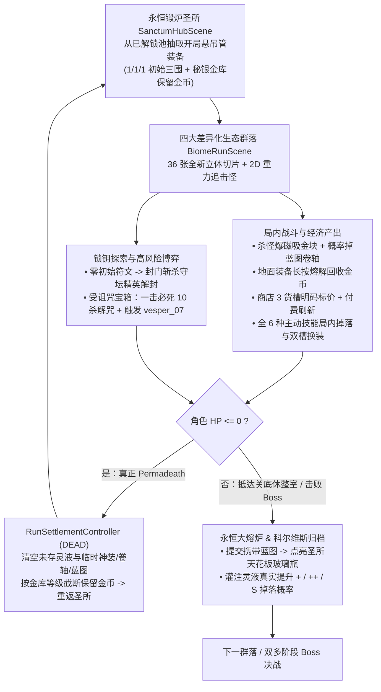

# 《水银坩埚（QUICKSILVER CRUCIBLE）》Beta 1.0.2 商业闭环升级工程开发规格书

> **文档编号**：`docs/06_BETA_1_0_2_DEVELOPMENT_PLAN.md`  
> **目标版本**：`v1.0.2-beta`  
> **前置基线**：已完成测试作弊残留清理（已移除起点房 6 武器演武架、圣所幽灵武器堆、起点 `1.6s` 无限复活木桩怪、起点重叠修女，并将 `ShaderQaDock` 与战术星盘跃迁/封印外挂严格锁定于开发态 `?dev=1` / `F9`）  
> **关联权威规范**：`AGENTS.md`、`docs/01_ARCHITECTURE_AND_SYNC.md`、`docs/02_COMBAT_AND_ROGUELITE_SPEC.md`、`docs/03_WORLD_LORE_AND_ENEMIES.md`  
> **最高架构红线**：所有逻辑源码文件严格 **≤ 250 行**；零 `fillRect` / `createOscillator` / `Math.random()`；新增精灵与瓦片 100% 配套 `*_n.png` 法线贴图；全部随机数严格通过 `DeterministicRng.fork()` 通道隔离。

---

## 1. Beta 1.0.2 版本北极星与全链路架构演进图

本版本旨在彻底打通《水银坩埚》作为对标《死亡细胞》的商业级动作肉鸽最核心的**三大玩法支柱**：
1. **Phase 1 — 肉鸽生死惩罚与局内经济/掉落全闭环**：终结“群落无限原地满血复活”、“杀怪零金币”、“商店白嫖”、“4 大主动技能无法获取”、“怪物蓝图死字段”与“大熔炉假进度条”；
2. **Phase 2 — 类银河恶魔城（Metroidvania）符文锁钥进度校正与受诅咒宝箱系统**：取消开局白送的后期符文，实装精英房封门守坛解封机制，并打通高风险一击必死「受诅咒秘库」与修女隐藏台词 `vesper_07`；
3. **Phase 3 — 后三关专属立体 `RoomChunk` 切片重制与地面怪物 2D 重力/跨层追击物理**：彻底替换第 2、3、4 关复制粘贴的雷同房间模板，并为全部地面怪物引入 `120Hz` 纵向重力、悬崖探测、平台下穿与跃升追击物理。



---

## 2. Phase 1：肉鸽生死惩罚与局内经济 / 掉落 / 蓝图全闭环

### 2.1 群落永久死亡结算（True Permadeath & Fresh Run Reset）

#### 现状问题定位
- `src/scenes/BiomeRunRig.ts` 中 `BiomeCombatSession` 与机关致死回调直接调用 `this.player.respawnAt(this.safeCheckpoint.x, this.safeCheckpoint.y)`，导致玩家在四大群落内无论死多少次都原地满血复活；
- `src/scenes/BossArenaScene.ts` 战死回圣所时传入了 `carryover: captureRunCarryover(...)`，导致上一局拾取的高阶武器、卷轴等级被带回新局。

#### 工程改造方案
1. **拆分独立结算控制器 `src/scenes/RunSettlementController.ts`（预算 `≤ 170 行`）**：
   - 当 `player.receiveIncomingHit(...) === 'dead'` 时，主角进入 `DeadState` 播放 `900ms` 白瓷躯壳碎裂与水银核散逸演出（期间锁定输入、拉低 `WebAudioFilterRack` 低通至 `380Hz`、触发慢动作 `timeScale = 0.35`）；
   - 演出结束时调用 `settlePlayerDeathAndReturnSanctum(scene, player, biomeId, roomId, killedById)`：
     1. 累加 `NarrativeStore.recordPlayerDeath()`；
     2. 构造 `lifecycleState: 'DEAD'` 的签名快照，调用 `CloudSync.finalizeRunOutcome('DEAD', snap, killedById)` 写入 `RunHistoryLogEntry` 并清除本地活跃断点档（防止刷新网页跳过死亡）；
     3. **计算秘银金库保留金币**：读取 `MetaProgressionRecord.forgeTierProgress.gold_reserve_lvl`（`0 ~ 4` 级对应上限 `[0, 800, 2000, 4000, 7500]`），计算下一局初始金币：
        $$G_{\text{next}} = \min\big(G_{\text{carried}},\; \text{GOLD\_RESERVE\_CAPS}[\text{lvl}]\big)$$
     4. **严禁传递旧局 `RunCarryoverSnapshot`**：切换至 `SanctumHubScene` 时仅传入 `{ inheritedGold: G_next, skipPrologue: true }`，未存入锻炉的 `unbankedIchor` 与未归档的携带蓝图全部随死亡遗失。
2. **保留非致死地形保护边界**：
   - 踩中 `SPIKE_BED`（尖刺池）但扣除 `20% MaxHP` 后仍存活（`res === 'hurt'`）时，维持跳回 `safeCheckpoint` 的平台防卡死机制；若扣至 `hp <= 0`（`res === 'dead'`），则严格走上述永久死亡流程。
3. **圣所开局悬吊蒸馏管 `src/world/StarterTubeSpawner.ts`（预算 `≤ 180 行`）**：
   - 玩家每次在圣所苏醒时，初始三系属性严格重置为 `{ rubedo: 1, citrinitas: 1, albedo: 1 }`，药瓶充能重置为 `forgeTierProgress.flask_charges`；
   - 在出发管道左侧生成开局装备架：从 `NarrativeStore.unlockedWeapons` 与 `unlockedSkills` 已解锁池中按 `runSeed` 抽取随机初始 `I` 阶主手武器、副手武器与初始主动技能（已解锁 `upg_starter_tubes` 时展示多套供挑选）。

---

### 2.2 杀怪金币掉落与地面装备熔解回收（Gold Economy & Recycle）

#### 1. 确定性随机通道扩展（`src/data/runes.data.ts`）
在 `RNG_CHANNEL_HASH` 中新增独立子流哈希，确保掉落金币与蓝图绝不污染关卡拓扑或词条抽签：
```typescript
export const RNG_CHANNEL_HASH = {
  BIOME_TOPOLOGY: 0x42494f4d,
  LOOT_AND_AFFIX: 0x4c4f4f54,
  ENEMY_SPAWN: 0x454e4d59,
  GOLD_AND_BLUEPRINT: 0x474f4c44, // 新增：金币面额微扰与蓝图掉率判定专享流
} as const;
```

#### 2. 精确金币产出与回收公式
- **怪物击杀金币掉落**：
  设群落深度 $d \in \{1, 2, 3, 4\}$，坩埚热阶 $h \in \{0..5\}$，随机浮动因子 $u \in [0.85, 1.15]$（由 `goldRng.nextFloat()` 采样）：
  $$G_{\text{enemy}}(d, h) = \text{round}\Big((14 + 6 \times d) \times (1 + 0.12 \times h) \times M_{\text{rank}} \times u\Big)$$
  其中普通怪 $M_{\text{rank}} = 1.0$，精英怪 $M_{\text{rank}} = 3.5$（分拆为 `4 ~ 6` 枚金块迸出），`Boss 1` 固定爆出 `280G`，`Boss 2` 固定爆出 `500G`。
- **物理与渲染规范（`src/world/GoldPickupPool.ts`，预算 `≤ 190 行`）**：
  - 通过 `asset-factory` 流水线向 `world_props_atlas` 补充 `gold_mercury_coin_0..2` 与 `gold_amalgam_nugget_0..1`（配套 Sobel 法线贴图，挂载 `Light2D` 管线）；
  - 预分配 `ObjectPool<PooledGoldCoin>(64)`，金块爆出时具初速度抛物线与地面瓦片弹性衰减（恢复系数 $e = 0.42$），进入玩家 `96px` 范围内自动加速磁吸飞入胸口水银核，触发 `sfx_ichor_pickup` 变调音效与 `+XXG` 飘字。
- **无用装备长按回收熔解**：
  - 站在任意非商店地面掉落武器或主动技能旁，除点按 `[E]` 对比换装外，支持长按 `[R]`（手柄 `Y/Triangle` 长按 `450ms`，移动端交互键旁浮现 `[♻ 回收 +XXG]` 胶囊按钮）将其化为炼金火花直接销毁并入账等价售价 `45%`（已解锁高阶回收升级时为 `75%`）的金币。

---

### 2.3 炼金军械商明码标价与刷新系统（Priced Armory Shop）

新增 `src/world/ShopMerchantController.ts`（预算 `≤ 220 行`）与 `src/ui/ShopPurchaseModal.tsx`（预算 `≤ 195 行`）：

1. **三槽位商业货架配置**：
   每个群落的 `SHOP` 房间取消原有的“免费地面掉落物”，改为生成一座带琥珀暖光的商队陈列台，固定提供 **3 个独立计价槽位**：
   - **槽位 A（主战兵器）**：从 `unlockedWeapons` 池抽取，等级为 `biomeDepth + 1`（上限 `VI`）；
   - **槽位 B（炼金技能/陷阱）**：从 `unlockedSkills` 池抽取，等级为 `biomeDepth + 1`；
   - **槽位 C（炼金补给）**：`50%` 概率刷出「高纯度灵液烧瓶（立即恢复 `1` 口药瓶充能）」，`50%` 概率刷出「钙化髓膏（立即回复 `55% MaxHP`）」。
2. **装备与补给品定价公式**：
   $$P_{\text{gear}}(L, g) = \text{round}\Big(P_{\text{base}} \times 1.32^{L - 1} \times M_{\text{forge}}(g)\Big)$$
   - 基础价 $P_{\text{base}}$：武器 `160G`，主动技能 `140G`；补给品按层数定价 $P_{\text{tonic}}(d) = 180 + 70 \times (d - 1)$；
   - 锻造阶乘数 $M_{\text{forge}}$：`BASE = 1.0`、`PLUS (+) = 1.35`、`DOUBLE_PLUS (++) = 1.75`、`S = 2.30`。
3. **防刷档持久化与付费刷新**：
   - 金币不足时交互提示红色 `[金币不足：需 XXXG]` 并拒绝交易；
   - 成交后立即扣除 `player.stats.gold`，将 `slotId` 记入 `WorldDeltaSnapshot.purchasedShopSlotIds`；
   - 若已解锁圣所升级 `upg_shop_restock`，每间商店允许最多 `3` 次付费刷新货架（费用递增：`120G -> 240G -> 420G`，由 `lootRng` 确定性步进）。

---

### 2.4 全 6 种主动技能局内掉落与双槽换装（Active Skill Loot Loop）

为解决此前 `skl_clockwork_saw_trap`（捕兽夹）、`skl_cryo_mercury_nova`（液氮霜环）、`skl_crimson_transfusion`（沸血狂潮）、`skl_aegis_tonics`（水银护瓮）无法在局内获取的断路：

1. **拆分 `src/world/SkillLootSpawner.ts`（预算 `≤ 185 行`）**：
   - 投放点位：① `RUNE_SECRET`（符文隐藏宝库）除卷轴外必出一件高阶装备（`50%` 武器 / `50%` 主动技能）；② 击败精英怪 `35%` 概率额外爆出一件随机技能或武器；③ 商店槽位 B 必刷一件主动技能。
   - 抽样池严格限定于 `MetaProgressionRecord.unlockedSkills`（新档初始已解锁：`skl_vitriol_flask`、`skl_clockwork_saw_trap`、`skl_cryo_mercury_nova` 三项基础技能；其余三项通过蓝图解锁，见 §2.5）。
2. **新增双技能对比弹窗 `src/ui/SkillCompareModal.tsx`（预算 `≤ 190 行`）**：
   - 拾取技能球时暂停 `ClockController`，并排展示候选技能与当前 `[Q] 技能槽 1`、`[C] 技能槽 2` 的品质徽章、冷却秒数、基础伤害、元素词条联动高亮（`providesTags` 与当前主副手武器 `consumesTags` 匹配时显示金色 `★ 化学联动` 角标）；
   - 选择替换 `[Q]` 或 `[C]` 后，被替换的旧技能掉落在原地地面并写入 `WorldDeltaSnapshot.droppedFloorLoot`。

---

### 2.5 怪物蓝图掉落与圣所收藏官解锁闭环（Blueprint Progression）

新增 `src/combat/BlueprintDropResolver.ts`（预算 `≤ 165 行`）与 `src/ui/CollectorBlueprintModal.tsx`（预算 `≤ 220 行`）：

1. **初始解锁池与待解锁蓝图矩阵校准**：
   - **新档默认已解锁（开局即可抽到）**：
     - 武器（4 把）：`wpn_rust_scalpel`、`wpn_alembic_bow`、`wpn_slag_buckler`、`wpn_athanor_cleaver`；
     - 技能（3 种）：`skl_vitriol_flask`、`skl_clockwork_saw_trap`、`skl_cryo_mercury_nova`；
     - 变异（6 种基础变异）：赤/黄/白每系各 2 种基础变异。
   - **需通过击杀对应物种获取蓝图解锁的 12 项进阶条目**（100% 激活 `ENEMY_CATALOG[id].blueprintDropId`）：

| 掉落怪物 (`speciesId`) | 产出蓝图 ID (`blueprintDropId`) | 类别 | 科尔维斯解锁灵液消耗 |
| :--- | :--- | :---: | :---: |
| `mob_01_slag_husk` 矿渣行尸 | `mut_open_wounds`（撕裂锯齿） | 变异 | `35 ✦` |
| `mob_02_frenzied_miner` 狂暴矿工 | `wpn_crucible_maul`（坩埚震地重锤） | 武器 | `55 ✦` |
| `mob_03_alembic_thrower` 烧瓶投掷工 | `wpn_vitriol_thrower`（矾酸蒸馏投掷瓶） | 武器 | `50 ✦` |
| `mob_04_acid_spitter` 矾酸囊肿虫 | `skl_crimson_transfusion`（赤化沸血狂潮）* | 技能 | `65 ✦` |
| `mob_05_brass_sentinel` 黄铜持盾卫兵 | `mut_mercury_ward`（镜面虹吸反击） | 变异 | `45 ✦` |
| `mob_06_flail_executor` 链锤处刑官 | `wpn_pendulum_halberd`（骸骨钟摆战戟） | 武器 | `75 ✦` |
| `mob_07_voltaic_weaver` 电弧织网者 | `wpn_voltaic_arc_staff`（星盘电弧法杖） | 武器 | `80 ✦` |
| `mob_08_clockwork_tick` 发条自爆蛛 | `wpn_clockwork_repeater`（发条连发重弩） | 武器 | `70 ✦` |
| `mob_09_ossuary_prelate` 骸骨堂司铎 | `skl_aegis_tonics`（哲学家水银护瓮） | 技能 | `90 ✦` |
| `mob_10_pendulum_assassin` 钟摆影刺客 | `wpn_cinnabar_twinblades`（辰砂双刃） | 武器 | `85 ✦` |
| `mob_11_mercury_stalker` 水银拟态猎手 | `wpn_quicksilver_rapier`（水银刺剑） | 武器 | `110 ✦` |
| `mob_12_astral_inquisitor` 星界审判官 | `wpn_mirror_aegis`（水银镜面圣盾） | 武器 | `130 ✦` |

*(注：`skl_tesla_coil_turret` 由首次击败 `Boss 1 典狱长萨尔弗` 必掉蓝图，消耗 `80 ✦` 解锁；`biomes.data.ts` 中 `mob_04` 原配的重复初始技能 `skl_vitriol_flask` 修正为 `skl_crimson_transfusion`)*。

2. **归档与即时奖励规则**：
   - 击杀怪物时若目标 `blueprintDropId` 尚未在 `MetaProgressionRecord` 解锁且不在当前局 `carriedBlueprints` 中，按普通怪 `14%`、精英怪 `50%` 概率掉落「秘银蓝图卷轴」；
   - 玩家**必须存活抵达关底 `EXIT` 锻炉台或返回圣所与科尔维斯对话**，方可将 `carriedBlueprints` 永久登记入 `MetaProgressionRecord.blueprintIchorMap`（半途阵亡则本局未登记蓝图遗失，营造紧张刺激的“护送图纸过关”心跳感）；
   - 在科尔维斯界面灌满某张蓝图所需灵液的瞬间，**免费在脚下直接爆出一把无消耗的该新武器/新技能供当场试用**，并同步点亮圣所大厅顶部的对应玻璃悬吊瓶（`sanctum_hanging_flask_lit`）。

---

### 2.6 大熔炉品质池真实概率数学模型（Legendary Forge Roll Math）

在 `src/entities/player/ForgeGradeRoller.ts`（预算 `≤ 120 行`）中实装装备等级与淬火阶抽签函数，彻底取代目前写死的 `'II', 'PLUS'` / `'III', 'S'`：

1. **基础品质等级 $L \in \{\text{I}..\text{VI}\}$**：
   - 普通地面/宝箱掉落：$L = \text{clamp}(1, 6,\; \text{biomeDepth} + \lfloor \text{crucibleHeat} / 2 \rfloor)$；
   - 精英怪 / 商店 / 受诅咒宝箱：$L = \text{clamp}(1, 6,\; \text{biomeDepth} + 1 + \lfloor \text{crucibleHeat} / 2 \rfloor)$。
2. **淬火阶 `ForgeGrade` 真实概率分布**（读取 `MetaProgressionRecord.forgeTierProgress`）：
   记 $+$ 级灌注进度比 $r_{+} = \min(1, \text{plus\_tier\_ichor} / 800)$，$++$ 级进度比 $r_{++} = \min(1, \text{pp\_tier\_ichor} / 1800)$，$S$ 级进度比 $r_{S} = \min(1, \text{s\_tier\_ichor} / 3600)$：
   $$P(\text{S}) = \min\big(0.60,\; 0.50 \cdot r_{S} + 0.05 \cdot \max(0, h - 2)\big)$$
   $$P(\text{DOUBLE\_PLUS}) = (1 - P(\text{S})) \cdot \min\big(0.85,\; 0.65 \cdot r_{++} + 0.06 \cdot h\big)$$
   $$P(\text{PLUS}) = (1 - P(\text{S}) - P(\text{DOUBLE\_PLUS})) \cdot \min\big(1.0,\; r_{+} + 0.08 \cdot (d - 1) + 0.10 \cdot h\big)$$
   其余概率落入 `BASE`。当玩家把 `+ 级淬火池` 灌满 `800/800 (100%)` 时，$r_{+} = 1.0 \implies P(\text{BASE}) = 0$，**全游戏掉落装备 100% 保底至少为 `+` 级**，完美兑现伊索尔德台词 `isolde_03` 的承诺！

---

## 3. Phase 2：探索符文锁钥进度校正与受诅咒宝箱系统

### 3.1 零初始符文与四阶类银河恶魔城（Metroidvania）锁钥链

1. **清除全部白送符文**：
   - 将 `src/core/NarrativeSessionStore.ts`（第 72 行）、`src/world/RuneInteractionController.ts`（第 44 行默认参数）、`src/scenes/SanctumHubScene.ts`（第 114 行）中的硬编码初始符文 `['rune_magnetic_claws', 'rune_calcined_ram']` **全部修正为空数组 `[]`**（仅从 `MetaProgressionRecord.unlockedRunes` 水合真实已解锁符文）；
   - 删除 `src/world/RuneInteractionController.ts` 第 208~212 行触摸 `SHOP_RACK` 白送 `rune_mercury_conduit` 的调试捷径。
2. **唯一合法的四阶解锁链路**：

| 解锁顺序 | 符文 ID 与名称 | 唯一产出源 | 解锁的新路线与真结局密室 |
| :-: | :--- | :--- | :--- |
| **Step 1** | `rune_vitriol_tendril`<br>矾蚀藤蔓符文 | 第一层「矿渣蒸馏厂」`ELITE` 祭坛房击败守坛精英 | 激活地面绿色排污格栅长出钙化藤梯，进入第一、二层高台 `RUNE_SECRET` 宝库 |
| **Step 2** | `rune_mercury_conduit`<br>水银导管符文 | 第二层「矾酸暗渠」`ELITE` 祭坛房击败守坛精英司铎 | 潜入墙内黄铜毛细棺椁瞬移，解封第二层 **`lore_04`【第一真名封印：悲悯】** |
| **Step 3** | `rune_calcined_ram`<br>煅烧震地符文 | 首次击败 `Boss 1：典狱长萨尔弗` 必掉 | 下砸威力 `+120%` 并轰碎红纹裂纹矿渣地板，解封第三层 **`lore_07`【第二真名封印：痛觉】** |
| **Step 4** | `rune_magnetic_claws`<br>磁铁攀爪符文 | 第三层「发条骸骨堂」`ELITE` 祭坛房击败守坛精英处刑官 | 垂直铁墙匀速滑行与无限交替蹬墙跳，攀上第四层极顶解封 **`lore_10`【第三真名封印：溶剂】** |

3. **无符文首周目 100% 连通性硬校验**：
   - 在 `tests/topology/DagReachability.test.ts` 中新增首周目零符文测试（`unlockedRunes = []`）：遍历 4 大群落 × `500` 个随机种子，验证所有主干必经房间（`ENTRANCE -> COMBAT -> TELEPORTER_HUB -> ELITE -> EXIT`）内的平台高度差严格 `≤ 96px`（二段跳包络）、水平沟壑 `≤ 144px`（二段跳 + 空中翻滚包络），**绝不允许任何必经主路依赖蹬墙跳或震碎地板**。

---

### 3.2 精英祭坛封门遭遇战状态机（`src/world/EliteAltarEncounter.ts`，预算 `≤ 170 行`）

1. **状态流转**：`DORMANT`（未踏入）→ `LOCKED_COMBAT`（玩家踏入祭坛 `140px` 内，若当前房间尚有存活 `isElite` 守卫，在房间左右连接门内侧升起临时高压蒸汽封门墙 `SolidWallRect` 并播放 `sfx_enemy_warn_red`）→ `CLEARED_UNLOCKABLE`（房内全部精英怪阵亡，蒸汽封门降下，祭坛符文徽章点亮并发出青金光柱，允许按 `[E]` 刻印）→ `CONSUMED`。
2. **多周目重复访问奖励转化**：若玩家在先前周目已永久解锁当前群落的 `altarDropRune`，击败守坛精英后祭坛自动转化为「淬火圣物匣」，交互直接奖励 **`1` 枚三系卷轴 + `45 ✦` 灵液结晶**。

---

### 3.3 受诅咒宝箱与一击必死解咒闭环（`src/combat/CurseStateController.ts`，预算 `≤ 145 行`）

1. **世界交互与视觉资产**：
   - 通过 `asset-factory` 向 `world_props_atlas` 补充 `cursed_skull_chest_closed` 与 `cursed_skull_chest_open`（含法线图 `*_n.png`），挂载紫黑烟雾粒子与 `#A855F7` 脉动点光源，部署于各群落支线 `CURSED_VAULT` 房间中央。
   - 靠近按 `[E]` 弹出暗紫警示确认框：**`【开启受诅咒秘匣】获得：无色传奇武器 ×1 + 炼金三系卷轴 ×1 + 250G ｜ 代价：承受【10 杀血咒】——解除前遭受任何伤害立即粉身碎骨！`**。
2. **血咒状态核心法则**：
   - 开启瞬间：`player.stats.cursedKillsRemaining += 10`；掉落的「无色传奇武器」自动将其主属性色动态绑定为玩家当前三围最高的那一系（随后续吃卷轴实时同步最高系！）；
   - **一击必死拦截（高于护盾与免死底牌）**：在 `PlayerEntity.receiveIncomingHit()` 中，若攻击未被翻滚无敌帧（`i-Frames`）或 `150ms` 黄金招架完全规避，且 `cursedKillsRemaining > 0`，则**跳过 `skl_aegis_tonics` 护盾吸收与 `mut_emergency_carapace` 1 血锁血**，直接扣光全部生命进入 `DeadState`（死亡原因记录为 `'cursed_shatter'`）；
   - **击杀解咒计数**：监听 `EventBus` 的 `combat:enemy_killed` 事件，每击杀 1 只普通怪 `-1`、击杀精英怪 `-3`、击败 Boss 直接清零。计数归 `0` 瞬间触发 `ChromaticImpact` 金白净化波纹与飘字 `✦ 血咒已破除！`。
3. **UI、存档与修女隐藏剧情全打通**：
   - `HudBar.tsx`：当 `cursedKillsRemaining > 0` 时，在血条上方醒目脉动渲染 `[☠ 血咒剩余 X 杀 · 触之即死]` 紫晶警示条；
   - `BiomeUiCommandBridge.ts`：将第 103 行硬编码的 `isPlayerCursed: false` 替换为 `isPlayerCursed: player.stats.cursedKillsRemaining > 0`，正式解锁修女维斯帕在关卡中感知玩家身缠黑雾时的专属台词 **`vesper_07`**；
   - `SaveSchema.ts` & `storage.data.ts`：在 `PlayerRunStateSnapshot` 中新增可选字段 `readonly cursedKillsRemaining?: number`（旧快照缺省按 `0` 兼容水合），杜绝玩家开完诅咒箱靠刷新网页白嫖洗掉诅咒。

---

## 4. Phase 3：第 2、3、4 关专属地图切片重制与怪物 2D 重力物理

### 4.1 淘汰雷同换皮模板：后三关 42 张专属立体 `RoomChunk` 重制规范

针对审计发现的“第 2、3、4 关 42 个 JSON 切片高度复制粘贴（仅 23 种真实几何）”问题，按三大生态群落截然不同的建筑空间力学彻底重绘后三关切片，并规范化文件命名：

| 群落 | 重制切片规模 | 核心空间几何母题（杜绝平底方盒换皮） | 专属机关与符文支路融合 |
| :--- | :---: | :--- | :--- |
| **II. 矾酸暗渠**<br>`vitriol_*` | `14` 张全重制 | **双层拱形下水涵洞 + 下沉式毒液蓄水池 + 悬索单向木栈桥**：主通道高低错落，底层涵洞积聚浅酸水池，上层为狭窄检修铁廊 | `ACID_GEYSER` 间歇酸泉封锁桥面缺口；`conduitPairs` 毛细棺椁连通密封隔墙后的真名封印解剖室 |
| **III. 发条骸骨堂**<br>`ossuary_*` | `14` 张全重制 | **哥特钟楼纵向高塔竖井 + 多级交错齿轮跳台 + 双层回廊中庭**：将房间高度扩展至 `34 ~ 38` 格，强调自下而上或自上而下的垂直纵深战斗 | `PENDULUM_BLADE` 巨型钟摆横扫竖井腰部跳台；祭坛下方铺设 `breakableSlagFloors` 红纹裂地通往地底停尸密室 |
| **IV. 星界熔炉之巅**<br>`apex_*` | `14` 张全重制<br>*(修正命名)* | **浮空黑曜石孤岛断桥 + 折断浑天仪高差外壁 + 云海悬崖镂空井**：重命名全部残留的 `_sluice / _cistern` 文件为 `_astrolabe_bridge / _mercury_cascade / _solar_nave` 等，大量采用无底镂空桥面与高耸磁力攀爬外墙 | `VOLTAIC_ARC_GATE` 电弧闸门拦截浮空跳台落点；近乎垂直的 `climbableWalls` 通往云端极顶第三封印观星台 |

- **自动化反雷同门禁 `tests/topology/ChunkUniqueness.test.ts`**：
  - 提取每张切片的归一化几何签名 `hash(widthTiles, heightTiles, solidRects, oneWayPlatforms, climbableWalls, breakableSlagFloors)`；
  - 硬性断言：**跨群落任意两张 `COMBAT`、`ENTRANCE`、`TELEPORTER_HUB`、`ELITE`、`RUNE_SECRET`、`EXIT` 切片的几何哈希重复数必须严格等于 `0`**；同时继续通过 `4 群落 × 500 种子 = 2,000` 次全图拼接零碰撞与运动学包络可达性测试。

---

### 4.2 地面怪物 120Hz 纵向重力与跨平台追击物理（2D Enemy Kinematics）

为彻底终结当前怪物“Y 轴锁死在出生高度、站在高台边缘发呆或悬空平移”的一维铁轨表现，在不突破 `BaseEnemy.ts ≤ 250 行` 红线的前提下，新增两个正交物理与导航模块：

#### 1. `src/entities/enemies/EnemyKinematics2D.ts`（预算 `≤ 205 行`）
为所有非浮空物种（即除 `mob_07_voltaic_weaver` 与 `mob_12_astral_inquisitor` 外的全部 10 种地面怪及双 Boss 地面态）维护帧率无关纵向动力学状态 `{ vy, grounded, dropThroughTimerMs, fallStartHeightY }`：
- **重力积分与终端速度钳制**（在 `FIXED_STEP_SEC = 1/120s` 内步进）：
  $$v_y(t + \Delta t) = \min\big(V_{\text{term}},\; v_y(t) + G_{\text{enemy}} \cdot \Delta t\big), \qquad G_{\text{enemy}} = 1380\text{ px/s}^2,\; V_{\text{term}} = 560\text{ px/s}$$
- **Swept AABB 地面与单向木平台着陆检测**：
  - 当 $v_y \ge 0$ 时，检测脚底线段 $[y_{\text{prev}}, y_{\text{next}}]$ 是否穿过 `baked.solidRects` 顶面或（当 `dropThroughTimerMs <= 0` 时）`baked.oneWayPlatforms` 顶面；
  - **击退坠崖与高坠冲击伤害**：移除 `pushBack()` 中死板锁死在 `patrolMinX..patrolMaxX` 的限制，改为真实水平墙体碰撞检测！玩家用重锤、反冲圆盾或破盾一击将高台敌人轰出平台边缘时，敌人真实抛物线坠落；若单次自由落体高度 $\Delta Y_{\text{fall}} = y_{\text{land}} - y_{\text{fallStart}} \ge 112\text{ px}$（`7` 格瓦片），落地瞬间承受 $\text{round}(0.18 \times \text{maxHp} \times (\Delta Y_{\text{fall}} / 112))$ 摔落伤害并陷入 `800ms` 眩晕（跌入尖刺池或酸液池额外触发 `TrapController` 巨额环境处决伤害！）。

#### 2. `src/entities/enemies/EnemyPlatformNavigator.ts`（预算 `≤ 190 行`）
提供零 GC 热路径探针纯函数（复用模块级静态结果结构体，零每帧对象分配）：
1. **巡逻态悬崖与陷阱止步探针（`probeSafePatrolStep`）**：
   - 未惊醒（`!aggroed`）巡逻时，在移动方向前方 `colliderWidth * 0.5 + 8px` 处向下发射 `20px` 支撑射线，并检测落点是否重叠 `SPIKE_BED / ACID_GEYSER`；若前方踏空或有尖刺池，立即翻转 `facing` 折返，防止未接敌怪物自行坠亡。
2. **仇恨态跨平台立体追击决策（`solveVerticalPursuitIntent`）**：
   - **向下跳落 / 下穿单向平台追击（Drop-Down Pursuit）**：当玩家位于怪物下方（$y_{\text{player}} - y_{\text{enemy}} \in [32\text{ px},\; 176\text{ px}]$ 且水平距离 $|\Delta x| \le 180\text{ px}$）：
     - 若怪物正站在 `oneWayPlatforms` 上且下方 `192px` 内存在非尖刺安全地面，置 `dropThroughTimerMs = 220ms` 直接下穿木平台落向玩家所在层；
     - 若站在实心高台边缘，允许越过原 `patrolMinX/MaxX` 走下高台边缘跳落追杀，落地后动态重算当前所在平台段的水平边界。
   - **向上跃升追击（Ledge Hop Pursuit）**：当玩家位于上方相邻平台（$y_{\text{enemy}} - y_{\text{player}} \in [28\text{ px},\; 88\text{ px}]$，水平距离 $|\Delta x| \le 104\text{ px}$），机动型近战怪（`mob_02` 狂暴矿工、`mob_08` 自爆蛛、`mob_11` 水银猎手）经过 `160ms` 屈膝蓄力后赋予起跳初速度：
     $$v_{y0} = -\sqrt{2 \cdot G_{\text{enemy}} \cdot (\Delta H + 20)}, \qquad v_{x,\text{hop}} = \frac{\Delta X}{T_{\text{flight}}}$$
     精准跃上玩家所在跳台持续施压（内置 `2,200ms` 跳跃冷却防鬼畜连跳）。

---

## 5. 新增与变更模块体积预算总表（严格遵守 ≤ 250 行铁律）

| 层级 | 文件路径 | 操作类型 | 职责边界说明 | 行数上限预算 |
| :---: | :--- | :---: | :--- | :---: |
| `data` | `src/data/economy.data.ts` | 新增 | 金币掉落系数、商店三槽定价曲线、回收折算率、12 蓝图解锁灵液表 | 静态配表 |
| `core` | `src/core/NarrativeSessionStore.ts` | 修改 | 移除初始白送双符文，新增 `carriedBlueprints` 暂存、归档与金库保留计算 | `≤ 240 行` |
| `combat` | `src/combat/BlueprintDropResolver.ts` | 新增 | 消费 `ENEMY_CATALOG.blueprintDropId`，按 `GOLD_AND_BLUEPRINT` 子流判定图纸爆落 | `≤ 165 行` |
| `combat` | `src/combat/CurseStateController.ts` | 新增 | 10 杀血咒赋予、一击必死优先级拦截、击杀递减解咒与事件广播 | `≤ 145 行` |
| `entities` | `src/entities/player/ForgeGradeRoller.ts` | 新增 | 基于大熔炉 `+ / ++ / S` 灵液进度的装备等级与淬火阶确定性抽签器 | `≤ 120 行` |
| `entities` | `src/entities/enemies/EnemyKinematics2D.ts` | 新增 | `120Hz` 地面怪纵向重力、单向平台下穿、击飞坠崖与高坠眩晕伤解算 | `≤ 205 行` |
| `entities` | `src/entities/enemies/EnemyPlatformNavigator.ts` | 新增 | 零 GC 悬崖/尖刺探针、跨层跳落与机动怪跃上高台弹道求解器 | `≤ 190 行` |
| `world` | `src/world/GoldPickupPool.ts` | 新增 | `ObjectPool` 金块抛物线弹跳、地面摩擦衰减与 `96px` 磁吸拾取器 | `≤ 190 行` |
| `world` | `src/world/SkillLootSpawner.ts` | 新增 | 全 6 种主动技能世界掉落物生成、回收熔解长按判定与原位替换同步 | `≤ 185 行` |
| `world` | `src/world/ShopMerchantController.ts` | 新增 | 商店 3 槽计价陈列、购买扣款校验、付费刷新与快照去重 | `≤ 220 行` |
| `world` | `src/world/EliteAltarEncounter.ts` | 新增 | 精英房踏入蒸汽封门、守坛精英全灭检测与符文/多周目圣物匣解封 | `≤ 170 行` |
| `world` | `src/world/StarterTubeSpawner.ts` | 新增 | 圣所新局初始 `I` 阶武器/技能悬吊管确定性抽样与拾取交互 | `≤ 180 行` |
| `scenes` | `src/scenes/RunSettlementController.ts` | 新增 | 统一接管群落与 Boss 房 Permadeath 碎裂演出、历史归档、金库截断与重返圣所 | `≤ 170 行` |
| `ui` | `src/ui/ShopPurchaseModal.tsx` | 新增 | Preact 军械商三槽购买、词条预览与货架刷新弹窗 | `≤ 195 行` |
| `ui` | `src/ui/SkillCompareModal.tsx` | 新增 | Preact 主动技能拾取与 `[Q]/[C]` 双槽对比换装弹窗 | `≤ 190 行` |
| `ui` | `src/ui/CollectorBlueprintModal.tsx` | 新增 | Preact 科尔维斯蓝图灵液解锁面板（与悬吊玻璃瓶图鉴实时联动） | `≤ 220 行` |
| `assets` | `public/assets/tilemaps/chunks/*.json` | 重制 | 重绘 `vitriol_*` (14)、`ossuary_*` (14)、`apex_*` (14) 共 42 张零雷同立体房间切片 | JSON 模板 |

---

## 6. 分阶段原子实施顺序与验收门禁（Definition of Done）

### Gate 1（完成 Phase 1 后验收）
- **自动化单测（`tests/unit/EconomyAndPermadeath.test.ts`）**：
  1. 断言在 `BiomeRunRig` 中玩家 `hp` 归零后触发 `DEAD` 快照归档，返回圣所后三围重置为 `1/1/1`、旧局临时神装不残留、金币严格按 `gold_reserve_lvl` 上限截断；
  2. 断言相同 `runSeed` 下杀怪爆出的金币总额、蓝图掉落结果与商店 3 槽商品及刷新序列 `100%` 比特级可复现；
  3. 断言将 `plus_tier_ichor` 灌满 `800` 后连续抽签 `1,000` 件装备，`BASE` 白板出现次数严格为 `0`；
  4. 断言全 6 种主动技能均可从 `SkillLootSpawner` 掉落并正常替换 `[Q]/[C]` 槽位。
- **实机视觉巡检**：在浏览器实机击杀怪物观察法线金块弹跳磁吸、进商店校验金币不足拦截与购买扣款、故意战死验证碎裂慢动作回流圣所并点亮新解锁的悬吊玻璃瓶。

### Gate 2（完成 Phase 2 后验收）
- **自动化单测（`tests/unit/RunesAndCurseLoop.test.ts` + `DagReachability.test.ts`）**：
  1. 断言新档初始 `unlockedRunes` 为空数组 `[]`，且在 `unlockedRunes = []` 下 `2,000` 个随机种子主干路线 100% 无符文畅通；
  2. 断言 `EliteAltarEncounter` 在精英怪存活时拒绝激活并封锁房门，击杀精英后立即解封；
  3. 断言开启受诅咒宝箱后 `cursedKillsRemaining === 10`：此时即使玩家挂满 `aegisShieldHp` 且持有 `mut_emergency_carapace`，受到 `1` 点伤害也必定当场死亡；连续击杀 `10` 只普通怪后诅咒自动清零；携带诅咒时与修女交互必优先命中 `vesper_07` 台词。

### Gate 3（完成 Phase 3 后终验）
- **自动化单测（`tests/topology/ChunkUniqueness.test.ts` + `tests/unit/EnemyKinematics2D.test.ts`）**：
  1. 断言全库 `55` 张 `RoomChunk` 跨群落主战斗与功能房地形几何哈希 **0 重复**，且全部清除 `apex_*_sluice / _cistern` 等错位命名；
  2. 断言地面怪在巡逻态遇悬崖/尖刺池 `100%` 自动折返；仇恨态面对下方单向平台玩家会自动下穿追击，机动怪面对 `≤ 84px` 高台玩家会起跳跃升；将高台怪物击退推出边缘后真实加速坠落并结算高坠眩晕伤。
- **全局发布红线总检**：
  - `npm run typecheck && npm run audit:zero-placeholder && npm run test && npm run build` 四连零报错通过；
  - 调起内置 `browser` Subagent 完成 `1920×1080` 桌面端与 `852×393` 移动端横屏全流程实机截图巡检，Console 零异常。
